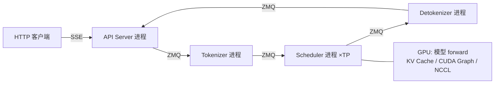

# 术语表

## 本章导读

这是一份"随查随用"的 AI Infra 术语表，覆盖本书全部章节涉及的核心概念：LLM 推理基础（token、prefill/decode、KV cache、TTFT/TPOT）、系统技术（连续批处理、PagedAttention、RadixCache、chunked prefill、CUDA Graph、张量并行、NCCL、MoE、量化）、工程组件（ZMQ、SSE、safetensors、FlashAttention/FlashInfer）。

为什么单独设一篇附录？因为推理引擎的难点往往不在代码本身，而在**术语背后的系统直觉**。读源码时遇到一个陌生词就跳到这里查一下：每条术语先给通俗解释和类比，再指出 mini-sglang 中对应的源码位置（精确到 `文件:行号`）以及本书哪一章深入讲解。建议第一遍快速浏览建立印象，读正文遇到卡点再回来精读。

本章涉及的源码文件横跨整个仓库：`python/minisgl/core.py`（请求与采样的数据模型）、`python/minisgl/scheduler/`（调度）、`python/minisgl/kvcache/`（显存管理）、`python/minisgl/engine/`（CUDA Graph 与采样）、`python/minisgl/distributed/` 与 `python/minisgl/kernel/pynccl.py`（多卡通信）、`python/minisgl/models/weight.py`（权重加载）、`python/minisgl/utils/mp.py`（进程间通信）、`python/minisgl/server/api_server.py`（HTTP 服务）。

## 背景概念：读懂术语表前的三分钟

本书的所有术语都围绕一个问题展开：**GPU 很贵，怎么让它的每一毫秒都在算有用的东西？**

LLM 推理在工程上的特殊之处在于它是"逐 token 生成"的：每产出一个词就要把整个模型跑一遍，而每次跑模型又依赖之前所有词的中间结果。这带来一对根本矛盾：

- **计算 vs 访存**：prefill 阶段一次算几百上千个 token，GPU 算力是瓶颈；decode 阶段一次只算一个 token，但要读完全部模型权重和历史 KV，显存带宽是瓶颈。两个阶段需要完全不同的优化手段。
- **显存容量 vs 并发数**：想同时服务更多请求，就要在有限的显存里塞进更多请求的 KV cache，于是显存管理（分页、共享、驱逐）成了推理引擎的核心竞争力。

后面每条术语，本质上都是这两个矛盾某一侧面的解法。另外请记住一个事实：mini-sglang 是多进程架构（HTTP 前端、tokenizer、调度器、detokenizer 各自是独立进程），所以你会看到 ZMQ、SSE 这类"通信层"术语和 CUDA Graph 这类"计算层"术语同时出现——它们属于同一台机器的不同楼层。

先给一张总览速查表，后文逐条展开：

| 术语 | 一句话定位 | 主要源码位置 | 深入章节 |
|---|---|---|---|
| Token | 模型的最小输入单位 | `message/backend.py`、`tokenizer/` | 整体架构与请求生命周期 |
| Prefill / Decode | 推理的两个阶段：读题 / 写答案 | `core.py:74`、`scheduler/scheduler.py:219` | 调度器与连续批处理 |
| KV Cache | 历史 token 的注意力中间结果缓存 | `kvcache/mha_pool.py:28` | KV Cache 与显存管理 |
| TTFT / TPOT | 首 token 延迟 / 逐 token 延迟 | `benchmark/client.py:324-333` | 服务化接口与性能评测 |
| 连续批处理 | token 粒度的请求上下车 | `scheduler/decode.py:12-15` | 调度器与连续批处理 |
| PagedAttention | KV 显存的分页管理 | `engine/engine.py`、`scheduler/cache.py` | KV Cache 与显存管理 |
| RadixCache | 前缀 KV 的共享复用 | `kvcache/radix_cache.py:101` | KV Cache 与显存管理 |
| Chunked Prefill | 长 prompt 切块，防止卡住 decode | `scheduler/prefill.py:23` | 调度器与连续批处理 |
| CUDA Graph | 录放 kernel 序列，消除 launch 开销 | `engine/graph.py:49-67` | CUDA Graph 与采样 |
| 张量并行（TP） | 权重切到多卡，all-reduce 合并 | `layers/linear.py:56/109` | 分布式与张量并行 |
| NCCL | 多 GPU 集合通信库 | `kernel/pynccl.py:45` | 分布式与张量并行 |
| MoE | 每 token 只激活 top-k 个专家 | `moe/fused.py:31/127` | 模型实现与权重加载 |
| 量化 | 低精度权重压缩（本书未实现） | — | — |
| ZMQ | 进程间消息队列 | `utils/mp.py` | 整体架构与请求生命周期 |
| SSE | HTTP 流式推送协议 | `server/api_server.py:255` | 服务化接口与性能评测 |
| safetensors | 安全快速的权重格式 | `models/weight.py:75-90` | 模型实现与权重加载 |
| FlashAttention / FlashInfer | 高性能注意力 kernel 库 | `attention/__init__.py:19-36` | Attention 后端与核心算子 |



## 一、LLM 推理基础

### Token（词元）

模型不认识文字，只认识数字。tokenizer 把文本切成一个个 token 并映射成整数 id——一个汉字可能是 2~3 个 token，一个英文单词也可能被拆开。在 mini-sglang 里，文本在 tokenizer 进程被编码成 int32 张量后以 `UserMsg` 发给调度器（`python/minisgl/message/backend.py`），此后的整个系统都只跟 token id 打交道，直到 detokenizer 把它变回文字。

一个容易踩的坑：token 边界不等于字符边界，所以流式输出不能逐 token 解码（会切出半个 UTF-8 字符 ``），mini-sglang 用三个游标做增量解码（`python/minisgl/tokenizer/detokenize.py:58-60`）。

→ 深入讲解：**《整体架构与请求生命周期》**一章的 detokenizer 小节。

### Prefill / Decode（预填充 / 解码）

一次推理分两个阶段，好比"读完题目"和"逐字写答案"：

- **Prefill**：把输入 prompt 的所有 token 一次性并行算完，建立它们的 KV cache，并产出第一个输出 token。计算密集，GPU 利用率高。
- **Decode**：之后每步只用最新的 1 个 token 算出下一个 token，自回归地循环。访存密集，单步算力很小。

mini-sglang 用 `Batch.phase` 字段区分两个阶段，一个批次要么纯 prefill 要么纯 decode（`python/minisgl/core.py:74`）。调度上 prefill 严格优先，`python/minisgl/scheduler/scheduler.py:219` 的 `_schedule_next_batch` 一行就写明了策略：

```python
def _schedule_next_batch(self) -> ForwardInput | None:
    # TODO: support other policies: e.g. DECODE first
    batch = (
        self.prefill_manager.schedule_next_batch(self.prefill_budget)
        or self.decode_manager.schedule_next_batch()
    )
    return self._prepare_batch(batch) if batch else None
```

两个阶段对硬件的压力完全不同（prefill 吃算力、decode 吃带宽），这就是为什么后面几乎所有系统技术都只针对其中一个阶段优化。

→ 深入讲解：**《调度器与连续批处理》**一章。

### KV Cache（键值缓存）

注意力机制中，每个 token 都要"看"它之前的所有 token。如果每生成一个新 token 都把历史 token 重新算一遍注意力，计算量会随长度平方爆炸。KV cache 把每个历史 token 在每层算出的 Key/Value 向量存下来，decode 时只需算新 token 的 Q、K、V，再和缓存的全部历史 K、V 做注意力。

代价是显存：KV cache 的大小 = 2（K和V）× 层数 × 序列长度 × KV 头数 × 头维度 × 字节数，长序列、大 batch 下往往比模型权重本身还大。mini-sglang 在启动时一次性预分配整块 KV 池，就是这个公式在代码里的样子（`python/minisgl/kvcache/mha_pool.py:28`）：

```python
self._kv_buffer = torch.empty(
    (2, num_layers, num_pages, page_size, local_kv_heads, head_dim),
    device=device,
    dtype=dtype,
)
```

总页数由"加载模型后剩余显存 × 0.9（`memory_ratio`）"倒推（`python/minisgl/engine/engine.py:148` 的 `_determine_num_pages`），运行期零动态分配。注意 `local_kv_heads` 已经被 TP 切分——每张卡只存自己那部分 KV 头。

→ 深入讲解：**《KV Cache 与显存管理》**一章。

### TTFT / TPOT（首 token 延迟 / 逐 token 延迟）

在线服务的两个核心延迟指标，以"点外卖"类比：TTFT 是下单后第一道菜上桌的时间，TPOT 是之后每道菜之间的平均间隔。

- **TTFT（Time To First Token）**：从请求发出到收到第一个输出 token 的时间，主要由排队时间 + prefill 耗时决定。
- **TPOT（Time Per Output Token）**：相邻两个输出 token 的间隔时间，基本等于 decode 单步耗时。

mini-sglang 的 benchmark 客户端对每个 SSE chunk 打时间戳，统计方式就是教科书定义的直接翻译（`python/minisgl/benchmark/client.py:324-333`）：

```python
for tics in results:
    deltas: List[float] = []
    for i in range(len(tics) - 1):
        diff = tics[i + 1] - tics[i]
        deltas.append(diff)
    first_times.append(deltas[0])      # TTFT = 第一个 chunk 间隔
    accum_times.extend(deltas[1:])     # TPOT = 其余所有间隔
```

注意这是**客户端视角**的延迟，包含了网络和序列化开销——工程上这也正是用户能感知的延迟。

→ 深入讲解：**《服务化接口与性能评测》**一章。

## 二、系统技术

### 连续批处理（Continuous Batching）

朴素的批处理像"班车"：一班车坐满才发，所有人到齐终点才返程——最慢的请求拖住整车人。连续批处理像"流水线"：每个 decode 步结束，完成的请求立刻下车、等待的请求立刻补位，GPU 永远满载。

mini-sglang 的实现：`DecodeManager` 维护一个 `running_reqs` 集合（`python/minisgl/scheduler/decode.py:12`），每步前向后用一行集合运算完成"下车 + 上车"（`decode.py:14-15`）：

```python
def filter_reqs(self, reqs: Iterable[Req]) -> None:
    self.running_reqs = {req for req in self.running_reqs.union(reqs) if req.can_decode}
```

这行代码同时做了两件事：把本批（含刚完成 prefill 的）请求并入运行集合，再把 `can_decode=False` 的（已达长度上限的、chunked prefill 中间块的）剔除。下一步所有在跑请求组成一个新 batch——请求的进入和退出发生在 token 粒度，而不是请求粒度。

→ 深入讲解：**《调度器与连续批处理》**一章。

### PagedAttention（分页注意力）

操作系统的虚拟内存把进程地址空间切成固定大小的"页"，按需映射到物理内存，避免为每个进程预留连续大块内存。PagedAttention 把同样的思想用到 KV cache：KV 池被切成固定大小的页，每个请求持有一张"页表"记录自己的第 i 个 token 存在哪个物理槽位，请求之间不要求物理连续。

好处是消除内存碎片：不为"可能生成 1024 个 token"预留 1024 格，而是生成到哪分配到哪。mini-sglang 的全局 `page_table` 直接存 token 级物理槽位号（`python/minisgl/engine/engine.py` 中分配，默认 `page_size=1` 即每页一个 token），attention kernel 靠它把"请求内位置"翻译成"物理槽位"。

→ 深入讲解：**《KV Cache 与显存管理》**一章；kernel 侧见**《Attention 后端与核心算子》**一章。

### RadixCache（前缀缓存）

很多请求共享相同的前缀：同一个 system prompt、同一段文档、多轮对话的历史。RadixCache 用一棵基数树（radix tree，即压缩前缀树）缓存"前缀 token 序列 → KV 物理槽位"的映射，新请求进来先查树，命中的前缀**完全不用重算**，直接复用已有 KV。

多轮对话是最典型的受益者：第二轮请求的输入 = 第一轮全部输入 + 输出 + 新提问，前缀几乎全中。mini-sglang 的实现有几个精妙约定：匹配时故意少匹配最后一个 token（它必须参与前向才能产出 logits，`python/minisgl/scheduler/cache.py:27-30`）；插入只入整页（`python/minisgl/kvcache/radix_cache.py:136`）；匹配到的槽位必须先 `lock_handle` 加引用计数才安全，否则可能被 LRU 驱逐（`radix_cache.py:113`）。

→ 深入讲解：**《KV Cache 与显存管理》**一章。

### Chunked Prefill（分块预填充）

一条 32K token 的长 prompt 如果一次算完，会独占 GPU 好几步，期间所有 decode 请求都被卡住——TPOT 出现毛刺。Chunked prefill 把长 prompt 切成固定预算的小块（mini-sglang 默认每块最多 8192 个 token，即 `max_extend_tokens`，见 `python/minisgl/scheduler/config.py`），每次 prefill 只算一块，中间块不产生输出 token，算完最后一块才进入 decode。

实现上只有三个小机关。其一，中间块用 `ChunkedReq` 标记"不采样、不进 decode"（`python/minisgl/scheduler/prefill.py:23-29`）：

```python
class ChunkedReq(Req):
    def append_host(self, next_token: torch.Tensor) -> None:
        raise NotImplementedError("ChunkedReq should not be sampled")

    @property
    def can_decode(self) -> bool:
        return False  # avoid being added to decode manager
```

其二，中间块照样跟着前向跑（它的 KV 要写进 cache），但采样结果被写到 `-1` 哨兵位置直接丢弃（`python/minisgl/scheduler/scheduler.py:265`）；其三，`PendingReq.chunked_req` 作为锚点让下一轮 prefill 优先续跑。没有引入任何新的状态机——这是全书"用最小改动实现一个工业特性"的最佳范例之一。

→ 深入讲解：**《调度器与连续批处理》**一章。

### CUDA Graph（CUDA 图）

GPU 每执行一个 kernel 都需要 CPU 发起一次"launch"，开销约几微秒。prefill 时 kernel 大、launch 开销占比小；但 decode 时每步要 launch 上百个小 kernel，**CPU 发令的速度可能追不上 GPU 干活的速度**。CUDA Graph 的解法是"先录后放"：把一串 kernel 的执行序列录制下来，之后一次 launch 回放整串，CPU 开销降到接近零。

代价是图的形状和内存地址在录制时固化：batch 大小必须落入预捕获的档位，mini-sglang 的档位选择逻辑（`python/minisgl/engine/graph.py:49-67`）是小 batch 密集、大 batch 稀疏：

```python
if cuda_graph_max_bs < 1:
    return []  # 禁用 CUDA Graph

return [1, 2, 4] + list(range(8, cuda_graph_max_bs + 1, 8))
```

运行时真实 batch 不够档位就用 dummy 请求向上补齐（`graph.py:160` 的 `pad_batch`）；输入数据必须在回放前拷进固定的静态 buffer（`graph.py:42` 的 `copy_from`）。一句话记忆：**图里冻结的是指针，不是数值**。

→ 深入讲解：**《CUDA Graph 与采样》**一章。

### 张量并行（Tensor Parallelism, TP）

模型太大一张卡装不下（或想让 decode 更快），就把每个权重矩阵切开分给 N 张卡：列并行的层（如 QKV 投影）各卡算输出的不同分量，天然无需通信；行并行的层（如输出投影）各卡只算出"部分和"，需要一次 all-reduce 求和。一个 decoder 层 = 列并行 + 行并行交替，每层两次 all-reduce，加上词表 embedding 和 LM head 各一次集合通信。

mini-sglang 中每个 TP rank 是一个独立进程（`python/minisgl/server/launch.py:59` 起），各 rank 收相同的消息流、独立做出完全一致的调度决策（复制式调度），只有模型 forward 里的激活值需要跨卡同步。切分逻辑集中在 `python/minisgl/layers/linear.py`（`LinearColParallelMerged:56`、`LinearRowParallel:109`）。

→ 深入讲解：**《分布式与张量并行》**一章。

### NCCL（NVIDIA 集合通信库）

NCCL 是 NVIDIA 的多 GPU 通信库，提供 all-reduce（各卡求和）、all-gather（各卡拼接）等"集合通信"原语，是多卡训练/推理的数据面基石。TP 每层两次 all-reduce 走的就是 NCCL。

mini-sglang 没有用 `torch.distributed` 的默认 NCCL 后端，而是写了一个极简封装 `PyNCCLCommunicator`（`python/minisgl/kernel/pynccl.py:45`）：只保留 all-reduce/all-gather 两个操作、只支持 fp16/bf16、预分配对称内存缓冲区，且通信挂在调用者的 CUDA stream 上——因此**可以被录进 CUDA Graph**（这是默认后端不好做到的）。NCCL 的 unique ID 引导则借道 gloo CPU 组广播完成。

→ 深入讲解：**《分布式与张量并行》**一章。

### MoE（混合专家模型）

稠密模型每个 token 都要经过全部参数；MoE 模型把 MLP 换成 E 个"专家"小 MLP，加一个路由器（gate）为每个 token 选出 top-k 个专家（如 Qwen3-MoE 选 8/128），只激活这几个专家。用"总参数量"换"激活参数量"：模型容量大、每步计算量小。

工程上 MoE 的难点是路由后的计算是"离散的分组 GEMM"：每个专家的 token 数量不等且动态变化。mini-sglang 用单个 Triton kernel 解决——先按专家排序对齐（`moe_align_block_size`，`python/minisgl/moe/fused.py:31`），再把"按排序 gather 输入、选专家矩阵、乘路由权重、scatter 写回"全部融进一次矩阵乘（`fused_experts_impl:127`）。注意 mini-sglang 的 MoE 只做 TP（切专家内部维度）不做 EP（把专家分到不同卡），这是教学版的刻意简化。

→ 深入讲解：**《模型实现与权重加载》**一章。

### 量化（Quantization）

把权重（有时连同激活）从 fp16/bf16 压缩到 int8/fp8/int4 等更低精度，换取显存减半乃至更低、访存带宽压力下降。常见路线有 GPTQ/AWQ（权重量化）、fp8 动态量化等。

需要坦白：**mini-sglang 当前没有实现量化**——全仓库只支持 fp16/bf16（见 `python/minisgl/kernel/pynccl.py` 的 dtype 表和 `server/args.py` 的 `--dtype`）。把它列进术语表是因为它是生产级引擎（SGLang/vLLM）的标配，且量化与 KV cache、PagedAttention 是显存优化的三驾马车。读完本书后想练手，给 mini-sglang 加一种量化格式是个不错的进阶课题。

→ 本书无对应章节，属于"知道它存在、读完再探索"的词条。

## 三、工程组件

### ZMQ（ZeroMQ）

一个轻量消息队列库，提供 PUSH/PULL（管道）、PUB/SUB（广播）等通信模式，支持 IPC（进程间）和 TCP。mini-sglang 的**全部进程间通信都走 ZMQ + msgpack**：前端→tokenizer→scheduler→detokenizer→前端这条链路上的每一跳都是 ZMQ IPC socket（`python/minisgl/utils/mp.py`）。

为什么用它而不是共享内存或 gRPC？因为它把"队列、序列化、异步"打包成了十几行代码就能用的东西，且 IPC 模式在同机进程间延迟极低。TP 多卡时 rank0 还用 PUB/SUB 把原始字节广播给其他 rank（`python/minisgl/scheduler/io.py:52-54`），避免重复序列化。五个地址 `ipc:///tmp/minisgl_0` 到 `_4` 各管一跳，记住它们就看懂了整个进程拓扑。

→ 深入讲解：**《整体架构与请求生命周期》**与**《服务化接口与性能评测》**两章。

### SSE（Server-Sent Events）

HTTP 的一种流式响应协议：服务器保持连接不断，每有新数据就推一行 `data: {...}\n\n`，客户端边收边渲染。它就是你在 ChatGPT 网页上看到"逐字蹦出"效果背后的协议。

mini-sglang 的 `/v1/chat/completions` 默认用 SSE 返回（`python/minisgl/server/api_server.py:280-284`，`stream=False` 时改为一次性返回完整 JSON）：每个增量文本包成 OpenAI 兼容的 chunk JSON，结束后补发 `finish_reason: "stop"` 和 `data: [DONE]`（`api_server.py:187`）。客户端断开时通过 `AbortMsg` 链路通知后端释放 KV cache，是"请求取消"的最小完整实现。

→ 深入讲解：**《服务化接口与性能评测》**一章。

### safetensors

Hugging Face 推出的模型权重存储格式，替代有安全隐患的 pickle（`.bin`）。特点是：纯张量数据 + JSON 头、支持内存映射（mmap）、可以**按需只读某几个张量、直接读到 GPU**，加载大模型时又快又安全。

mini-sglang 的权重加载器 `load_weight`（`python/minisgl/models/weight.py:75`）是个流式生成器：用 `safetensors.safe_open(file, framework="pt", device=str(device))`（`weight.py:90`）逐张量直读 GPU，在同一流水线里完成 TP 切分、q/k/v 与 gate/up 合并打包、MoE 专家堆叠，峰值显存只有"一个张量 + 一个小合并缓冲"。下载时也只拉 `*.safetensors` 文件。

→ 深入讲解：**《模型实现与权重加载》**一章。

### FlashAttention / FlashInfer（注意力 kernel 库）

注意力是 Transformer 里最重的算子，朴素的 `QK^T → softmax → ×V` 会物化一个巨大的 N×N 中间矩阵。FlashAttention（FA）用分块计算 + 在线 softmax 把这个矩阵"算在寄存器里"，既不爆显存又吃满 tensor core，是现代推理引擎的事实标准。FlashInfer（FI）是另一个面向推理场景的高性能 kernel 库，提供 ragged/paged attention、采样、RMSNorm 等一整套算子，采用"先 plan 后 run"的两段式 API。

mini-sglang 把多后端抽象成统一接口 `BaseAttnBackend`（`python/minisgl/attention/base.py:18`），注册了三个实现：`"fa"`（FlashAttention 3/4）、`"fi"`（FlashInfer）、`"trtllm"`（TensorRT-LLM kernel，经 FlashInfer 暴露），见 `python/minisgl/attention/__init__.py:19-36`。还能用 `"fa,fi"` 一行字符串组合成 hybrid 后端：prefill 用 FA、decode 用 FI，各取所长。采样、norm、RoPE 等"非注意力"算子也大量复用 FlashInfer 的实现。

→ 深入讲解：**《Attention 后端与核心算子》**一章。

## 设计亮点

从术语全景回看，mini-sglang 的设计哲学值得单独一提：

1. **每个术语都落在极简实现上**。Chunked prefill 只靠 `ChunkedReq` + `-1` 哨兵 + `chunked_req` 锚点三个机关；连续批处理的核心是一个 `Set[Req]` 加一行 `filter_reqs`；RadixCache 的全部接口只有 match/insert/lock/evict 四个方法（`python/minisgl/kvcache/base.py:67`）。教学版砍的是复杂度，不是语义。
2. **术语之间的接口是解耦的**。RadixCache 不知道 attention 的存在（attention 只消费 `cached_len`）；CUDA Graph 不知道模型结构（模型 forward 无参、读全局 `Context`）；通信层不知道是 torch.distributed 还是 PyNCCL 在干活（插件栈 `plugins[-1]` 生效）。每个概念都可以单独读懂。
3. **取舍是明示的**。量化没做、MoE 只做 TP、prefill 严格优先于 decode、不支持 prefill/decode 混合批——代码里以 TODO 或注释明确标注，读者能清楚区分"这是本质约束"还是"这是教学简化"。

## 常见困惑

**Q1：prefill 优先于 decode，那长 prompt 来了岂不是 decode 全卡住？**

会，这正是 chunked prefill 要缓解的问题：`max_extend_tokens=8192` 把长 prompt 切块，块与块之间 decode 请求能插进来跑。但 mini-sglang 目前仍是 prefill 严格优先（`scheduler.py:219-225`，代码里有支持 decode-first 的 TODO），高负载下 TTFT 好看的代价是 TPOT 有毛刺。这是调度策略的权衡问题，vLLM/SGLang 也各有答案。

**Q2：KV cache、RadixCache、PagedAttention 三个词总在同一章出现，它们是一回事吗？**

不是，是三层协作：PagedAttention 解决"显存怎么分页分配"（物理层），KV cache 是"要存的东西"本身（数据层），RadixCache 解决"已算过的前缀怎么复用"（逻辑层）。在 mini-sglang 里分别对应 `MHAKVCache`（`kvcache/mha_pool.py:10`）、全局 `page_table` 与 `CacheManager`（`scheduler/cache.py:15`）、`RadixPrefixCache`（`kvcache/radix_cache.py:101`）。

**Q3：TTFT 低是不是就代表服务快？**

不一定。TTFT 只衡量"第一个 token"，TPOT 才决定长回复的体感速度，而吞吐（tokens/s）决定服务器能扛多少并发。三者经常互相打架：batch 开大了吞吐高但 TPOT 变差。mini-sglang 的 benchmark 会同时报告三者（`python/minisgl/benchmark/client.py:358-376`），评估服务时要看整条负载-延迟曲线，不能只盯一个数。

**Q4：CUDA Graph 和连续批处理矛盾吗？batch 一直在变，图却要求形状固定？**

不矛盾，靠 padding 调和：decode batch 的真实大小是动态的，但回放前用 dummy 请求补齐到最近的预捕获档位（`graph.py:160`），dummy 请求的读写全部落进专属的"垃圾桶页"（`engine.py:98`），结果在返回时切掉。多算几个 token 的代价远小于图化省下的 launch 开销。prefill 形状太不规则，干脆不走图。

**Q5：量化这么重要，为什么本书不讲？**

因为 mini-sglang 没实现——教学版优先把"调度 + 显存 + kernel"这条主线讲完整，量化属于可在其上叠加的优化层。本书提到的显存优化三件套（分页、前缀缓存、CUDA Graph 内存池）已经能回答"显存去哪了"；量化回答的是另一个问题"每个字节能不能更小"。

## 回顾与动手

本章把全书的术语串成了一张地图：推理基础（token → prefill/decode → KV cache → TTFT/TPOT）回答"系统在算什么"，系统技术（连续批处理 → PagedAttention/RadixCache/chunked prefill → CUDA Graph → TP/NCCL/MoE/量化）回答"怎么算得快、装得多"，工程组件（ZMQ/SSE/safetensors/FlashAttention/FlashInfer）则是支撑这一切的脚手架。建议把这张地图放在手边，读正文时随时对照。

三个小实验，把术语变成手感：

1. **亲眼看到 chunked prefill**：用 `--max-prefill-length 64` 之类的小预算（对应 `max_extend_tokens`）启动服务，发一条几百 token 的长 prompt，在 `python/minisgl/scheduler/prefill.py` 的 `_add_one_req` 里加一行日志打印 `chunk_size` 与 `cached_len`，观察一条请求被切成多块、逐块推进的过程。
2. **感受 CUDA Graph 的收益**：分别用默认配置和 `--cuda-graph-max-bs 0`（禁用图，见 `_determine_cuda_graph_bs`，`engine/graph.py:49`）启动服务，跑 `benchmark/online/bench_simple.py` 对比 TPOT——图化带来的每 token 延迟下降就是 kernel launch 开销的真实量级。
3. **验证 RadixCache 命中**：启动服务后，用同一个长 system prompt 连发两条不同的提问，在 `python/minisgl/scheduler/cache.py:27` 的 `match_req` 处加日志打印 `cached_len`：第二条请求的 `cached_len` 应该接近 system prompt 长度，且第二条明显更快出首 token（TTFT 下降）。

做完这三个实验，再回头看本术语表，每个词应该都已经从"名词解释"变成了"我改过它的代码"。
