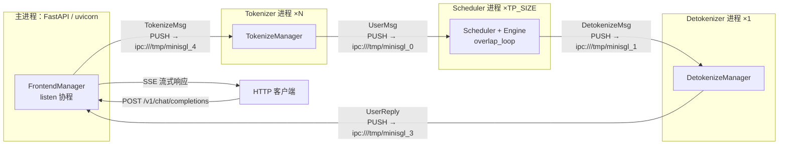
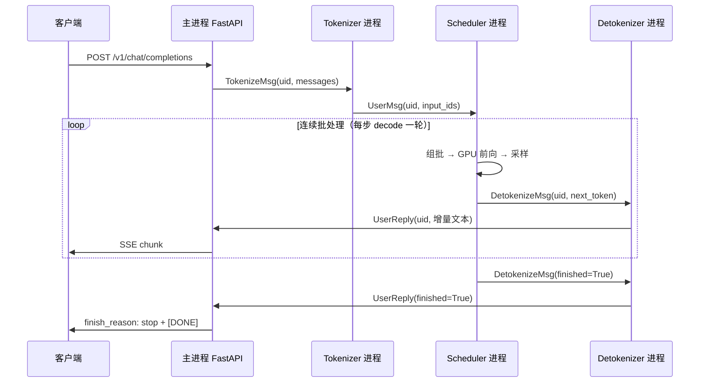

# 整体架构与请求生命周期

## 本章导读

本章是全书的"全局地图"。mini-sglang 有约 8000 行代码，一上来就钻进某个模块很容易迷失；正确的打开方式是先搞清楚**系统里有哪几类进程、它们之间怎么通信、一条请求从头到尾经历了什么**。本章会做三件事：

1. 用一张进程拓扑图讲清在线模式下 4 类进程（HTTP 前端、Tokenizer、Scheduler、Detokenizer）的划分，以及它们之间的 ZMQ 消息流；
2. 跟着一条 `POST /v1/chat/completions` 请求，走完整条链路：HTTP → Tokenize → 调度 → GPU 前向 → 增量 Detokenize → SSE 流式返回；
3. 看看不需要 HTTP 的两种用法：离线 `LLM` API 和交互式 shell。

本章对应的源码文件：

```
python/minisgl/
├── __main__.py, shell.py     # 两个进程入口
├── server/launch.py          # 拉起所有子进程
├── server/api_server.py      # FastAPI 前端 + shell 主循环
├── tokenizer/                # tokenize / detokenize 进程
├── scheduler/scheduler.py    # 调度主循环（本章只看骨架）
├── scheduler/io.py           # scheduler 的收发消息层
├── engine/engine.py          # Engine 对外接口（内部留给第 4、7 章）
├── llm/llm.py                # 离线 LLM API
├── core.py                   # Req / Batch / SamplingParams 等核心数据结构
└── message/                  # 进程间的消息协议
```

读完本章，你应该能回答："用户敲下回车后，文本是在哪个进程里变成 token 的？GPU 算出的下一个 token 又经过哪几站变回文字？"后续每一章都是这张地图的局部放大。

## 背景概念

**Token 与 tokenizer。** 大模型不认识文字，只认识整数序列。tokenizer 负责"文字 ↔ token id 列表"的互转：编码（tokenize）把字符串切成 token，解码（detokenize）把 token 拼回字符串。常用的 BPE tokenizer 有个麻烦：token 边界不等于字符边界——一个汉字可能由 2~3 个 token 拼成。这件事会在本章"增量解码"一节变得很重要。

**Prefill 与 decode。** LLM 推理分两阶段：prefill 阶段一次性处理整个输入 prompt，为每个 token 算出 KV cache 并产出第一个输出 token；decode 阶段自回归地每次只算一个新 token。两个阶段计算特征完全不同（一个吃算力、一个吃显存带宽），调度器区别对待它们，这是第 2 章的主题。

**ZMQ 与 PUSH/PULL。** ZMQ（ZeroMQ）是一个消息队列库，可以理解成"加强版 socket"：PUSH 端只管发、PULL 端排队收，自带缓冲，不需要自己写拆包逻辑。mini-sglang 里所有进程间通信都用 ZMQ 的 IPC socket（走本地文件而非网络），消息体用 msgpack 二进制序列化（`python/minisgl/utils/mp.py:12`）。

**SSE（Server-Sent Events）。** HTTP 响应的一种流式形式：服务器不一次性返回结果，而是持续推送 `data: ...` 行，客户端边收边显示。这就是你在 ChatGPT 网页上看到的"打字机效果"背后的协议。

## 进程拓扑：4 类进程与消息流

### 启动：谁拉起谁

`python -m minisgl` 的入口是 `python/minisgl/__main__.py`，它只是调用 `launch_server()`（`python/minisgl/server/launch.py:40`）。这个函数解析命令行参数后，把"拉起子进程"的工作打包成一个回调 `start_subprocess`（`python/minisgl/server/launch.py:47`）：

```python
def start_subprocess() -> None:
    import multiprocessing as mp
    from minisgl.tokenizer import tokenize_worker

    mp.set_start_method("spawn", force=True)
    world_size = server_args.tp_info.size
    ack_queue: mp.Queue[str] = mp.Queue()

    for i in range(world_size):
        new_args = replace(server_args, tp_info=DistributedInfo(i, world_size))
        mp.Process(target=_run_scheduler, args=(new_args, ack_queue), ...).start()

    # 然后是 1 个 detokenizer + num_tokenizer 个 tokenizer（均为 tokenize_worker）
    ...
    for _ in range(num_tokenizers + 2):   # 等所有子进程报"ready"
        logger.info(ack_queue.get())
```

（`python/minisgl/server/launch.py:47-111`，节选）

几个要点：

- `mp.set_start_method("spawn")` 强制用 spawn 方式创建进程。CUDA 程序不能用 fork（fork 出的子进程继承不了父进程的 CUDA 上下文），spawn 是干净的新解释器进程。
- Scheduler 每个 **TP（张量并行）rank 一个进程**：`--tp-size 4` 就起 4 个，各自持有 1/4 的模型权重，占一张卡。TP 的细节见第 6 章，本章只需知道"可能不止一个 scheduler 进程"。
- 所有子进程起来后，各自往 `ack_queue` 里发一条 "ready"，主进程收齐才放行——避免前端还没就绪的 scheduler 就开始接客。

有趣的是 `run_api_server`（`python/minisgl/server/api_server.py:411`）里，主进程**先创建自己的 ZMQ socket，再调 `start_backend()`**（`api_server.py:431-446`）。ZMQ 的 socket 分 bind（创建地址）和 connect（连接地址）两种角色，mini-sglang 用一个 `create` 布尔参数显式控制谁 bind 谁 connect，保证"先存在的一方 bind"。

### 拓扑总览

进程都起来之后，在线模式的完整拓扑如下：



四个"站点"各管一件事：

| 进程 | 数量 | 职责 |
| --- | --- | --- |
| 主进程（FastAPI） | 1 | 接 HTTP 请求、分配 uid、收结果、推 SSE |
| Tokenizer | `--num-tokenizer` 个（默认共享） | 文本 → token id |
| Scheduler | TP_SIZE 个（每 rank 一个） | 组批、调度、驱动 GPU 前向 |
| Detokenizer | 1 | token id → 增量文本 |

站点之间传的"包裹"是 `python/minisgl/message/` 下定义的 dataclass，按流向分三个文件：`tokenizer.py`（进出 tokenizer 进程的 `TokenizeMsg`/`DetokenizeMsg`/`AbortMsg`）、`backend.py`（进 scheduler 的 `UserMsg`/`AbortBackendMsg`/`ExitMsg`）、`frontend.py`（回前端的 `UserReply`）。每个消息类自带 `encoder/decoder`，序列化走 msgpack，dataclass 会被反射成一个带 `__type__` 字段的 dict，1D 的 `torch.Tensor` 则直接转成 numpy 原始字节（`python/minisgl/message/utils.py:20`）——没有引入 protobuf 之类的重型 IDL，协议即 Python 类。

ZMQ 地址方案也值得一看（`python/minisgl/scheduler/config.py:23-33`）：

```python
@property
def zmq_backend_addr(self) -> str:
    return "ipc:///tmp/minisgl_0" + self._unique_suffix

@property
def zmq_detokenizer_addr(self) -> str:
    return "ipc:///tmp/minisgl_1" + self._unique_suffix

@property
def zmq_scheduler_broadcast_addr(self) -> str:
    return "ipc:///tmp/minisgl_2" + self._unique_suffix
```

地址是 `ipc:///tmp/minisgl_{编号}.pid=<主进程pid>`：编号区分通道（`_0` tokenizer→scheduler、`_1` scheduler→detokenizer、`_2` TP 广播、`_3` detokenizer→前端、`_4` 前端→tokenizer），pid 后缀保证你在同一台机器上起两个服务实例不会互相抢地址。

### 一个反直觉的细节：tokenizer 和 detokenizer 是同一个函数

`launch.py` 拉起 detokenizer 和 tokenizer 时，`target` 都是同一个 `tokenize_worker`（`python/minisgl/tokenizer/server.py:31`）。这个函数同时实例化 `TokenizeManager` 和 `DetokenizeManager`，主循环收到什么消息就干什么活：

```python
detokenize_msg = [m for m in pending_msg if isinstance(m, DetokenizeMsg)]
tokenize_msg = [m for m in pending_msg if isinstance(m, TokenizeMsg)]
abort_msg = [m for m in pending_msg if isinstance(m, AbortMsg)]
if len(detokenize_msg) > 0:
    replies = detokenize_manager.detokenize(detokenize_msg)
    ... # 打包成 UserReply 发给前端
if len(tokenize_msg) > 0:
    tensors = tokenize_manager.tokenize(tokenize_msg)
    ... # 打包成 UserMsg 发给 scheduler
```

（`python/minisgl/tokenizer/server.py:67-101`，节选）

它本质上是一个"带 tokenizer 的消息泵"，角色完全由监听哪个地址决定。默认 `--num-tokenizer 0`（`python/minisgl/server/args.py:18`）时系统只起**一个**这样的进程，`zmq_tokenizer_addr` 直接等于 `zmq_detokenizer_addr`（`args.py:29-35`）——同一个进程既收前端的 tokenize 请求、又收 scheduler 的输出，名副其实的"tokenizer 兼 detokenizer"。只有显式设置 `--num-tokenizer N` 才会拆分角色，应对高并发下 tokenize 成为瓶颈的场景。

## 一条请求的旅行

现在跟着一条 `curl` 请求走完全程。沿途每个站点只讲它"对这条请求做了什么"，模块内部的复杂逻辑留给后续章节。



### 第 1 站：HTTP 接入（主进程）

FastAPI 路由 `/v1/chat/completions`（`python/minisgl/server/api_server.py:255`）收到请求后，做三件事：向 `FrontendManager` 申请一个 **uid**（全局递增的请求编号，是整条链路上识别这条请求的"快递单号"）、把消息组装成 `TokenizeMsg` 发给 tokenizer、返回一个 `StreamingResponse`：

```python
uid = state.new_user()
await state.send_one(
    TokenizeMsg(
        uid=uid,
        text=prompt,
        sampling_params=SamplingParams(
            ignore_eos=req.ignore_eos,
            max_tokens=req.max_tokens,
            temperature=req.temperature,
            top_k=req.top_k,
            top_p=req.top_p,
        ),
    )
)
return StreamingResponse(
    state.stream_with_cancellation(state.stream_chat_completions(uid), request, uid),
    media_type="text/event-stream",
)
```

（`python/minisgl/server/api_server.py:265-283`）

注意这里的设计取舍：**无论客户端是否要求 stream，前端永远用 SSE 流式返回**——教学项目不做"攒齐再一次性返回"的分支，链路只有一条，读起来省心。另外 `OpenAICompletionRequest` 收了不少 OpenAI 标准参数（`n`、`stop`、`presence_penalty` 等），但 `api_server.py:264` 的 TODO 表明它们并未实现，传了也没用。

`new_user`（`api_server.py:109`）除了发 uid，还建立了两样东西：`ack_map[uid]`（存这条请求收到的回复）和 `event_map[uid]`（一个 `asyncio.Event`，用于"有回复到了就唤醒等待中的协程"）。它们在第 8 站回收结果时会用到。

### 第 2 站：Tokenize（Tokenizer 进程）

`tokenize_worker` 收到 `TokenizeMsg` 后交给 `TokenizeManager.tokenize`（`python/minisgl/tokenizer/tokenize.py:14`）：

```python
for msg in msgs:
    if isinstance(msg.text, list):
        prompt = self.tokenizer.apply_chat_template(
            msg.text, tokenize=False, add_generation_prompt=True,
        )
    else:
        prompt = msg.text
    input_ids = self.tokenizer.encode(prompt, return_tensors="pt")
    results.append(input_ids.view(-1).to(torch.int32))
```

（`python/minisgl/tokenizer/tokenize.py:17-30`，节选）

如果前端发来的是 OpenAI 格式的 `messages` 列表，先用 tokenizer 自带的 chat 模板拼成完整 prompt 字符串（`add_generation_prompt=True` 会在末尾补上"助手该说话了"的起始标记），然后 `encode` 成一个 CPU 上的 1D int32 张量。为什么把文本转成张量的工作要单独放在一个进程？因为 tokenize 是 CPU 密集操作，放在主进程会阻塞 asyncio 事件循环；拆出去后前端可以一直轻快地接请求。

产物被包成 `UserMsg(uid, input_ids, sampling_params)` PUSH 给 scheduler。

### 第 3 站：接收与校验（Scheduler 进程）

Scheduler 是系统的大脑，每个 TP rank 一个进程，核心结构在 `python/minisgl/scheduler/scheduler.py:45`：

```python
class Scheduler(SchedulerIOMixin):
    def __init__(self, config: SchedulerConfig):
        from minisgl.engine import Engine
        self.engine = Engine(config)
        # 另一个 CUDA stream，用于让元数据处理与计算重叠
        self.stream = torch.cuda.Stream(device=self.device)
        self.engine_stream_ctx = torch.cuda.stream(self.engine.stream)
        ...
        self.table_manager = TableManager(config.max_running_req, self.engine.page_table)
        self.cache_manager = CacheManager(...)   # RadixCache 前缀缓存
        self.decode_manager = DecodeManager(config.page_size)
        self.prefill_manager = PrefillManager(...)
```

（`python/minisgl/scheduler/scheduler.py:45-65`，节选）

它内部组合了执行计算的 `Engine`（GPU 侧，本章第 5 站见）和四个管理器：page table 分配、KV 缓存管理、decode 队列、prefill 队列——这些是第 2、3 章的主角，本章只需记住"请求进来先排进 prefill 队列"。

收消息的是 `SchedulerIOMixin`（`python/minisgl/scheduler/io.py:15`）。TP=1 时直接 PULL 收；TP>1 时只有 rank0 连 tokenizer，它收到**原始字节**后先用 ZMQ PUB 广播给其他 rank，再自己解码（`io.py:88-107`），并用 gloo 的 `broadcast` 同步消息条数（`io.py:101-102`），保证所有 rank 每轮处理的消息完全一致——否则各 rank 组出的 batch 不一样，TP 集合通信会直接挂死。

收到 `UserMsg` 后的处理（`python/minisgl/scheduler/scheduler.py:169`）：

```python
elif isinstance(msg, UserMsg):
    input_len, max_seq_len = len(msg.input_ids), self.engine.max_seq_len
    max_output_len = max_seq_len - input_len
    if max_output_len <= 0:
        return logger.warning_rank0(
            f"Input sequence length {input_len} exceeds {max_seq_len}, "
            f"request {msg.uid} is dropped."
        )
    if msg.sampling_params.max_tokens > max_output_len:
        msg.sampling_params.max_tokens = max_output_len
    self.prefill_manager.add_one_req(msg)
```

（`python/minisgl/scheduler/scheduler.py:175-189`）

逻辑很直白：输入超长直接丢弃并打 warning；`max_tokens` 超界就截断；合格则进入 prefill 等待队列。顺带一提，同函数里 `ExitMsg` 会被转成 `raise KeyboardInterrupt`（`scheduler.py:173-174`）——用 Python 的键盘中断异常实现优雅停机，是个取巧但有效的办法。

### 第 4 站：调度与组批（Scheduler 进程）

调度发生在主循环 `overlap_loop`（`scheduler.py:83`）里，每圈做三件事：收新消息、组一个 batch 送去算、处理上一圈 batch 的结果。组批的入口是：

```python
def _schedule_next_batch(self) -> ForwardInput | None:
    # TODO: support other policies: e.g. DECODE first
    batch = (
        self.prefill_manager.schedule_next_batch(self.prefill_budget)
        or self.decode_manager.schedule_next_batch()
    )
    return self._prepare_batch(batch) if batch else None
```

（`python/minisgl/scheduler/scheduler.py:219-225`）

一行 `or` 道出了策略：**prefill 优先于 decode**——先让新请求算出第一个 token（降低 TTFT，首 token 延迟），没有可跑的 prefill 才推进 decode。`prefill_budget`（默认 `max_extend_tokens=8192`）限制一次 prefill 最多算多少 token，超长 prompt 会被切成多轮"chunked prefill"，避免一个大 prefill 把所有 decode 卡住。连续批处理和 chunked prefill 的完整机制见第 2 章。

`_prepare_batch`（`scheduler.py:204`）负责把选中的请求整理成 GPU 能吃的张量：pad 到 CUDA graph 捕获的 batch size、分配 KV 页、生成位置与读写映射、让 attention backend 准备元数据。

### 第 5 站：前向与采样（Engine，在 Scheduler 进程内）

Engine 不是独立进程，它就住在 Scheduler 进程里，管着模型权重、KV cache 池、CUDA Graph 和采样器。初始化时有一个值得知道的细节：KV cache 能开多大不是拍脑袋的配置，而是**加载完模型后按剩余显存反推**的（`python/minisgl/engine/engine.py:148-168`）：`(memory_ratio × 初始空闲显存 − 模型占用) ÷ 每页 KV 大小`，`memory_ratio` 默认 0.9。分页 KV cache 是第 3 章的主题。

一次前向的对外接口是 `forward_batch`（`engine.py:191`）：

```python
def forward_batch(self, batch: Batch, args: BatchSamplingArgs) -> ForwardOutput:
    with self.ctx.forward_batch(batch):
        if self.graph_runner.can_use_cuda_graph(batch):
            logits = self.graph_runner.replay(batch)
        else:
            logits = self.model.forward()
    for req in batch.reqs:
        req.complete_one()
    next_tokens_gpu = self.sampler.sample(logits[: batch.size], args).to(torch.int32)
    next_tokens_cpu = next_tokens_gpu.to("cpu", non_blocking=True)
    copy_done_event = torch.cuda.Event()
    copy_done_event.record(self.stream)
    return ForwardOutput(next_tokens_gpu, next_tokens_cpu, copy_done_event)
```

（`python/minisgl/engine/engine.py:191-206`）

三个要点：

- decode 阶段且 batch size 不超过捕获上限时走 CUDA Graph replay（把整个前向录制成一张"图"原样重放，省掉 CPU 反复发射 kernel 的开销），否则正常 `model.forward()`。CUDA Graph 见第 7 章。
- 采样器在全贪心（`SamplingParams.is_greedy`）时直接 `torch.argmax`，否则用 flashinfer 的 top-k/top-p 采样。注意 `SamplingParams` 的默认 `temperature=0.0`（`python/minisgl/core.py:17`）——不传采样参数时默认就是贪心。
- 最后三行是本章最重要的细节之一：算出的 token 通过 `non_blocking=True` **异步**从 GPU 拷回 CPU，只记录一个 `copy_done_event` 就返回了。此时 CPU 并不知道结果是什么——这正是下一站的伏笔。

### 第 6 站：结果处理，与下一轮前向重叠（Scheduler 进程）

回头看 `overlap_loop` 的全貌（`python/minisgl/scheduler/scheduler.py:83`）：

```python
def overlap_loop(self, last_data: ForwardData | None) -> ForwardData | None:
    blocking = not (last_data is not None or ...)
    for msg in self.receive_msg(blocking=blocking):
        self._process_one_msg(msg)

    forward_input = self._schedule_next_batch()
    ongoing_data = None
    if forward_input is not None:
        with self.engine_stream_ctx:  # 在 engine 的 stream 上跑
            self.engine.stream.wait_stream(self.stream)
            ongoing_data = (forward_input, self._forward(forward_input))

    self._process_last_data(last_data)   # 处理的是"上一圈"的结果
    return ongoing_data
```

（`python/minisgl/scheduler/scheduler.py:83-106`，节选）

注意传参和返回值：每圈收到的是**上一圈**的 `last_data`，产出的是本圈新发射的 `ongoing_data`。`_forward` 只是把 CUDA 任务"发射"到 engine 的 stream 上就立刻返回（GPU 计算是异步的），随后 `_process_last_data` 处理上一圈的结果——此时 GPU 正在跑本圈的 batch，CPU 在干上一圈的后处理，两者重叠。这就是 **overlap scheduling**：把 CPU 调度延迟藏在 GPU 计算之下。

`_process_last_data`（`scheduler.py:138`）里第一件事就是兑现上一站埋的伏笔：

```python
batch, (_, next_tokens_cpu, copy_done) = last_data[0].batch, last_data[1]
copy_done.synchronize()
reply: List[DetokenizeMsg] = []
with self.cache_manager.lazy_free_region():
    for i, req in enumerate(batch.reqs):
        if isinstance(req, ChunkedReq):
            continue
        next_token = next_tokens_cpu[i]
        req.append_host(next_token.unsqueeze(0))
        next_token = int(next_token.item())
        finished = not req.can_decode
        if not req.sampling_params.ignore_eos:
            finished |= next_token == self.eos_token_id
        reply.append(DetokenizeMsg(uid=req.uid, next_token=next_token, finished=finished))
        if finished and req not in self.finished_reqs:
            self.decode_manager.remove_req(req)
            self._free_req_resources(req)
```

（`python/minisgl/scheduler/scheduler.py:142-162`，节选）

`copy_done.synchronize()` 是整条链路上唯一"等 GPU"的点——上一圈发射的异步拷贝此刻必须落地。然后逐请求：把新 token 追加到 CPU 侧的 `input_ids`；结束判定是"达到长度上限"或"（未忽略 eos 时）产出 eos token"；给 detokenizer 发 `DetokenizeMsg`；已结束的请求释放 page table 行并把前缀写回 RadixCache，供后续请求复用。`ChunkedReq`（还在分段 prefill 中的请求）不产生输出 token，直接跳过。

一个微妙的注释在 `scheduler.py:158`：overlap 模式下同一请求可能在两圈里都被判成 finished 而被 free 两次，所以用 `self.finished_reqs` 集合去重。这是 overlap 引入的典型一致性坑。

### 第 7 站：增量 Detokenize（Detokenizer 进程）

现在 token 到了 detokenizer 手里。最朴素的做法是每来一个 token 就 `decode` 一次发给客户端——但前面说过，BPE 的 token 边界不等于字符边界：一个汉字可能拆成 2~3 个字节级 token，单独 decode 会得到乱码 ``；一个英文单词被切开时，空格归属也会出错。

mini-sglang 沿用了 SGLang 原版的增量解码算法（`python/minisgl/tokenizer/detokenize.py:63`，文件头注明 "Borrowed from sglang"）。每个 uid 维护一个 `DecodeStatus`（`detokenize.py:54`），核心是三个游标：

- `read_offset`：已"完整确认过"的 token 数；
- `surr_offset`：上一个可能不完整 token 的起点（surrogate offset）；
- `sent_offset`：已发给客户端的字符串长度。

每一步的处理（`detokenize.py:70-109`）：

```python
if not (msg.finished and msg.next_token == self.eos_token_id):
    s.decoded_ids.append(msg.next_token)
read_ids.append(s.decoded_ids[s.surr_offset :])
surr_ids.append(s.decoded_ids[s.surr_offset : s.read_offset])
...
read_texts = self.tokenizer.batch_decode(read_ids)
surr_texts = self.tokenizer.batch_decode(surr_ids)
...
new_text = read_str[len(surr_str) :]
if len(new_text) > 0 and not new_text.endswith(""):
    output_str = s.decoded_str + new_text      # 确认：推进游标
    s.decoded_str = output_str
    s.surr_offset = s.read_offset
    s.read_offset = len(s.decoded_ids)
else:
    new_text = find_printable_text(new_text)   # 保守：只发到"安全位置"
    output_str = s.decoded_str + new_text
incremental_output = output_str[s.sent_offset :]
s.sent_offset = len(output_str)
```

（`python/minisgl/tokenizer/detokenize.py:83-107`，节选）

思路是"**整段重解码再取差集**"：每次从 `surr_offset` 开始把后缀全部 `batch_decode` 一遍，减去上次已确认的部分，得到 `new_text`。若 `new_text` 不以 `` 结尾，说明没有半个字符，可以放心确认并推进游标；否则走 `find_printable_text`（`detokenize.py:35`）的保守启发式——以换行或 CJK 字符结尾就全发（CJK 文字没有空格分词问题），否则只发到最后一个空格为止，避免把半个单词发出去。最后 `incremental_output = output_str[sent_offset:]`，只把新增部分发给前端。

代价是每步重解码整个后缀（O(后缀长度) 而非 O(1)），换来的是客户端永远看到合法 UTF-8、且不被切开的词——对教学项目，正确性优先，这个取舍很值。

产物是 `UserReply(uid, incremental_output, finished)`，PUSH 给主进程。

### 第 8 站：回收与 SSE 推送（主进程）

主进程里有个常驻后台协程 `listen()`（`api_server.py:116`），从 detokenizer 收 `UserReply`，按 uid 塞进 `ack_map` 并 `event.set()` 唤醒对应请求的等待协程。而 `wait_for_ack`（`api_server.py:134`）是个 async generator，逐批取出回复、yield 给上层，`finished` 时退出循环并清理 map。

最外层 `stream_chat_completions`（`api_server.py:160`）把增量文本包装成 OpenAI 兼容的 SSE chunk：首 chunk 带 `role: assistant`，结束发 `finish_reason: stop` 和 `[DONE]`。至此，客户端的终端上一个字一个字地蹦出了回答，旅程结束。

还有一条支线：如果客户端中途断开连接，`stream_with_cancellation`（`api_server.py:190`）检测到后触发 `abort_user`，向前端→tokenizer→scheduler 一路发 `AbortMsg`/`AbortBackendMsg`，scheduler 把请求从队列中移除并释放资源（`scheduler.py:190-195`）。

## 离线模式：LLM API

做性能评测或脚本批处理时，起 HTTP 服务是多余的。mini-sglang 的离线 API 设计得非常"偷懒"——`LLM` 直接**继承** `Scheduler`（`python/minisgl/llm/llm.py:28`）：

```python
class LLM(Scheduler):
    def __init__(self, model_path: str, dtype: torch.dtype = torch.bfloat16, **kwargs):
        config = SchedulerConfig(
            model_path=model_path,
            tp_info=DistributedInfo(0, 1),
            dtype=dtype,
            offline_mode=True,
            **kwargs,
        )
        super().__init__(config)
```

（`python/minisgl/llm/llm.py:28-37`）

`offline_mode=True` 让 IO mixin 在初始化时把 `receive_msg/send_result` 换成内存方法（`io.py:30-33`）：`offline_receive_msg` 从 `self.pending_requests` 列表里取（受 `prefill_budget` 限流，`llm.py:48-54`），`offline_send_result` 把输出 token 累积进 `status_map`。`generate()` 填好 prompts 后直接调同一个 `run_forever()` 主循环，所有请求完成时 `offline_receive_msg` 抛出自定义异常 `RequestAllFinished` 退出循环（`llm.py:89-92`），最后统一 `tokenizer.decode` 一次性解码返回。

没有 ZMQ、没有子进程、没有增量 detokenize——整个调度引擎被原封不动地复用了。这种"离线模式 = 在线调度器换一套 IO"的设计在 SGLang/vLLM 中也是同款思路：保证离线路径和在线路径跑出完全一致的行为。

## Shell 入口

`python -m minisgl.shell`（入口 `python/minisgl/shell.py`）等价于 `launch_server(run_shell=True)`。进程拓扑与在线模式完全一样，区别只在主进程最后不起 uvicorn，而是 `asyncio.run(shell())`（`api_server.py:452`）：一个 `prompt_toolkit` 交互循环，维护多轮对话历史，把输入包成 `OpenAICompletionRequest` 直接调 `shell_completion`（不走 HTTP，就在同一事件循环内调用），再逐 chunk 打印 SSE 输出（`api_server.py:351-398`）。

shell 模式会强制 `cuda_graph_max_bs=1`、`max_running_req=1`（`args.py:231-234`）——交互场景只有一条请求，不必为大批量捕获 CUDA graph，省显存也省启动时间。

## 设计亮点

1. **Overlap scheduling**：双 CUDA stream + 异步 D2H 拷贝 + event 延迟同步，让"上一批的 CPU 后处理"与"下一批的 GPU 前向"重叠，把调度开销藏起来（`scheduler.py:83`、`engine.py:203-205`）。可用环境变量 `MINISGL_DISABLE_OVERLAP_SCHEDULING` 退回朴素的 `normal_loop`，方便对比教学。
2. **极简 IPC**：全链路 ZMQ IPC + msgpack，消息协议就是 Python dataclass，张量走 numpy 原始字节。没有 gRPC、没有共享内存，约 150 行（`utils/mp.py`）撑起所有进程间通信。
3. **一份代码两种角色**：`tokenize_worker` 靠监听地址区分 tokenizer/detokenizer；`LLM` 靠 `offline_mode` 把在线调度器变成离线引擎。复用而非分叉，大幅压缩了代码量。
4. **生产级算法的教学版保留**：增量 detokenize、RadixCache 前缀写回、TP 广播"rank0 收原始字节再转发"这些细节都和 SGLang 原版一致——精简的是代码量，不是思想。
5. **诚实的 TODO**：OpenAI 兼容层未实现的参数、`# TODO: batch tokenization`（`tokenize.py:16`）等都明晃晃地标着，读者能清楚看到"完整系统"与"教学骨架"的边界在哪。

## 常见困惑

**Q1：tokenizer 和 detokenizer 为什么共用一个函数、甚至默认共用一个进程？**

`tokenize_worker` 只是"带 tokenizer 的消息泵"：两个 Manager 都实例化，收到 `TokenizeMsg` 就编码、收到 `DetokenizeMsg` 就解码。默认 `--num-tokenizer 0` 时全系统只有一个这种进程，前端的请求和 scheduler 的输出都发到同一个地址（`zmq_tokenizer_addr == zmq_detokenizer_addr`）。对单用户/低并发教学场景，一个进程足够；tokenize 成为瓶颈时才用 `--num-tokenizer N` 拆出专职进程。

**Q2：`Req` 里的 `cached_len`、`device_len`、`max_device_len` 三个长度到底谁是谁？**

它们是同一条序列的三个视角（`python/minisgl/core.py:38-54`）：`cached_len` = KV cache 里已有的前缀长度（不用重算）；`device_len` = 当前序列总长度；`max_device_len` = 长度上限（输入长 + `max_tokens`）。decode 一步就是 `complete_one()`：`cached_len` 追平旧的 `device_len`，`device_len` 加一。prefill 时 `extend_len = device_len - cached_len` 就是本轮实际要算的 token 数。

**Q3：结果是怎么"不等 GPU"就发出去的？**

并没有不等，只是等待被藏起来了。`forward_batch` 里 D2H 拷贝是 `non_blocking=True`，只记录 `copy_done_event`；真正的 `synchronize()` 发生在**下一圈循环**的 `_process_last_data` 里，而那时 GPU 已经在跑下一个 batch。overlap scheduling 的全部秘密就是"把同步点推迟一拍"。

**Q4：TP > 1 时每个 rank 都从 ZMQ 收消息吗？**

不。只有 rank0 连 tokenizer，它把**原始字节**先 PUB 给其他 rank 再自己解码（避免重复序列化）；消息条数用 gloo `broadcast` 对齐，保证所有 rank 每轮处理的消息完全一致，否则 TP 集合通信会挂死。同理只有 rank0 回送 `DetokenizeMsg`，其他 rank 的 `_reply_tokenizer_rank1` 是空操作（`io.py:132-133`）。

**Q5：为什么 OpenAI 接口传了 `n=2`、`stop` 等参数没效果？**

因为没实现。`api_server.py:264` 的 TODO 说明采样参数只接了 `temperature/top_k/top_p/max_tokens/ignore_eos`，其余字段（`n`、`stop`、penalty 系列）在 pydantic 模型里存在但会被静默忽略。这是教学项目的边界，不是 bug。

## 回顾与动手

本章要点：

- 在线模式 4 类进程：FastAPI 主进程、Tokenizer、Scheduler（每 TP rank 一个）、Detokenizer，全部用 ZMQ IPC + msgpack 通信，地址带 pid 后缀。
- 一条请求的链路：`TokenizeMsg → UserMsg → 组批/前向/采样 → DetokenizeMsg → UserReply → SSE`；uid 是全链路的请求标识。
- Overlap scheduling：异步 D2H + event 延迟同步，CPU 后处理与 GPU 前向重叠。
- 离线 `LLM` 直接继承 `Scheduler` 换一套内存 IO；shell 模式复用同一拓扑、不起 HTTP。

动手实验（建议按 README 用 `Qwen/Qwen3-0.6B` 之类的小模型跑通后再做）：

1. **追踪一条请求的 uid**。把日志级别调低（各模块 logger 均支持 debug），或在 `api_server.py` 的 `new_user`、`scheduler.py` 的 `_process_one_msg`、`detokenize.py` 的 `detokenize` 三处各加一行 `logger.info(f"uid={uid} ...")`，发一条请求，观察同一个 uid 在三个进程间流动的顺序和耗时。
2. **关掉 overlap 看差别**。设 `MINISGL_DISABLE_OVERLAP_SCHEDULING=1` 重启服务，用 `benchmark/` 下的脚本或简单并发 `curl` 对比开/关 overlap 时的吞吐，体会"把同步点推迟一拍"值多少钱。
3. **观察增量解码的保守策略**。用 `--num-pages` 或 `ignore_eos=true` 让模型输出长英文文本，在 `detokenize.py` 的 `find_printable_text` 返回处加日志打印被"扣下"的后缀，你会看到英文单词总是等空格出现才发出，而中文是逐字流出的。

下一章我们放大这张地图的大脑：调度器如何组批、连续批处理如何让 GPU 不空转、chunked prefill 如何切分长 prompt。
