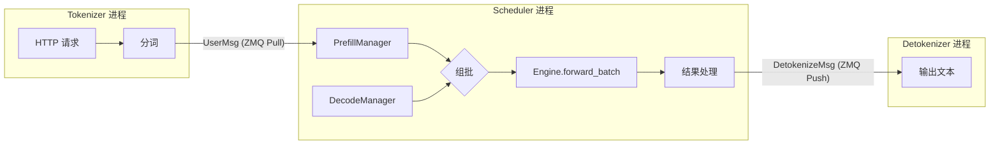
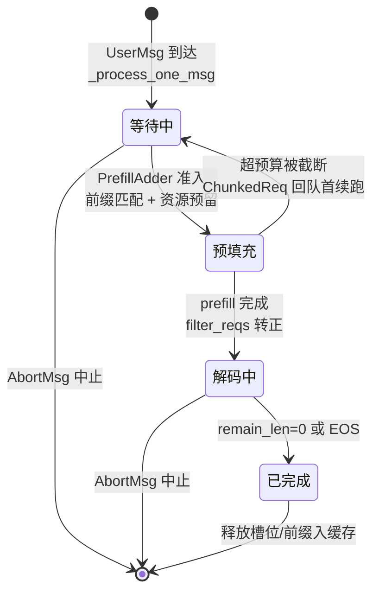

# 调度器与连续批处理

## 本章导读

上一章我们从外部视角看了一遍 mini-sglang 的请求生命周期。本章我们钻进整个系统的"大脑"——**调度器（Scheduler）**，把推理引擎最重要的一个概念——**连续批处理（Continuous Batching）**——讲透。

为什么调度器重要？大模型推理和训练最大的不同在于：请求是**随时到达、长度不一、先后完成**的。如果像训练那样"凑满一个固定 batch、跑完再换下一批"，GPU 会在大部分时间里空转。连续批处理的核心思想是：**每一个解码步（step）都重新组一次 batch**——完成的请求立刻离场，就绪的新请求立刻入场，让 GPU 上的计算始终保持"满员"。谁来决定每一步谁来谁走？就是调度器。

本章对应的源码在 `python/minisgl/scheduler/` 目录下，共 8 个文件约 800 行：

| 文件 | 职责 |
|---|---|
| `scheduler.py` | 主循环、组批决策、批准备、结果处理 |
| `prefill.py` | 预填充批的构建与准入控制（含 chunked prefill） |
| `decode.py` | 解码批的构建 |
| `cache.py` | KV cache 页分配与前缀缓存交互 |
| `table.py` | 请求槽位（table slot）与 token 池管理 |
| `io.py` | 与 Tokenizer/Detokenizer 进程的通信 |
| `config.py` / `utils.py` | 调度器配置与等待队列元素 |

读这一章之前，建议你先把 `python/minisgl/core.py`（约 136 行）通读一遍——`Req` 和 `Batch` 两个数据类是本章所有讨论的通用语言。

## 背景概念

**Prefill 与 Decode**。自回归推理分两个阶段：*prefill*（预填充）一次性并行处理整个 prompt，算出每个位置的 KV 并得到第一个新 token；*decode*（解码）此后每步只输入 1 个 token、产出 1 个 token。Prefill 是计算密集型的，decode 是访存密集型的——这个差异决定了二者要分开组批、采用不同的调度策略。

**KV Cache 与分页**。每个 token 算过的 Key/Value 会缓存起来避免重算。mini-sglang 像操作系统管理内存一样把 KV cache 切成固定大小的**页（page）**，用一张 **page table**（页表）记录"某请求的第 i 个 token 的 KV 存在哪个物理槽位"。本章只需要记住：`page_table[table_idx, pos] = 物理槽位`，细节留给第 3 章。

**前缀缓存（Prefix Cache / RadixCache）**。如果两个请求的 prompt 开头相同（比如共享同一个 system prompt），相同前缀的 KV 可以直接复用。mini-sglang 用一棵基数树（Radix Tree）按 token 序列索引已缓存的前缀。

**CUDA Stream**。可以把 stream 理解为 GPU 上的"任务队列"：同一队列里的任务严格按序执行，不同队列之间可以并行，队列之间用事件（event）做同步。这是后面"overlap scheduling"的底层机制。

## 调度器在系统中的位置

mini-sglang 是多进程架构：`python/minisgl/server/launch.py:40` 的 `launch_server` 会 spawn 出 Tokenizer 进程、Detokenizer 进程，以及每个 TP rank 一个的 **Scheduler 进程**。三者之间用 ZMQ 消息通信：



注意数据流的划分：Scheduler 进程里**只有 token id，没有文本**。分词和反分词都被挪到了独立进程，这样 GPU 侧的调度循环永远不会被文本处理拖慢。消息协议的四种类型——`UserMsg`（新请求）、`AbortBackendMsg`（中止）、`BatchBackendMsg`（打包）、`ExitMsg`（退出）——在 `scheduler/scheduler.py:169-198` 的 `_process_one_msg` 里被分发处理。

值得一提的是，离线推理入口 `LLM`（`python/minisgl/llm/llm.py:28`）直接**继承** `Scheduler`，只是把收发消息的两个方法替换成了进程内调用（`scheduler/io.py:30-33`）。同一套调度逻辑同时服务在线和离线两种场景，没有一份代码被复制。

## 一切状态皆长度：Req 的三个刻度

理解调度器，先要理解它调度的对象。`Req`（`python/minisgl/core.py:28-68`）的全部状态可以归结为三个长度：

```python
# python/minisgl/core.py:38-54
def __post_init__(self) -> None:
    assert self.input_ids.is_cpu
    self.device_len = len(self.input_ids)
    self.max_device_len = len(self.input_ids) + self.output_len
    assert 0 <= self.cached_len < self.device_len <= self.max_device_len

@property
def remain_len(self) -> int:
    return self.max_device_len - self.device_len

@property
def extend_len(self) -> int:
    return self.device_len - self.cached_len

def complete_one(self) -> None:
    self.cached_len = self.device_len
    self.device_len += 1
```

用停车场打个比方：

- `cached_len`：**已经算好 KV** 的前缀长度。prefill 开始时它是前缀缓存命中的长度（白捡的，不用算）；此后每步前向结束，`complete_one()` 把它推进到 `device_len`。
- `device_len`：**GPU 上已经占了槽位** 的长度。它总是比"已算好的"多一格——这一步采样出的新 token 已经为它预留了位置，KV 要等下一步前向才真正写入。
- `max_device_len`：本请求生命周期的总长上限（输入 + 最大输出）。

两个派生量就是调度器每步要回答的问题：`extend_len = device_len - cached_len` 是"本步要新算几个 token"；`remain_len = max_device_len - device_len` 是"还能生成几个 token"。而 `can_decode = remain_len > 0`（`core.py:59-61`）就是"还没写完"的判据。整个请求状态机，其实就是这三个数字的推移。

## 调度主循环：错开一拍的流水线

调度器的入口是 `run_forever`（`scheduler/scheduler.py:120-131`），它根据环境变量 `MINISGL_DISABLE_OVERLAP_SCHEDULING`（对应 `python/minisgl/env.py:69` 的 `ENV.DISABLE_OVERLAP_SCHEDULING`）在两种循环中选一种。先看简单的非 overlap 版（`scheduler/scheduler.py:108-118`）：收消息 → 组批 → 前向 → 立即处理本批结果，严格串行，很好懂。

生产模式用的是 overlap 版，它是本章的核心机制：

```python
# python/minisgl/scheduler/scheduler.py:90-106
blocking = not (
    last_data is not None  # don't block if we have a batch to be processed
    or self.prefill_manager.runnable
    or self.decode_manager.runnable
)
for msg in self.receive_msg(blocking=blocking):
    self._process_one_msg(msg)

forward_input = self._schedule_next_batch()
ongoing_data = None
if forward_input is not None:
    with self.engine_stream_ctx:  # run the batch in the engine's stream
        self.engine.stream.wait_stream(self.stream)
        ongoing_data = (forward_input, self._forward(forward_input))

self._process_last_data(last_data)
return ongoing_data
```

每一轮迭代做四件事，关键在于**时间轴错开一拍**：

1. **收消息**。`blocking` 条件（`scheduler.py:90-94`）表示：只有当"没有待处理的上批结果，且 prefill/decode 都无活可干"时才阻塞等待新消息，否则非阻塞地把消息队列掏空。空闲时还会顺手做一次 `cache_manager.check_integrity()` 页守恒校验（`scheduler.py:78-81`）。
2. **组本批**。`_schedule_next_batch()` 决定跑谁，`_prepare_batch()` 把元数据全部拷上 GPU。这些 H2D 拷贝都发在 **scheduler 自己的 stream** 上。
3. **发射本批前向**。`self.engine.stream.wait_stream(self.stream)`（`scheduler.py:102`）让 engine 的 stream 等 scheduler 的拷贝完成，然后 `_forward()` 把模型前向、采样、结果 D2H 拷贝**全部排队到 GPU 上，CPU 立即返回**。
4. **处理上一批的结果**。注意 `_process_last_data(last_data)` 处理的是 `last_data`——**上一轮**发射的批次。等到 CPU 做 Python 级别的逐请求循环、拼回复消息时，GPU 正在跑本批前向。CPU 的调度开销就这样被藏进了 GPU 的计算时间里。

这就是 overlap scheduling：把"第 N 批的 CPU 后处理"和"第 N+1 批的 GPU 计算"重叠在一起。它的正确性依赖两个精细设计，我们会在结果处理一节看到（`lazy_free_region` 和 `finished_reqs` 去重）。

## 组批决策：prefill 优先

每一步到底跑哪个 batch？答案只有两行：

```python
# python/minisgl/scheduler/scheduler.py:220-224
# TODO: support other policies: e.g. DECODE first
batch = (
    self.prefill_manager.schedule_next_batch(self.prefill_budget)
    or self.decode_manager.schedule_next_batch()
)
```

**只要有等待中的请求，就先做 prefill；否则才让在跑的请求继续 decode。** `or` 短路求值用得很妙：prefill 返回 `None` 才轮到 decode。

这个"prefill 优先"策略的理由是：新请求的 prefill 越早做，它的首 token 延迟（TTFT）越低，且 decode 请求被推迟一步的代价很小（反正它们每步只出一个 token）。代价则是 decode 的步间延迟（ITL）会出现毛刺。`scheduler.py:220` 的 TODO 注释表明作者知道还有 decode-first 等其他策略——这类"诚实留在代码里的 TODO"在教学项目里很常见，读源码时把它们当作路标而不是缺陷。另一个教学简化是：**一个 batch 要么是纯 prefill 要么是纯 decode，不支持混合批**（见 `Batch.phase`，`core.py:74`）。

## Prefill 批构建：入场检票与 chunked prefill

`PrefillManager.schedule_next_batch`（`scheduler/prefill.py:126-151`）按先来先服务（FCFS）的顺序扫描等待队列 `pending_list`，用一个 `PrefillAdder` 逐个"检票入场"，**遇到第一个加不进去的请求就 break**——不放行后面的请求插队，策略简单公平：

```python
# python/minisgl/scheduler/prefill.py:139-150
for pending_req in self.pending_list:
    if req := adder.try_add_one(pending_req):
        pending_req.chunked_req = None
        if isinstance(req, ChunkedReq):
            pending_req.chunked_req = req
            chunked_list.append(pending_req)
        reqs.append(req)
    else:
        break  # We cannot add more requests
if len(reqs) == 0:
    return None
self.pending_list = chunked_list + self.pending_list[len(reqs) :]
```

### 两个配额：token 预算与显存预留

`PrefillAdder`（`prefill.py:32-38`）手里握着两个配额：

- `token_budget`：本批 prefill 最多算多少个 token，初始值是 `max_extend_tokens`（默认 8192，`scheduler/config.py:16`）。它是 **chunked prefill 的预算**——限制单个 prefill 批的规模，避免一个超长 prompt 霸占 GPU 太久，把 decode 饿死。
- `reserved_size`：给正在 decode 的请求**预留的未来空间**，初始值是 `decode_manager.inflight_tokens`。这是准入控制的安全阀，下一节细讲。

新请求的准入检查在 `_try_allocate_one`（`prefill.py:39-63`）：先做前缀匹配，然后估算这个请求整个生命周期需要的显存（`extend_len + output_len`），要求加上预留量后仍不超过 `available_size`：

```python
# python/minisgl/scheduler/prefill.py:44-54
handle = self.cache_manager.match_req(req).cuda_handle
cached_len = handle.cached_len
# TODO: better estimate policy
extend_len = req.input_len - cached_len
estimated_len = extend_len + req.output_len

if estimated_len + self.reserved_size > self.cache_manager.available_size:
    return None
self.cache_manager.lock(handle)
if estimated_len + self.reserved_size > self.cache_manager.available_size:
    return self.cache_manager.unlock(handle)
```

注意这里检查了**两次**。因为 `lock(handle)` 会把命中的前缀从"可被逐出"变成"受保护"，导致 `available_size` 变小；第二次检查若失败就 unlock 回滚。这个 match→lock→二次校验→unlock 回滚的协议是操作前缀缓存的标准姿势。（`prefill.py:46` 的 TODO 说明作者也认为这个估算法比较粗糙——长输出的请求会被过度预留。）

如果命中了前缀（`cached_len > 0`），`_try_allocate_one` 还会把缓存部分的 token id 和历史 KV 槽位索引直接拷进 `token_pool` 和 `page_table`（`prefill.py:57-61`）——前缀零重算，这就是前缀缓存的回报。

### Chunked prefill：超长 prompt 的分段消化

如果请求剩余的输入比 token 预算还长怎么办？`_add_one_req`（`prefill.py:65-90`）会把它截断成一个 chunk：

```python
# python/minisgl/scheduler/prefill.py:72-76
remain_len = pending_req.input_len - cached_len
chunk_size = min(self.token_budget, remain_len)
is_chunked = chunk_size < remain_len
CLS = ChunkedReq if is_chunked else Req
self.token_budget -= chunk_size
```

被截断的请求会包装成 `ChunkedReq`（`prefill.py:23-29`），并且原 `PendingReq` 被放回等待队列的**队首**（`prefill.py:150` 的 `chunked_list + ...`），下一轮 prefill 优先续跑它。`ChunkedReq` 的设计极简——它只是 `Req` 的子类，改了两件事：`can_decode` 永远返回 `False`（别把我放进 decode 批），`append_host` 直接抛异常（我不该被采样）：

```python
# python/minisgl/scheduler/prefill.py:23-29
class ChunkedReq(Req):
    def append_host(self, next_token: torch.Tensor) -> None:
        raise NotImplementedError("ChunkedReq should not be sampled")

    @property
    def can_decode(self) -> bool:
        return False  # avoid being added to decode manager
```

续跑时 `try_add_one` 走 `prefill.py:96-102` 的分支：**不做资源检查、不重新做前缀匹配**，直接从上次的 `cached_len` 接着算。整个 chunked prefill 特性没有引入任何新的调度状态，靠"`ChunkedReq` 标记 + 队首锚点 + `-1` 写哨兵"三个小机关就撑起来了——写哨兵在批准备一节会看到。

## Decode 批构建：为什么没有准入控制

相比 prefill 的小心翼翼，decode 侧简单到几乎空无一物：

```python
# python/minisgl/scheduler/decode.py:14-15, 27-35
def filter_reqs(self, reqs: Iterable[Req]) -> None:
    self.running_reqs = {req for req in self.running_reqs.union(reqs) if req.can_decode}

@property
def inflight_tokens(self) -> int:
    tokens_reserved = (self.page_size - 1) * len(self.running_reqs)  # 1 page reserved
    return sum(req.remain_len for req in self.running_reqs) + tokens_reserved

def schedule_next_batch(self) -> Batch | None:
    if not self.runnable:
        return None
    return Batch(reqs=sorted(self.running_reqs, key=lambda req: req.uid), phase="decode")
```

**decode 批 = 全部在跑请求，没有任何运行时内存检查。** 这不会 OOM 吗？不会，因为安全是 prefill 准入时"一次性买好全程票"换来的：`inflight_tokens`（`decode.py:27-30`）估算所有 decode 请求跑完剩余输出还要多少槽位，外加每个请求最多 `page_size - 1` 的页对齐碎片，这笔账被计入 prefill 的 `reserved_size`。于是 decode 热路径上零分支、零检查，代价是显存预留偏保守。

`filter_reqs`（`decode.py:14-15`）这一行同样精妙，它在每次前向之后被调用，一个集合表达式同时干两件事：把本批非 chunk 的 prefill 请求并入运行集合（prefill → decode 的转正），把 `can_decode=False` 的请求滤掉（chunk 中的请求、已写满 `max_tokens` 的请求）。

还有一个容易一眼扫过的细节：组批时为什么要 `sorted(..., key=lambda req: req.uid)` 而不是直接 `list(self.running_reqs)`？因为 `running_reqs` 是**集合（set）**，迭代顺序由哈希决定，不同进程可能不同。TP 多卡时每个 rank 各有一个调度器进程，各自独立组批；如果两个 rank 组出的 batch 里请求顺序不同，page table 的行号就对不上，KV 会写串。按 uid 排序是"复制式调度"（每个 rank 跑同样的调度逻辑）能成立的前提——所有 rank 必须就 batch 内容**和顺序**达成确定性的共识（上游 #113 修的就是这个问题）。

## 批准备：把"组 batch"变成纯索引运算

定下跑谁之后，`_prepare_batch`（`scheduler/scheduler.py:204-217`）要把这个 batch 翻译成 GPU 能执行的形式：

```python
# python/minisgl/scheduler/scheduler.py:204-217
def _prepare_batch(self, batch: Batch) -> ForwardInput:
    self.engine.graph_runner.pad_batch(batch)
    self.cache_manager.allocate_paged(batch.reqs)
    batch.positions = _make_positions(batch, self.device)
    input_mapping = _make_input_tuple(batch, self.device)
    write_mapping = _make_write_tuple(batch, self.device)
    batch.out_loc = self.engine.page_table[input_mapping]
    self.engine.attn_backend.prepare_metadata(batch)
    return ForwardInput(
        batch=batch,
        sample_args=self.engine.sampler.prepare(batch),
        input_tuple=input_mapping,
        write_tuple=write_mapping,
    )
```

逐步拆解：

1. **CUDA Graph padding**（`pad_batch`，`engine/graph.py:160-166`）：decode 批若能用 CUDA Graph，就用 dummy 请求把 batch 补齐到最近的已捕获 batch size 档位（档位为 `[1, 2, 4] + range(8, max+1, 8)`，`graph.py:67`）。dummy 请求的读写都被引导到一页专门的"垃圾但合法"的内存上，无需任何特判。CUDA Graph 的原理见第 7 章，这里只需知道 padding 的原因。
2. **分配新页**（`allocate_paged`，`scheduler/cache.py:42-53`）：对每个请求只分配 `[ceil(cached_len/ps), ceil(device_len/ps))` 的**增量页**，写入 GPU page table。注意入参是 `batch.reqs` 而非 padded——dummy 请求不需要新页。
3. **positions**：每个请求本次要算的位置区间 `arange(cached_len, device_len)` 拼接起来（`scheduler.py:236-249`）。decode 时每请求恰好 1 个位置，prefill 时是本 chunk 的全部位置。
4. **两对索引张量**（`input_tuple` / `write_tuple`），这是理解 mini-sglang 数据布局的钥匙。

系统里有三块同坐标系的 GPU 大数组：`page_table[table_idx, pos] = KV 物理槽位`（`engine/engine.py:69-73`）、`token_pool[table_idx, pos] = token id`（`scheduler/table.py:11`）、以及按物理槽位存 K/V 的 KV cache pool。`input_tuple` 是 `(table_idx 展平, positions)`，`write_tuple` 是 `(table_idx, device_len 或 -1)`。于是 `_forward` 里出现了两句优雅的对偶操作：

```python
# python/minisgl/scheduler/scheduler.py:227-233
def _forward(self, forward_input: ForwardInput) -> ForwardOutput:
    batch, sample_args, input_mapping, output_mapping = forward_input
    batch.input_ids = self.token_pool[input_mapping]
    forward_output = self.engine.forward_batch(batch, sample_args)
    self.token_pool[output_mapping] = forward_output.next_tokens_gpu
    self.decode_manager.filter_reqs(forward_input.batch.reqs)
    return forward_output
```

读：用 `input_tuple` 从 `token_pool` 里索引出本步的输入 token；写：把采样出的新 token 用 `write_tuple` 写回 `token_pool` 的下一格。下一步的输入直接从池子里再索引出来——**decode 阶段 CPU 侧没有任何 token 拼接开销，组批就是一次张量索引**。

`write_tuple` 里的 `-1` 哨兵（`scheduler.py:265`）值得停留一秒：对 `can_decode=False` 的请求（即 chunked prefill 请求），写入位置是 `-1`，也就是 Python 负索引——写到该请求所在行的最后一格，反正马上会被覆盖，无害。这就是"chunked 请求的采样结果直接丢弃"的实现方式：采样器确实为它算了 logits（一点必要的算力浪费），但没有任何人读它。

`engine.forward_batch`（`engine/engine.py:191-206`）内部：CUDA Graph replay 或 eager 前向 → 对每个请求调 `complete_one()` 推进状态 → 采样 → 异步 D2H 拷贝新 token 并 record 一个 `copy_done` event。

## 结果处理：完成判定与延迟释放

`_process_last_data`（`scheduler/scheduler.py:138-167`）是每轮迭代的收尾，也是 overlap 模式正确性的关键所在：

```python
# python/minisgl/scheduler/scheduler.py:146-164
with self.cache_manager.lazy_free_region():
    for i, req in enumerate(batch.reqs):
        if isinstance(req, ChunkedReq):
            continue
        next_token = next_tokens_cpu[i]
        req.append_host(next_token.unsqueeze(0))
        next_token = int(next_token.item())
        finished = not req.can_decode
        if not req.sampling_params.ignore_eos:
            finished |= next_token == self.eos_token_id
        reply.append(DetokenizeMsg(uid=req.uid, next_token=next_token, finished=finished))

        # NOTE: overlap scheduling may make the request freed twice, skip second free
        if finished and req not in self.finished_reqs:
            self.decode_manager.remove_req(req)
            self._free_req_resources(req)
            new_finished_reqs.add(req)
        elif batch.is_prefill:  # for prefill, non-chunk req, cache the prefix
            self.cache_manager.cache_req(req, finished=False)
```

三个细节：

- **完成判定是双保险**：长度耗尽（`can_decode=False`）或采出了 EOS（且用户没设 `ignore_eos`）。
- **`finished_reqs` 集合防止重复释放**。overlap 模式下，decode batch 是上一轮就组好并发射的；一个请求可能"本轮被判定完成，但它还在已经发射的下个 decode batch 里"，于是它的结果会被处理第二次。靠这个集合跳过第二次释放（`scheduler.py:158-162`）。
- **整个循环包在 `lazy_free_region()` 里**（`cache.py:93-104`）：归还 KV 页只登记、不生效，退出循环时才一次性合并回空闲列表。为什么？overlap 模式下 CPU 处理第 N 批结果时，**GPU 正在跑的第 N+1 批的 attention kernel 还在读这些请求的 KV 页**。如果立即归还，下一次分配可能把同一页发给新请求并被覆写——典型的 CPU/GPU 异步竞态，轻则输出乱码，重则非法内存访问（IMA）。延迟释放把归还点推到了安全线之后。

非完成的 prefill 请求还会顺手把已算出的前缀插回 RadixCache（`scheduler.py:163-164`），供后来的请求共享；完成请求的资源释放（`scheduler.py:200-202`）则是归还 table 槽位 + 把前缀插入缓存。`cache_req` 内部对三段内存区间的精细处理（`cache.py:55-79` 的注释写得极好）留给第 3 章展开。

## 一个请求的完整旅程

把本章的零件拼起来，一个请求的状态机如下：



## 设计亮点

1. **Overlap scheduling**：双 CUDA stream + 错拍流水线，CPU 处理第 N 批结果的同时 GPU 跑第 N+1 批。配套的 `ForwardInput` 输入缓存（`scheduler.py:34` 的注释）、`lazy_free_region` 延迟释放、`finished_reqs` 去重，是这套机制正确性的三根支柱。设 `MINISGL_DISABLE_OVERLAP_SCHEDULING=1` 可以关掉对比。
2. **以槽位为中心的数据布局**：`token_pool` / `page_table` 两个同形 2D 数组 + 两对索引张量，把组批变成纯索引运算，decode 热路径上 CPU 零拼接。
3. **准入控制单次悲观预留**：decode 侧零检查，安全完全由 prefill 准入时的 `estimated_len + inflight_tokens` 预留保证——用显存利用率换热路径简洁。
4. **Chunked prefill 极简实现**：不新增调度状态，一个 `ChunkedReq` 标记 + 队首锚点 + `-1` 写哨兵，三个机关撑起整个特性。
5. **调度与 CUDA Graph 解耦**：scheduler 只调 `pad_batch`，dummy 请求的所有读写落在合法的垃圾内存上，上层代码无一处特判。

## 常见困惑

**Q1：`cached_len` 到底是"缓存长度"还是"已算长度"？**

两个含义兼有，且随时间切换。prefill 开始时它是"前缀缓存命中的长度"；每步前向后 `complete_one()` 把它推进到 `device_len`，此时含义是"本步之前所有 KV 已就绪"。任何时候 `extend_len = device_len - cached_len` 都是"本步要新算的 token 数"，抓住这个不变量就不会乱。

**Q2：decode 不做内存检查，为什么不会 OOM？**

因为 prefill 准入时已经为每个 decode 请求把全部剩余输出（`remain_len`）外加最多一页的对齐碎片预留进了 `reserved_size`（`prefill.py:133`、`decode.py:27-30`）。是"入场时买好全程票"，不是"每站检票"。

**Q3：`ChunkedReq` 也走了 `complete_one` 和采样，为什么不会乱？**

三个机关各管一段：(a) `write_tuple` 给它写 `-1`，采样结果写到行尾废格，无害；(b) `_process_last_data` 里 `isinstance(req, ChunkedReq)` 直接跳过，不追加 token 也不回信；(c) `can_decode=False` 让它被 `filter_reqs` 挡在 decode 门外。

**Q4：为什么前缀匹配故意少匹配最后一个 token？**

`match_req` 只对 `input_ids[:input_len-1]` 做匹配（`cache.py:30`）。因为最后一个输入 token 必须参与前向计算才能产出 logits——没有 logits 就没法采样出第一个新 token。这是所有前缀缓存系统的通用约定。

**Q5：代码里那些 TODO 和没人用的东西是怎么回事？**

这是教学项目的真实样貌，读源码时不必困惑：`scheduler/utils.py:30-33` 的 `ScheduleResult` 是未被任何代码引用的**死代码**（疑似早期设计的残留）；`scheduler.py:73` 有一行被注释掉的 `# self.config = config`；`scheduler.py:220` 和 `prefill.py:43,46` 的 TODO 分别标记了"支持 decode-first 策略"和"更好的内存预估"这两个已知改进方向。它们不影响任何运行行为。

## 回顾与动手

本章要点：

- 连续批处理 = 每一步重新组批，完成的离场、就绪的入场；mini-sglang 采取 **prefill 优先**策略，且 prefill/decode 不混批。
- 请求状态完全由 `cached_len` / `device_len` / `max_device_len` 三个长度刻画；`extend_len` 和 `remain_len` 是调度器每步要回答的问题。
- prefill 准入 = 前缀匹配 + 双配额检查（token 预算 + 显存预留）；decode 零检查，安全靠准入时的悲观预留。
- chunked prefill 用 `ChunkedReq` + 队首锚点 + `-1` 哨兵三个机关实现。
- overlap scheduling 把 CPU 后处理藏进 GPU 计算，正确性靠 `lazy_free_region` 和 `finished_reqs` 保障。

动手实验：

1. **给调度循环加日志**。在 `scheduler/scheduler.py:98` 的 `_schedule_next_batch` 调用后加一行 `logger.info`（或 `print`），打印 `batch.phase`、`batch.size` 和每个请求的 `(cached_len, device_len)`。用 `LLM` 离线接口跑几个不同长度的 prompt，观察 prefill/decode 批如何交替、`device_len` 如何逐格推进。
2. **观察 chunked prefill**。把 `max_extend_tokens` 调小（如 256，`SchedulerConfig` 的构造参数，离线模式下可以直接传给 `LLM(model_path, max_extend_tokens=256)`），喂一个 1000+ token 的长 prompt，配合上一步的日志观察同一个请求被切成多个 chunk、反复从队首续跑的过程。
3. **关掉 overlap 对比性能**。用环境变量 `MINISGL_DISABLE_OVERLAP_SCHEDULING=1` 分别跑一遍 `benchmark/offline/` 下的离线吞吐脚本，对比开/关 overlap scheduling 的 tokens/s 差异，直观感受 CPU 开销被隐藏的收益。
