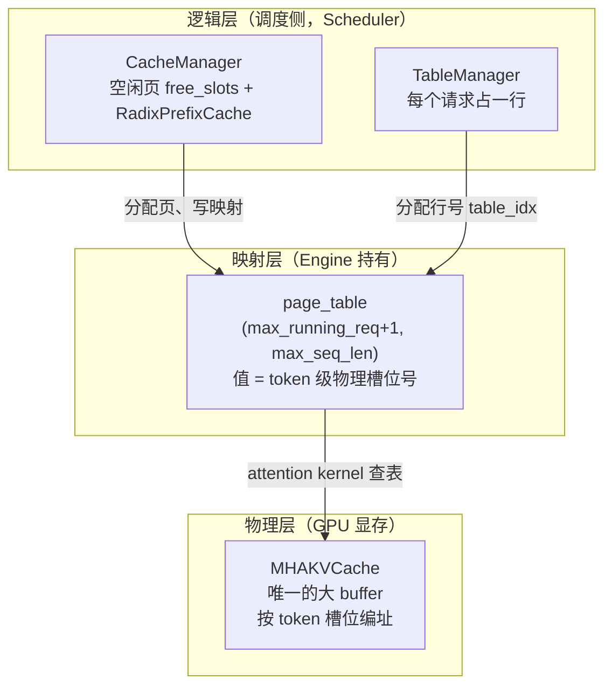
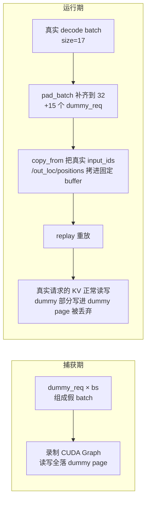

# KV Cache 与显存管理

## 本章导读

LLM 推理引擎里最贵、最稀缺、也最需要精打细算的资源不是算力，而是 **GPU 显存**——准确地说，是存放 KV cache 的那块显存。一个推理引擎的吞吐量上限，很大程度上取决于它能在显存里同时塞进多少个请求的 KV，以及复用得多聪明。

本章我们把 mini-sglang 的显存管理子系统从头到尾读一遍，回答四个问题：

1. KV cache 在显存里到底长什么样？（paged KV 池的布局与一次性预分配）
2. 显存页是怎么分配、回收的？（CacheManager 的页分配器）
3. 相同前缀的请求如何共享 KV？（RadixCache 的前缀匹配、lock 与 LRU 驱逐）
4. CUDA Graph 这种"形状必须固定"的优化，怎么和动态变化的显存布局共存？（page table、dummy page 与 dummy req）

涉及的核心源码文件：

- `python/minisgl/kvcache/mha_pool.py` — 物理 KV 显存池
- `python/minisgl/kvcache/radix_cache.py` — Radix 前缀缓存树
- `python/minisgl/scheduler/cache.py` — 页分配器 CacheManager
- `python/minisgl/scheduler/table.py` — 请求槽位 TableManager
- `python/minisgl/engine/engine.py` — 启动期的显存预分配
- `python/minisgl/engine/graph.py` — CUDA Graph 捕获与 dummy req

## 背景概念

**KV cache 是什么。** 自回归生成时，每一步都要对之前所有 token 做 attention。如果每步都重算历史 token 的 Key/Value 投影，计算量会随序列长度平方增长。KV cache 把每个 token 在每层算好的 K、V 向量存下来，后续步骤直接读，用显存换计算。它是推理引擎的"第一公民"，通常占掉的显存比模型权重还多。

**prefill 与 decode。** 推理分两阶段：prefill 一次性处理整个 prompt（每个位置都算出一个新 token 的 logits，但只有最后一个有用），decode 每步只处理一个新 token。两阶段对显存的需求模式不同：prefill 需要一次分配一大块，decode 每步只需要一个槽位。

**分页（paging）。** 如果给每个请求分配一段连续显存，序列变长时就要像 `realloc` 一样整体搬家，碎片严重。PagedAttention（vLLM 提出）借鉴操作系统虚拟内存的思想：把 KV 池切成固定大小的**页（page）**，一个请求的 KV 可以散落在不连续的页里，再用一张**页表（page table）** 记录"逻辑位置 → 物理位置"的映射。mini-sglang 完整实现了这套机制。

**前缀缓存（prefix cache）。** 很多请求共享相同前缀：系统提示词、多轮对话的历史、few-shot 示例。如果这些前缀的 KV 能缓存复用，第二个请求就不必重算。mini-sglang 用一棵 radix 树（压缩前缀树）来组织这些可共享的前缀。

**CUDA Graph。** GPU kernel 的启动有固定开销，decode 阶段每步只有几十微秒的计算，启动开销占比很高。CUDA Graph 把整个前向计算"录制"下来，之后一键重放（replay），消除启动开销。代价是：**图一旦录制，batch 形状和所有显存地址就固定了**。这与"每个请求的显存位置每步都在变"天然矛盾——如何解决这个矛盾是本章的重点之一。

## 三层抽象：先看懂全局地图

mini-sglang 的显存管理分三层，理清这三层，后面所有代码都能对号入座：



- **物理层**：`MHAKVCache`（`python/minisgl/kvcache/mha_pool.py:10`）持有唯一的一整块显存，把整个池看成 `num_pages × page_size` 个 **token 槽位**，每个槽位存一个 token 在某一层的 K 或 V。槽位号从 0 编到 `num_pages × page_size - 1`。
- **逻辑层**：`CacheManager`（`python/minisgl/scheduler/cache.py:15`）决定哪些页空闲、哪些页被缓存树占着；`TableManager`（`python/minisgl/scheduler/table.py:4`）给每个请求分配一个"行号"。
- **映射层**：全局 `page_table`（`python/minisgl/engine/engine.py:69`）把"请求的第 i 个 token"翻译成物理槽位号。注意一个关键设计：**page_table 里存的是 token 级槽位号，不是页号**（`engine.py:66` 的注释写得很直白："store raw locations instead of pages"）。

用一个类比收个尾：KV 池是停车场，车位（槽位）统一编号；CacheManager 是车场管理员，手里有一串空闲车位的钥匙；每个请求是一辆列车，表管理给它一条专属车道（page_table 的一行），车道上依次写着"我的第 1 节车厢停在 37 号位、第 2 节停在 38 号位……"；attention kernel 是司机，只看车道上的记录找车厢。

## 显存预分配：先加载模型，再倒推池子大小

mini-sglang 在启动时**一次性**把 KV 池分配好，运行期绝不再向 CUDA 申请显存。这是 vLLM/SGLang 系引擎的共同策略：避免运行期 `cudaMalloc` 的延迟和碎片。那么池子开多大？答案是"用剩余显存倒推"，见 `Engine._determine_num_pages`（`python/minisgl/engine/engine.py:148`）：

```python
    def _determine_num_pages(self, old_free_memory: int, config: EngineConfig) -> int:
        new_free_memory = self._sync_get_memory()[1]
        cache_per_page = (
            2  # key + value
            * config.model_config.head_dim
            * div_even(config.model_config.num_kv_heads, config.tp_info.size, allow_replicate=True)
            * config.page_size
            * self.dtype.itemsize
            * config.model_config.num_layers
        )
        num_pages = config.num_page_override
        if num_pages is None:
            model_memory = old_free_memory - new_free_memory
            available_memory = int(config.memory_ratio * old_free_memory) - model_memory
            num_pages = available_memory // cache_per_page
```

逻辑三步走：

1. 加载权重前记录空闲显存 `old_free_memory`，加载后再测一次，差值就是模型占的显存；
2. 允许使用的总量是 `memory_ratio`（默认 0.9）× 加载前空闲显存，减去模型占用，剩下的全给 KV 池；
3. 除以每页的字节数 `cache_per_page`，得到页数。每页的字节数包含 K 和 V 两份、所有层——因为页是"所有层共享的逻辑单位"，一个槽位在每一层都有一席之地。

张量并行（TP）下还有两个细节：`_sync_get_memory`（`engine.py:170`）在所有 rank 间 all_reduce 取**最小**空闲显存，保证各 rank 的池一样大（paged kernel 是跨 rank 对称的）；rank 间空闲显存差超过 2 GiB 直接报错，因为这通常意味着某张卡上有别的进程在占显存。

接着创建池和页表（`engine.py:55-73`）：

```python
        self.num_pages = self._determine_num_pages(init_free_memory, config)
        num_tokens = self.num_pages * config.page_size
        self.ctx.kv_cache = self.kv_cache = create_kvcache_pool(
            model_config=config.model_config,
            num_pages=self.num_pages + 1,  # +1 for dummy page
            page_size=config.page_size,
            device=self.device,
            dtype=self.dtype,
        )
        ...
        self.max_seq_len = min(config.max_seq_len, num_tokens)
        aligned_max_seq_len = _align_up_32(self.max_seq_len)
        self.ctx.page_table = self.page_table = torch.zeros(  # + 1 for dummy request
            (config.max_running_req + 1, aligned_max_seq_len),
            dtype=torch.int32,
            device=self.device,
        )
```

两处 `+1` 都是为 CUDA Graph 服务的：池子多一页 **dummy page**，page_table 多一行 **dummy request**，后文专门展开。另外注意 `max_seq_len = min(config.max_seq_len, num_tokens)`——如果显存太小，KV 池容量会反过来限制最大序列长度。

## 物理层：MHAKVCache 的布局与写入

`MHAKVCache.__init__`（`python/minisgl/kvcache/mha_pool.py:16`）只有一件事：`torch.empty` 出一个 6 维大张量：

```python
        tp_info = get_tp_info()
        local_kv_heads = div_even(num_kv_heads, tp_info.size, allow_replicate=True)
        self._kv_buffer = torch.empty(
            (2, num_layers, num_pages, page_size, local_kv_heads, head_dim),
            device=device,
            dtype=dtype,
        )
        self._k_buffer = self._kv_buffer[0]
        self._v_buffer = self._kv_buffer[1]
        self._storage_shape = (num_pages * page_size, local_kv_heads, head_dim)
```

维度含义依次是 `(K/V, 层, 页, 页内偏移, KV头, head_dim)`。对 attention kernel 来说，取出某一层后，页号和页内偏移拼起来正好等价于一个 `(总token数, 头数, head_dim)` 的数组——这就是为什么全系统可以用统一的"token 槽位号"编址：`slot = page_id × page_size + offset`。TP 下每个 rank 只存自己分到的 KV 头；`allow_replicate=True` 允许 KV 头数少于 TP size 时复制而不是报错（GQA 小模型配大 TP 的场景）。

写 KV 的唯一入口是 `store_kv`（`mha_pool.py:45`）：

```python
    def store_kv(
        self, k: torch.Tensor, v: torch.Tensor, out_loc: torch.Tensor, layer_id: int
    ) -> None:
        from minisgl.kernel import store_cache

        store_cache(
            k_cache=self._k_buffer[layer_id].view(self._storage_shape),
            v_cache=self._v_buffer[layer_id].view(self._storage_shape),
            indices=out_loc,
            k=k,
            v=v,
        )
```

它把该层的 buffer `view` 成 token 级数组，然后调 `store_cache` kernel（`python/minisgl/kernel/store.py:30`）按 `out_loc` 做 scatter 写入：batch 里第 i 个新 token 的 K/V 写到槽位 `out_loc[i]`。底层 CUDA kernel 让每个 warp 搬运一个 token 的整条 KV，并针对 `element_size`（= 头数 × head_dim × 字节数）做模板特化 JIT 编译。每层 attention 算完都会调一次 `store_kv`，**"先写 KV 再做 attention"是每一层的固定动作**。

## 逻辑层一：CacheManager 页分配器

`CacheManager`（`python/minisgl/scheduler/cache.py:15`）是调度侧的显存管家。它的"现金"是 `free_slots`：

```python
        # The `_free_slots` follows a page-aligned manner. For example, if page_size = 2,
        # the `_free_slots` may look like [0, 2, 4, 6, ...], and each slot represents a page.
        self.free_slots = torch.arange(num_pages, dtype=torch.int32, device=device) * page_size
```

注意 `free_slots` 里每个元素是**页首的 token 槽位号**（0, page_size, 2×page_size, …），一个元素代表一整页。全系统分配和回收都只流通页首槽位号，保证永远页对齐——`check_integrity`（`cache.py:81`）在调度器空闲时会断言两件事：`空闲页 + 缓存树占用的页 == 总页数`（守恒，不漏页），以及所有空闲槽位都能被 `page_size` 整除（对齐）。这是排查显存泄漏的第一道关卡。

分配入口 `allocate_paged`（`cache.py:42`）在每步 forward 前被调用，为 batch 里每个请求算出本步新增的页区间：

```python
    def allocate_paged(self, reqs: List[Req]) -> None:
        needed_pages = 0
        allocation_info: List[Tuple[int, int, int]] = []
        for req in reqs:
            first_page = div_ceil(req.cached_len, self.page_size)
            last_page = div_ceil(req.device_len, self.page_size)
            if last_page > first_page:
                needed_pages += last_page - first_page
                allocation_info.append((req.table_idx, first_page, last_page))
        if needed_pages > 0:
            allocated = self._page_to_token(self._allocate(needed_pages))
            _write_page_table(self.page_table, allocated, allocation_info, self.page_size)
```

这里出现了 `Req` 的三个长度（定义在 `python/minisgl/core.py:38-54`，是整个调度逻辑的枢纽）：

- `cached_len`：已经躺在 KV 池里、attention 可以直接读的前缀长度；
- `device_len`：本步 forward 之后应该达到的长度；
- `extend_len = device_len - cached_len`：本步实际要算的 token 数。

decode 每步结束 `complete_one()` 把 `cached_len` 追平到 `device_len` 再 +1。所以分配区间的含义是：`[ceil(cached_len/page_size), ceil(device_len/page_size))` 这段页是"本步新需要的"，之前的页要么来自缓存命中，要么上一轮已经分配过。decode 阶段大多数时候这个区间是空的（一页没装满就不用新页），这正是分页省显存的来源——页是按需一页一页"长大"的。

现金不够怎么办？`_allocate`（`cache.py:106`）会向 Radix 树"讨债"：

```python
    def _allocate(self, needed_pages: int) -> torch.Tensor:
        if needed_pages > (free_pages := len(self.free_slots)):
            evicted = self.prefix_cache.evict((needed_pages - free_pages) * self.page_size)
            self.free_slots = torch.cat([self.free_slots, evicted[:: self.page_size]])
            assert len(self.free_slots) >= needed_pages, "Eviction did not free enough space."
        allocated = self.free_slots[:needed_pages]
        self.free_slots = self.free_slots[needed_pages:]
        return allocated
```

空闲页不足时，驱逐缓存树里最久未用的前缀，把它们的槽位（`[::page_size]` 抽页首）充公。所以"可用显存"的真实定义是 `available_size`（`cache.py:33`）：**空闲页 + 缓存树里可驱逐的部分**——缓存的前缀本质是"可以随时变现的资产"，准入控制按这个口径算账。

## 逻辑层二：RadixCache 前缀树

### 树的结构：边是整页 token，值是物理槽位

Radix 树（压缩前缀树）和普通字典树的区别在于：一条边可以携带一串字符而不是一个字符，只有分叉的地方才有节点。mini-sglang 的 `RadixTreeNode`（`python/minisgl/kvcache/radix_cache.py:17`）字段如下：

- `_key`：这条边上的 token id 序列（CPU tensor）；
- `_value`：与 `_key` 等长的**物理槽位号**序列——匹配上前缀就等于直接拿到了那段 KV 的存放地址；
- `ref_count`：引用计数，为 0 才允许被驱逐；
- `timestamp`：`time.monotonic_ns()`，LRU 淘汰的依据；
- `children`：子节点字典，字典的 key 由 `key_fn`（`radix_cache.py:234`）生成：`page_size == 1` 时取单个 token，否则取**整页 token 组成的 tuple**。也就是说，树的最小粒度是页——不满一页的 token 永远进不了缓存树。

### 匹配：tree_walk 与边拆分

`match_prefix` 内部走 `_tree_walk`（`radix_cache.py:205`）：

```python
    def _tree_walk(self, input_ids: torch.Tensor) -> Tuple[RadixTreeNode, int]:
        prefix_len = 0
        indice_len = len(input_ids)
        node = self.root_node
        tic = time.monotonic_ns()

        while prefix_len < indice_len:
            child_node = node.children.get(self.key_fn(input_ids[prefix_len:]))
            if child_node is None:
                return node, prefix_len
            node = child_node  # walk to child node

            # NOTE: at least 1 page is matched, so match_len >= page_size
            match_len = node.get_match_len(input_ids[prefix_len:])
            match_len = align_down(match_len, self.page_size)
            prefix_len += match_len

            # need to split the node if not fully matched
            if match_len != node.length:
                node = node.split_at(match_len)
                node.timestamp = tic
                return node, prefix_len

            node.timestamp = tic

        return node, prefix_len
```

流程像走迷宫：在当前节点的孩子里按下一页的 token 找入口，找到了就用 `fast_compare_key`（`python/minisgl/kernel/radix.py:18`，一个用 C++ `std::mismatch` 实现的 CPU 比较函数，因为这是纯 CPU 热路径）算公共前缀长度，再向下取整到页对齐。如果整条边被吃掉了就继续下行；只吃掉一部分，就把这条边**拆成两段**——`split_at`（`radix_cache.py:69`）新建一个节点拿走前 `[0, pos)` 挂在原父节点下，自己拿着后半段改挂到新节点下。沿途刷新 timestamp，等于顺手做了 LRU 的"最近使用"标记。

匹配到的物理槽位如何取回？`RadixCacheHandle.get_matched_indices`（`radix_cache.py:91`）从匹配节点沿父链一路爬到根，把各段的 `_value` 拼接起来——因为前缀被树拆成了若干段，得把散在各节点上的槽位号串成完整序列。

### lock：一份显式的所有权协议

这是初学者最容易漏掉、也最关键的一条契约，写在基类注释里（`python/minisgl/kvcache/base.py:74`）：

> Handles must be locked before the previously-returned tensor of `match_prefix` is used. Otherwise it may be evicted by calling evict.

`match_prefix` **不修改任何状态**，它返回的槽位可能挂在 `ref_count == 0` 的节点上——也就是随时可能被驱逐回收。在你拿着这些槽位去写 page_table 之前，如果另一个请求触发了 `evict`，这些槽位就会被分给别人，你读到的就是别人请求的 KV。`lock_handle`（`radix_cache.py:113`）沿祖先链把 `ref_count` 加一，把节点从"可驱逐"挪进"受保护"账本：

```python
    def lock_handle(self, handle: BaseCacheHandle, unlock: bool = False) -> None:
        assert isinstance(handle, RadixCacheHandle)
        node = handle.node
        if unlock:
            while not node.is_root():
                node.ref_count -= 1
                assert node.ref_count >= 0
                if node.ref_count == 0:
                    self.evictable_size += node.length
                    self.protected_size -= node.length
                node = node.parent
        else:
            while not node.is_root():
                if node.ref_count == 0:
                    self.evictable_size -= node.length
                    self.protected_size += node.length
                node.ref_count += 1
                node = node.parent
```

根节点的 `ref_count` 恒为 1（`radix_cache.py:111`），永远不会被驱逐。

准入控制里能看到这套协议的完整用法（`python/minisgl/scheduler/prefill.py:44-54`）：先 match 得到 `cached_len`，估算显存够不够用，然后 **lock，再检查一次容量**——因为 lock 会把一批节点从 evictable 变成 protected，`available_size` 会缩水，第一次检查的结论可能失效。不够就 unlock 放弃，请求继续排队。这种"检查—加锁—复查"的模式和数据库里乐观锁的思路一模一样。

### 插入与驱逐

请求算完 prefill，它的前缀就该进缓存树供后来者复用。`insert_prefix`（`radix_cache.py:136`）：

```python
    def insert_prefix(self, input_ids: torch.Tensor, indices: torch.Tensor) -> InsertResult:
        insert_len = align_down(len(input_ids), self.page_size)
        input_ids, indices = input_ids[:insert_len], indices[:insert_len]
        node, prefix_len = self._tree_walk(input_ids)
        if prefix_len != insert_len:  # NOTE: prefix_len < insert_len
            new_node = RadixTreeNode(self.key_fn)
            new_node.set_key_value(input_ids[prefix_len:], indices[prefix_len:].clone())
            new_node.set_parent(node)
            self.evictable_size += new_node.length
            node = new_node
        return InsertResult(prefix_len, RadixCacheHandle(insert_len, node))
```

两个要点：**不满一页的尾部直接不入缓存**（`align_down`），这保证了"页"作为流通单位的纯粹性；`tree_walk` 之后如果还有没匹配上的部分，就新建叶子节点挂上去。返回的 `cached_len = prefix_len` 表示"插入之前树里已经有的长度"——注意这段对应的物理槽位是本请求自己占的页，但内容已经被别的请求抢先缓存过了，必须释放掉，否则就泄漏了。

驱逐 `evict`（`radix_cache.py:148`）是标准 LRU：收集所有 `ref_count == 0` 的叶子，按 timestamp 建最小堆，逐个弹出最老的，直到腾出足够的空间；弹掉一个叶子后如果父节点变成了"无引用的叶子"，就把它也推进堆里继续驱逐——所以驱逐会像落叶一样从末梢往根部蔓延，但实际驱逐量可能超过请求量（以页为单位取整）。

### 回收：cache_req 的四段区间

请求结束（或 prefill 完转 decode）时，`cache_req`（`cache.py:55`）负责把这个请求占用的资源分类处理。函数开头那段注释是全文件最好的文档，把一个请求的槽位划成四段：

```
[0, old_handle.cached_len)                插入前已在 Radix 树里的部分（复用的，不用动）
[old_handle.cached_len, cached_len)       自己占的页被别人抢先缓存了 → 立即 free（防泄漏）
[cached_len, new_handle.cached_len)       本次新插入树的部分（保留，变成可共享缓存）
[new_handle.cached_len, req.cached_len)   不足一页的尾巴 → 请求结束就 free，否则留着并 lock
```

代码动作与之一一对应（`cache.py:67-79`）：先 `insert_prefix` 把前缀塞进树，再 `unlock` 旧 handle（顺序很重要：先让新 handle 接管引用，旧引用才能安全放手），free 掉重叠段；请求已结束就把尾巴也 free，否则更新 handle 并 lock 住新 handle——因为 decode 还在继续用这些槽位。

## 映射层：page_table 的构建与消费

每步 forward 前，`_prepare_batch`（`python/minisgl/scheduler/scheduler.py:204`）做三件事：pad batch、`allocate_paged` 分配新页、算出 `out_loc`：

```python
    def _prepare_batch(self, batch: Batch) -> ForwardInput:
        self.engine.graph_runner.pad_batch(batch)
        self.cache_manager.allocate_paged(batch.reqs)
        batch.positions = _make_positions(batch, self.device)
        input_mapping = _make_input_tuple(batch, self.device)
        write_mapping = _make_write_tuple(batch, self.device)
        batch.out_loc = self.engine.page_table[input_mapping]
        self.engine.attn_backend.prepare_metadata(batch)
```

`input_mapping` 是一个二元组 `(table_idx 序列, position 序列)`：batch 里第 i 个待算 token 属于哪个请求、在请求内的第几个位置。用它索引 page_table，得到的 `out_loc` 就是每个新 token 的物理写入槽位——正是 `store_kv` 需要的那个参数。

新分配的页怎么写进 page_table？`_write_page_table`（`cache.py:127`）在 CPU 侧用 pinned memory 拼好 `(行号, 列号)` 两个数组，一次 `non_blocking` 拷贝上卡，再做一次 scatter：

```python
    table_idxs = table_idx_host.to(page_table.device, non_blocking=True)
    offsets = positions_host.to(page_table.device, non_blocking=True)
    page_table[table_idxs, offsets] = allocated
```

pinned memory（锁页内存）是 CPU 侧一块不会被交换出去的内存，H2D 拷贝可以走 DMA 异步进行，避免每步同步等待。

page_table 的唯一消费者是各 attention 后端，但它们的"口味"不同。全局表存的是 token 槽位号，而 FlashAttention 的 paged kernel 要的是页号（block table），于是 FA 后端消费时临时做一次"折叠"（`python/minisgl/attention/fa.py:92`）：

```python
        page_table = get_global_ctx().page_table
        new_page_table = torch.stack(  # NOTE: global page table treat page_size = 1, we need slice
            [page_table[req.table_idx, : max_seqlen_k : self.page_size] for req in reqs]
        )
        if self.page_size > 1:
            new_page_table.div_(self.page_size, rounding_mode="floor")
```

即：每行隔 `page_size` 取一个槽位号，再整除 `page_size` 还原成页号。这个"全局统一用 token 槽位号，各后端自行换算"的设计，让 `store_kv`、FlashInfer 的 ragged indices、FA 的 block table 三种消费方式共用一张表，逻辑集中在一处；代价是表比纯页号表大 `page_size` 倍，但这点显存（每元素 4 字节）相对 KV 池本身可以忽略。

## 重点专题：dummy page 与 dummy req 如何服务 CUDA Graph

### 矛盾在哪里

CUDA Graph 的收益来自"录制一次、重放千次"，但它的硬性约束是：**重放时的 batch 形状、所有 tensor 的显存地址都必须和录制时一致**。真实的 decode 流量却不听话：这一步 batch size 是 17，下一步变成 16；每个请求每步的 KV 槽位都在变。如果每次变化都重新录制图，开销反而更大。

业界的标准解法分两半，mini-sglang 都实现了：

1. **形状固定**：只录制一组离散 batch size（如 1, 2, 4, 8, …），真实 batch 不足时用假请求**补齐（padding）**到最近的一档；
2. **地址固定**：graph 内部只读写一组固定的输入 buffer，重放前把真实数据拷进去；attention 的寻址信息通过 page table 间接传递——**表的地址固定，表的内容可变**。

第 2 点正是"全局 page_table 存 token 槽位号"设计的另一半好处：graph 捕获时 attention kernel 读的是捕获时那张固定地址的表（`fa.py:128-136` 的 `prepare_for_replay` 把新算好的页表内容拷进捕获用的固定 buffer），内容每步更新即可，无需重新捕获。

第 1 点带来一个新问题：**padding 出来的假请求，forward 时也会真实地跑 attention、真实地读写 KV 池**。如果这些读写落到真实请求的槽位上，数据就被污染了；如果落到非法地址，就是非法内存访问（IMA）。dummy page 和 dummy req 就是为这个"垃圾桶"需求设计的。

### dummy req：一个什么都能吸收的伪请求

`Engine.__init__` 末尾（`engine.py:89-98`）构造了它：

```python
        self.dummy_req = Req(
            input_ids=torch.tensor([0], dtype=torch.int32, device="cpu"),
            table_idx=config.max_running_req,
            cached_len=0,
            output_len=1,
            uid=-1,
            sampling_params=None,  # type: ignore
            cache_handle=None,  # type: ignore
        )
        self.page_table[self.dummy_req.table_idx].fill_(num_tokens)  # point to dummy page
```

三个精心安排的细节：

- **专属行号**：`table_idx = max_running_req`，即 page_table 的最后一行——这正是 page_table 分配 `max_running_req + 1` 行的原因。这行永远不属于任何真实请求，TableManager 的行号池（`table.py:7`）只有 `0 .. max_running_req-1`，不会把它发出去。
- **整行指向 dummy page**：`fill_(num_tokens)` 把这一行所有位置都填上 dummy page 的首槽位号（`num_tokens = num_pages × page_size`，即多分配的那一页，也是 KV 池多分配一页的原因）。于是伪请求无论读还是写，落点永远是这一页垃圾场，真实数据毫发无伤。
- **合法的 token id**：dummy req 的 input token 是 0。`TableManager` 里 `token_pool` 用 `torch.zeros` 初始化（`table.py:11`）的注释也说明了这一点：dummy request 会从 token_pool 读 input ids，零初始化保证它读到的是合法 token 0，embedding 不会越界。

### 它在哪里被使用

**捕获期**（`python/minisgl/engine/graph.py:129-144`）：对每个候选 batch size，用 dummy req 组成一个纯假 batch 跑一次前向并录制：

```python
            graph = torch.cuda.CUDAGraph()
            batch = Batch(reqs=[self.dummy_req] * bs, phase="decode")
            batch.padded_reqs = batch.reqs
            self.attn_backend.prepare_for_capture(batch)
            self.buffer.set_batch(batch)
            with get_global_ctx().forward_batch(batch):
                self.buffer.logits[:bs] = model.forward()
                with torch.cuda.graph(graph, pool=pool, stream=self.stream):
                    self.buffer.logits[:bs] = model.forward()
```

因为所有伪请求的读写都被 dummy page 吸收，**图捕获过程对真实 KV 池零污染**——哪怕捕获发生在引擎已经服务请求之后（这里在启动期，但设计上不依赖这一点）。

**运行期**（`graph.py:160-166`）：decode batch 不够档时，用 dummy req 补齐：

```python
    def pad_batch(self, batch: Batch) -> None:
        padded_size = (  # choose the first available batch size
            next(bs for bs in self.graph_bs_list if bs >= batch.size)
            if self.can_use_cuda_graph(batch)
            else batch.size
        )
        batch.padded_reqs = batch.reqs + [self.dummy_req] * (padded_size - batch.size)
```

补齐后的伪请求走完整条 forward 流水线：它的 out_loc 指向 dummy page（写 KV 等于写垃圾场），它的 logits 算出来后被丢弃（`forward_batch` 里 `self.sampler.sample(logits[: batch.size], ...)` 只取前 `batch.size` 行，`engine.py:202`）。除了浪费一点算力，没有任何副作用——而这点算力换来了全链路**零特判**：attention、store_kv、sampler 都不知道 dummy 的存在。

这套设计的美妙之处在于它把"CUDA Graph 的静态性"和"paged KV 的动态性"解耦了：图负责固定形状和地址，page table 负责承载动态内容，dummy 机制负责吸收多余的形状。三者各管一段，组合起来天衣无缝。



## 设计亮点

1. **PagedAttention + RadixCache 的最小完整实现**。token 槽位统一编址、页粒度分配、radix 树按页共享前缀，lock/evict/split 语义一个不少，但砍掉了 SGLang 原版的 HiCache 分层缓存等复杂度（`base.py:64` 只有一行 TODO）。约四百行代码装下了两个顶会级别的核心思想，非常适合学习。
2. **全局 page_table 存 token 槽位号而非页号**。写 KV 的 out_loc、FlashInfer 的 ragged indices、FA 的 block table 三种消费方式共用一张表，需要页号的后端临时 slice + 整除换算。逻辑统一，page_size=1 时零开销。
3. **match 故意少匹配一个 token**（`cache.py:30` 的 `match_prefix(req.input_ids[: input_len - 1])`）。最后一个 input token 必须参与 forward 才能采样出下一个 token，匹配它毫无意义，反而可能白占一页。
4. **插入只入整页，驱逐只出整页**。不满一页的尾部不进缓存树，换来 `free_slots` 永远页对齐的不变式，碎片被限制在每个请求尾部最多 `page_size - 1` 个槽位——decode 准入时 `inflight_tokens`（`python/minisgl/scheduler/decode.py:28-30`）已经为每个在飞请求预留了将近一页的尾部空间。
5. **lock/unlock 的显式所有权协议**。match 返回的是"裸指针"，lock 之后才受保护；`cache_req` 里先 insert 新 handle 再 unlock 旧 handle，任何时刻被引用的节点都不会悬空。
6. **lazy_free_region 服务 overlap 调度**（`cache.py:93`）。overlap 模式下 GPU 可能还在异步执行上一个 batch 的 kernel、正读着这些页，立即回收再分给别人就是 IMA。这个 contextmanager 把 `_free` 临时换成收集器，退出时一次性合并回收（`scheduler.py:146`）。
7. **dummy page + dummy req 消灭特判**。CUDA Graph padding 的伪请求有真实的表行、真实的（dummy）物理页，forward 全链路无需一个 `if is_dummy`。

## 常见困惑

**Q1：page_table 里存的到底是页号还是槽位号？**

是 **token 级物理槽位号**（0 到 `num_pages × page_size - 1`），不是页号。`free_slots` 里每个元素是页首槽位号，回收和驱逐的结果都用 `indices[::page_size]` 抽出页首再入库。只有 FA/TRTLLM 这类需要 block table 的 kernel，才在 `prepare_metadata` 里临时 `÷ page_size` 换算成页号（`fa.py:96-97`）。

**Q2：Radix 树的 key 和 value 分别是什么？匹配命中后发生了什么？**

key 是 token id 序列（按页为边的最小单位），value 是等长的物理槽位号序列。命中一段前缀 = 直接拿到那段 KV 的物理地址，PrefillAdder 把它们拷进该请求的 page_table 行（`prefill.py:57-61`），**不重算 attention**，本步 forward 直接从 `cached_len` 之后开始算。

**Q3：为什么 match 之后还要 lock？为什么 lock 完还要再查一次容量？**

`match_prefix` 不改状态，返回的槽位可能挂在 `ref_count == 0` 的节点上；lock 之前若发生驱逐，这些槽位会被回收复用，你就读到别人的 KV 了。lock 把整条祖先链引用计数 +1 才安全。而 lock 会把节点从 evictable 挪到 protected，`available_size` 随之缩水——所以 `prefill.py:52-54` 在 lock 后做第二次容量检查，不够就 unlock 放弃。

**Q4：`cached_len`、`device_len`、`extend_len` 三个长度老搞混？**

一句话版：`cached_len` 是"已经在 KV 池里的长度"，`device_len` 是"本步算完后的总长度"，差值 `extend_len` 是本步实际要算、可能需要新页的 token 数。decode 每步 `complete_one()` 把 cached 追平到 device 再 +1。分配新页时用的区间 `[ceil(cached_len/ps), ceil(device_len/ps))` 就是"从已缓存处到新长度之间跨了几页"。

**Q5：ChunkedReq 的输出 token 写到哪去了？**

长 prompt 按 `max_extend_tokens`（默认 8192）切块做 chunked prefill，中间块被构造成 `ChunkedReq`，`can_decode=False`，不会被采样。写采样结果时第二维用 `-1` 哨兵（`scheduler.py:265`：`req.device_len if req.can_decode else -1`），写到 token_pool 的最后一个位置——一个任何人都不再读的"垃圾桶位置"。和 dummy page 是同一个思想：给"必须发生但无意义"的写入准备一个安全的落点。

## 回顾与动手

本章我们顺着显存的生命周期走了一圈：启动时按剩余显存倒推页数、一次性预分配 KV 大池（`engine.py`）；请求到来时 Radix 树做前缀匹配、lock 保护命中段（`radix_cache.py` + `prefill.py`）；每步 forward 前 CacheManager 按需分配整页、写 page_table（`cache.py`）；attention 每层先 `store_kv` 写池再读全量前缀；请求结束时 `cache_req` 把前缀插入缓存树、按四段区间回收；显存不够时 LRU 驱逐兜底。dummy page / dummy req 则像一个精心设计的垃圾场，让 CUDA Graph 的静态形状与动态显存布局和平共处。

几个可以亲手做的小实验：

1. **观察页分配与驱逐**。在 `CacheManager._allocate`（`cache.py:106`）的驱逐分支加一行日志：`logger.info(f"evict {needed_pages - free_pages} pages, evictable={self.prefix_cache.evictable_size}")`。然后用 `--num-pages` 把池子调小（如 512），发送多条共享长系统提示词的请求，观察驱逐何时触发、每次驱逐多少页。
2. **验证前缀命中**。在 `PrefillAdder._try_allocate_one`（`prefill.py:44`）后加日志打印 `cached_len / req.input_len`。先后发两条只有最后一个词不同的相同 prompt，第二条应该命中几乎全部前缀（注意是 `input_len - 1` 再向下取整到页）。再把 `page_size` 从 1 改成 16 对比命中率的变化，体会"页粒度匹配"的代价。
3. **关掉前缀缓存做对照**。用 `--cache-type naive` 启动（`NaivePrefixCache` 永远 miss，`python/minisgl/kvcache/naive_cache.py:16`），重复上面的双请求实验，对比 TTFT（首 token 延迟）。这个空实现存在的意义就是当对照组。
4. **给 dummy page 下毒**。在 `Engine.__init__` 创建 KV 池之后，把 dummy page 对应的槽位填成 NaN（`kv_cache._kv_buffer[:, :, -1].fill_(float('nan'))`，注意只是实验），跑一小段时间观察：真实输出不应受影响——因为 dummy page 的内容只会被 dummy req 写出，而 dummy 的 logits 被 `logits[:batch.size]` 丢弃。这能帮你确认"垃圾桶页"的隔离性假设。
