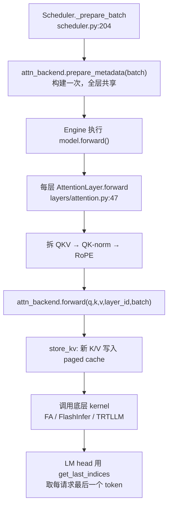

# Attention 后端与核心算子

## 本章导读

Attention 是 LLM 前向计算中计算量最大、也最考验工程功力的一块。在 mini-sglang 中，这一层被封装成「Attention 后端」子系统：上层模型只看到一个统一的 `forward(q, k, v, layer_id, batch)` 接口，下层却可以插拔三种业界主流的高性能 kernel——FlashAttention、FlashInfer、TensorRT-LLM。

本章你将学到：

- 三种后端如何通过 `BaseAttnBackend` 抽象基类统一接口，又如何用一行字符串 `"fa,fi"` 组合出 prefill/decode 异构后端；
- 每一步前向之前，`prepare_metadata` 如何把调度器给出的变长请求翻译成 kernel 能消费的索引结构（`cu_seqlens`、page table 等），以及 prefill 与 decode 的构建逻辑差在哪；
- ragged（变长打包）+ paged（块表寻址）的调用方式是怎么回事，为什么 decode 和 prefill 天然适合不同的 kernel 形态；
- 为 CUDA Graph 准备的「静态缓冲 + 内容注入」模式是如何在 attention 层落地的。

对应源码文件：

- `python/minisgl/attention/base.py` —— 抽象基类与混合后端
- `python/minisgl/attention/__init__.py` —— 后端注册与工厂
- `python/minisgl/attention/fa.py` —— FlashAttention 后端
- `python/minisgl/attention/fi.py` —— FlashInfer 后端
- `python/minisgl/attention/trtllm.py` —— TensorRT-LLM 后端
- `python/minisgl/attention/utils.py` —— CUDA Graph 静态缓冲
- `python/minisgl/layers/attention.py` —— 模型侧的 Attention 层入口

阅读本章前，建议先读完第 2 章（调度器与 Batch 的构成）和第 3 章（KV Cache 的 page 组织方式），本章会大量引用其中的概念。

## 背景概念

**Prefill 与 decode。** LLM 推理分两个阶段：prefill 阶段一次性处理用户输入的全部 prompt token（可能上千个），decode 阶段每步只算 1 个新 token。两者的计算形态完全不同：prefill 是「多 query 对多 KV」的稠密矩阵乘，算力受限；decode 是「每请求 1 个 query 对全部历史 KV」，瓶颈在搬运 KV cache 的显存带宽。这个差异是本章几乎所有设计取舍的根源。

**Ragged tensor（变长打包）。** 连续批处理下，一个 batch 里各请求的序列长度不一样。朴素做法是把它们 pad 成等长的矩形张量，浪费计算；ragged 做法是把所有 token 首尾相接拼成一维长条，再用一个「前缀和数组」记录每段的边界。这个前缀和数组就是大名鼎鼎的 `cu_seqlens`（cumulative sequence lengths）。例如三个请求各有 2、3、1 个新 token，则 `cu_seqlens_q = [0, 2, 5, 6]`。

**Paged KV cache（分页显存）。** 第 3 章已经讲过：KV cache 不按请求连续分配，而是像操作系统管理内存一样切成固定大小的 page，用一张 page table（块表）把「请求的第 i 个 token」翻译成「物理显存槽位」。attention kernel 读 KV 时必须拿着这张表去「按图索骥」。

**Attention kernel。** 手算 attention 需要 O(n²) 的中间矩阵，FlashAttention 一类的 kernel 通过分块计算和在线 softmax 把显存占用降到线性，是现代推理引擎的标配。但不同 kernel 库（FA、FlashInfer、TRTLLM）的接口风格差异很大，mini-sglang 的第一项工作就是把它们抹平。

## 全景：一步前向中发生了什么

先用一张图建立整体印象。attention 子系统在一步前向中承担三件事：**构建元数据（plan）→ 写入 KV → 计算注意力（run）**：



一个值得立刻记住的设计：**metadata 在调度阶段只构建一次，被模型所有层共享**。`prepare_metadata` 把结果挂在 `batch.attn_metadata` 上（`python/minisgl/core.py:81`），之后每一层的 `forward` 只是读它，不会重复构建。这符合直觉——batch 里有哪些请求、各多长，与「算到第几层」无关。

## 统一抽象：三个后端，一个接口

### 抽象基类

`attention/base.py` 定义了两个抽象，分别对应「数据」和「行为」：

```python
# python/minisgl/attention/base.py:12-34
@dataclass
class BaseAttnMetadata(ABC):
    @abstractmethod
    def get_last_indices(self, bs: int) -> torch.Tensor: ...


class BaseAttnBackend(ABC):
    @abstractmethod
    def forward(
        self, q: torch.Tensor, k: torch.Tensor, v: torch.Tensor, layer_id: int, batch: Batch
    ) -> torch.Tensor: ...

    @abstractmethod
    def prepare_metadata(self, batch: Batch) -> None: ...

    @abstractmethod
    def init_capture_graph(self, max_seq_len: int, bs_list: List[int]) -> None: ...

    @abstractmethod
    def prepare_for_capture(self, batch: Batch) -> None: ...

    @abstractmethod
    def prepare_for_replay(self, batch: Batch) -> None: ...
```

`BaseAttnBackend` 的五个方法可以分成两组：`forward` + `prepare_metadata` 是 eager 路径的日常；后三个 `*_graph` / `*_capture` / `*_replay` 专为 CUDA Graph 服务（第 7 章详述，本章只看 attention 这一侧的配合）。

`BaseAttnMetadata` 只有一个抽象方法 `get_last_indices(bs)`，作用是回答「batch 中第 i 个请求的最后一个 token，在 ragged 输出里排第几」。prefill 的输出包含每个请求的全部新 token，但采样只需要最后一个；这个边界信息恰好只有 attention metadata 知道，所以接口挂在它上面。LM head 端的消费代码在 `python/minisgl/layers/embedding.py:92-94`：

```python
# python/minisgl/layers/embedding.py:92-95
if batch.is_prefill:
    indices = batch.attn_metadata.get_last_indices(bs)
    x = x[indices].contiguous()
```

### 注册表与工厂

三个后端通过 `Registry` 注册，全部惰性 import（`python/minisgl/attention/__init__.py:19-40`）——这样即使你没装 FlashInfer，只要不用 `"fi"` 后端就不会报错。工厂函数支持一个很有表达力的语法：

```python
# python/minisgl/attention/__init__.py:57-66
if "," in backend:
    assert backend.count(",") == 1, "Only one comma is allowed in hybrid backend"
    p_backend, d_backend = backend.split(",", 1)
    if p_backend != d_backend:
        logger.info(f"Using hybrid attention backend: prefill={p_backend}, decode={d_backend}")
        p_backend = create_attention_backend(p_backend, config)
        d_backend = create_attention_backend(d_backend, config)
        return HybridBackend(p_backend, d_backend)
```

命令行传 `--attention-backend fa,fi` 就意味着「prefill 用 FlashAttention、decode 用 FlashInfer」。为什么需要这种组合？因为不同 kernel 各有擅长的战场：FA 系对长序列 prefill 优化得好，而 FlashInfer / TRTLLM 的 decode kernel 对小 batch、短 query 的场景打磨得更细。`HybridBackend` 的实现直白到可爱——按 `batch.is_prefill` 分发：

```python
# python/minisgl/attention/base.py:46-63
def forward(self, q, k, v, layer_id, batch):
    backend = self.prefill_backend if batch.is_prefill else self.decode_backend
    return backend.forward(q, k, v, layer_id, batch)
# ... prepare_metadata 同理；而三个 CUDA graph 方法只转发给 decode_backend，
# 因为只有 decode 走 CUDA graph
```

注意最后一行注释揭示的不对称性：CUDA Graph 相关的三个方法**只转发给 decode 端**。原因在第 7 章展开——decode 的每步计算形状固定（每请求恰好 1 个 token），才能被录制重放；prefill 形状千变万化，录 graph 没有意义。

## 模型侧入口：AttentionLayer

在看后端之前，先看模型这一层把什么交给了后端。`AttentionLayer.forward` 短小精悍：

```python
# python/minisgl/layers/attention.py:47-57
def forward(self, qkv: torch.Tensor) -> torch.Tensor:
    ctx = get_global_ctx()
    q, k, v = qkv.split([self.qo_attn_dim, self.kv_attn_dim, self.kv_attn_dim], dim=-1)
    if self.q_norm is not None:
        self.q_norm.forward_inplace(q.view(-1, self.num_qo_heads, self.head_dim))
    if self.k_norm is not None:
        self.k_norm.forward_inplace(k.view(-1, self.num_kv_heads, self.head_dim))
    q, k = self.rotary.forward(ctx.batch.positions, q, k)
    q = q.view(-1, self.num_qo_heads, self.head_dim)
    o = ctx.attn_backend.forward(q, k, v, self.layer_id, ctx.batch)
    return o.view(-1, self.qo_attn_dim)
```

四个动作，一行一个职责：

1. **拆 QKV**：上一层投影把 Q、K、V 融合成一个大矩阵一次算完（省一次 kernel launch），这里按维度切回三份；
2. **QK-norm**（可选，如 Qwen3）：对 q/k 按 head 做归一化，稳定训练外推；
3. **RoPE**：给 q/k 注入位置信息，用的 `positions` 是调度器在 `_prepare_batch` 里算好的绝对位置（`python/minisgl/scheduler/scheduler.py:207`）；
4. **交给后端**：注意传入的 `q` 已经 view 成 `(total_tokens, num_qo_heads, head_dim)` 的 ragged 三维形状——batch 维度在这里被「拍平」了，段边界信息完全由 metadata 里的 `cu_seqlens_q` 表达。

构造函数里还有一处 TP（张量并行）细节值得瞟一眼：`python/minisgl/layers/attention.py:33-34` 中 q head 按 `tp_size` 均分，kv head 却允许 `allow_replicate=True`——GQA 模型的 kv head 数可能比 GPU 数还少，此时宁可每个 rank 复制一份也不要切分失败。

## Metadata 构建：prefill 与 decode 的分野

这是本章的核心小节。以 FA 后端的 `prepare_metadata` 为例（`python/minisgl/attention/fa.py:67-105`），TRTLLM 后端几乎逐行同构（`trtllm.py:91-129`）。

### 输入：Batch 里的三个长度

metadata 的全部原料来自每个 `Req` 对象的三个属性（`python/minisgl/core.py:40-50`）：

- `device_len`：该请求当前在 GPU 上应有的总长度（prompt + 已生成）；
- `cached_len`：前缀命中 RadixCache、无需重算的 token 数；
- `extend_len = device_len - cached_len`：本步真正要新算的 token 数。prefill 时是「未命中部分的长度」，decode 时恒为 1。

```python
# python/minisgl/attention/fa.py:71-82
seqlens_q = [req.extend_len for req in reqs]
seqlens_k = [req.device_len for req in reqs]
cached_lens = [req.cached_len for req in reqs]
max_seqlen_k = max(seqlens_k)
max_seqlen_q = max(seqlens_q)
CPU_KWARGS = {"device": "cpu", "dtype": torch.int32, "pin_memory": True}

device = self.kvcache.device
cache_seqlens = torch.tensor(seqlens_k, **CPU_KWARGS)
cache_seqlens = cache_seqlens.to(device, non_blocking=True)
cu_seqlens_k = torch.tensor([0] + seqlens_k, **CPU_KWARGS).cumsum_(dim=0)
cu_seqlens_k = cu_seqlens_k.to(device, non_blocking=True)
```

`seqlens_k` 用 `device_len`（**含历史**）而非 `extend_len`，因为 attention 要「看见」全部历史 KV；`seqlens_q` 用 `extend_len`，因为 query 只有新 token。这组张量先在 **pinned CPU 内存**构建，再 `.to(device, non_blocking=True)` 异步拷到 GPU——pinned memory 是 DMA 直达显存的「快速通道」，异步拷贝让 CPU 端的 Python 开销与 GPU 计算重叠。这是推理引擎里成本极低、收益稳定的标准手法。

### `cu_seqlens_q` 的三个分支

接下来是全章最容易看晕的十行：

```python
# python/minisgl/attention/fa.py:84-90
if max_seqlen_q == 1:
    cu_seqlens_q = torch.arange(0, padded_size + 1, device=device, dtype=torch.int32)
elif all(l == 0 for l in cached_lens):  # prefill with no cache hit
    cu_seqlens_q = cu_seqlens_k
else:  # normal extend prefill, with partial cache hit
    cu_seqlens_q = torch.tensor([0] + seqlens_q, **CPU_KWARGS).cumsum_(dim=0)
    cu_seqlens_q = cu_seqlens_q.to(self.kvcache.device, non_blocking=True)
```

三个分支其实是同一个前缀和的三种构造捷径，恰好对应三种执行形态：

| 分支 | 场景 | 为什么可以走捷径 |
|---|---|---|
| `max_seqlen_q == 1` | decode | 每请求恰好 1 个 query，前缀和必然是 `[0,1,2,...,bs]`，一个 `arange` 搞定 |
| `cached_len` 全为 0 | 无缓存命中的 prefill | 没有历史 KV，query 数和 KV 数相等，`cu_seqlens_q` 与 `cu_seqlens_k` 是同一个数组，直接复用，零拷贝 |
| 其余 | 部分命中前缀缓存的 extend | query 是「总长 − 命中长」，两者不同，只能老老实实算一遍 |

这就是「prefill 与 decode metadata 构建差异」的全部实质：**decode 的 ragged 结构是平凡的（等长为 1），可以解析地写出；prefill 必须真的去累加；而命中前缀缓存的 prefill 介于两者之间**。mini-sglang 不混批（一个 batch 只有一个 phase），所以这三个分支互斥，代码非常干净。

### Page table：全局表与后端表的换算

```python
# python/minisgl/attention/fa.py:92-97
page_table = get_global_ctx().page_table
new_page_table = torch.stack(  # NOTE: global page table treat page_size = 1, we need slice
    [page_table[req.table_idx, : max_seqlen_k : self.page_size] for req in reqs]
)
if self.page_size > 1:
    new_page_table.div_(self.page_size, rounding_mode="floor")
```

这里藏着一个「通用货币」设计：全局 `page_table`（`python/minisgl/core.py:103-104`）**永远以 page_size=1 的语义存「token 序号 → 物理槽位」**，调度器和 cache manager 只认这一种格式。各后端要用更大的 page（比如 16 个 token 一页）时，自己做两步换算：按 `page_size` 步长切片（每页取一个代表元素），再整除把槽位号变成页号。全局格式统一、后端各取所需，换来的是调度层完全不感知后端的 page 粒度。

## forward：先写 KV，再算 attention

三个后端的 `forward` 第一行都是同一句：

```python
# python/minisgl/attention/fa.py:51-65
metadata = batch.attn_metadata
assert isinstance(metadata, FAMetadata)
self.kvcache.store_kv(k, v, batch.out_loc, layer_id)
return _fa_sgl_impl(
    q=q,
    k_cache=self.kvcache.k_cache(layer_id),
    v_cache=self.kvcache.v_cache(layer_id),
    page_table=metadata.page_table,
    cache_seqlens=metadata.cache_seqlens,
    cu_seqlens_q=metadata.cu_seqlens_q,
    cu_seqlens_k=metadata.cu_seqlens_k,
    max_seqlen_q=metadata.max_seqlen_q,
    softmax_scale=self.scale,
    version=self.version,
)
```

**为什么先把新 K/V 写进 cache，再从 cache 里读出来算？** 因为新 token 的 self-attention 需要看到自己；与其让 kernel 同时接受「历史 cache + 新 K/V」两路输入，不如先按 `out_loc` 把新 K/V 落进 paged cache，然后 kernel 只面对一种数据源——paged cache。新 token 是否会错误地「看到」同一请求里排在自己后面的 token？不会，kernel 内部的 causal mask（`causal=True`）保证第 i 个 query 只关注前 i 个 KV。`store_kv` 最终调到 `kvcache/mha_pool.py:45-56` 的 `store_cache` JIT kernel，按 token 位置逐个写入。

随后便是「ragged q + paged KV」的标准调用形态：q 是 `(total_tokens, heads, head_dim)` 的 ragged 张量，由 `cu_seqlens_q` 界定；KV cache 由 `page_table` + `cache_seqlens` 寻址。FA 后端调的是 `sgl_kernel.flash_attn.flash_attn_with_kvcache`（`fa.py:165-182`），并按硬件自动选版本——Blackwell（SM100）用 FA4，否则 FA3（`fa.py:46`）。

### TRTLLM 后端：prefill/decode 显式分家

TRTLLM 后端把「两个阶段用不同 kernel」这件事写在了明面上：

```python
# python/minisgl/attention/trtllm.py:60-89（节选）
if batch.is_prefill:
    return trtllm_batch_context_with_kv_cache(
        query=q, kv_cache=kv_cache,
        block_tables=metadata.page_table,
        seq_lens=metadata.cache_seqlens,
        max_q_len=metadata.max_seqlen_q,
        cum_seq_lens_q=metadata.cu_seqlens_q,
        cum_seq_lens_kv=metadata.cu_seqlens_k,
        bmm1_scale=self.scale, bmm2_scale=1.0, kv_layout="NHD", ...
    )
else:
    return trtllm_batch_decode_with_kv_cache(
        query=q, kv_cache=kv_cache,
        block_tables=metadata.page_table,
        seq_lens=metadata.cache_seqlens,
        max_seq_len=metadata.max_seqlen_k,
        bmm1_scale=self.scale, bmm2_scale=1.0, kv_layout="NHD", ...
    )
```

对比可见：prefill kernel 需要 `cum_seq_lens_q`（因为各请求 query 数不等）和 `max_q_len`；decode kernel 连这两个参数都不要——它假设每请求恰好 1 个 query，接口因此更窄、内部可以做得更激进（例如专门针对「读一条长 KV、点积一个向量」的访存模式做 split-K 并行）。**这就是「为什么 decode 和 prefill 要用不同 kernel 调用形态」的答案：约束越强，kernel 越专，性能越高。** decode 每步只算 1 个 token 却要读全部历史 KV，任何为通用情形付出的开销在这里都是纯浪费。

### FlashInfer 后端：plan/run 两段式

FlashInfer 的风格与前两者都不同：它不是「一次调用算完」，而是 **plan（规划）→ run（执行）** 两段式。plan 在 host 上根据序列长度做负载均衡划分、预计算辅助张量，run 才真正启动 GPU kernel。因此 `FIMetadata` 要携带 CPU/GPU 双份元数据，连张量住在哪里都要逐一断言：

```python
# python/minisgl/attention/fi.py:65-74
def __post_init__(self) -> None:
    assert self.page_size == 1, "Currently only page_size=1 is supported."
    assert (
        self.cu_seqlens_k_cpu.is_cpu
        and self.cu_seqlens_q_cpu.is_cpu
        and self.cu_seqlens_q_gpu.is_cuda
        and self.indices.is_cuda
        ...
    )
```

plan 被刻意推迟到首次 forward 时才执行（惰性初始化），并且用一个 CUDA event 做串行化保护：

```python
# python/minisgl/attention/fi.py:129-132
metadata.initialized = True
# FlashInfer planning reuses a pinned host staging buffer and launches an
# async H2D copy. Wait here before the next plan mutates that host buffer.
self.last_event.synchronize()
```

这个 `last_event` 防的是一个真实存在的坑：FlashInfer 的 plan 会复用一块 pinned host 中转缓冲并发起异步 H2D 拷贝；如果上一次拷贝还没完成，下一次 plan 就往这块缓冲里写，旧数据就被覆写了。先 `synchronize()` 等上次拷贝落地、plan 完再 `record()`（`fi.py:166`），是最朴素也足够用的解法——在 overlap scheduling（CPU 调度与 GPU 计算重叠）的场景下，这类「host 缓冲复用竞争」是常客。

另外两个 FI 特有的细节：

- **page_size 锁死为 1**（`fi.py:57`）。于是 paged 退化成 ragged：`forward` 里把 KV cache view 成 `(-1, 1, H, D)`（`fi.py:179-180`），page table 直接拍平当 indices 用（`fi.py:215`）。`last_page_len` 也因此恒为全 1，由一个按 2 的幂扩容的 pinned 缓存张量提供（`_get_ones_cpu`，`fi.py:168-174`）。
- **decode 是否用 tensor core 由 GQA 倍数决定**（`fi.py:236-242`）：`num_qo_heads // num_kv_heads >= 4` 才启用。GQA 倍数大意味着多个 q head 共享一份 KV，tensor core 版本的 kernel 才能把这份共享读出红利。

## CUDA Graph 一侧的配合

第 7 章会完整讲 CUDA Graph，这里只交代 attention 子系统承担的义务：**graph 录制后，kernel 抓的是固定显存地址；replay 时只能改这些地址里的内容，不能换指针**。为此 `attention/utils.py` 提供了一组静态缓冲：

```python
# python/minisgl/attention/utils.py:14-23
@classmethod
def create(cls, max_bs: int, max_seq_len: int, device: torch.device, **kwargs):
    return cls(
        seq_lens=torch.ones((max_bs,), dtype=torch.int32, device=device),
        positions=torch.zeros((max_bs,), dtype=torch.int32, device=device),
        cu_seqlens_k=torch.arange(0, max_bs + 1, dtype=torch.int32, device=device),
        cu_seqlens_q=torch.arange(0, max_bs + 1, dtype=torch.int32, device=device),
        page_table=torch.zeros((max_bs, max_seq_len), dtype=torch.int32, device=device),
        **kwargs,
    )
```

捕获（capture）阶段，`prepare_for_capture` 构造的 metadata 直接引用这些静态缓冲的切片（`fa.py:115-126`），graph 录下的 kernel 因此指向固定地址。回放（replay）阶段，scheduler 已经按普通 eager 路径构建了一份临时 metadata，`prepare_for_replay` 把其中的值逐字段 `copy_` 进静态缓冲：

```python
# python/minisgl/attention/fa.py:128-136
metadata, bs = batch.attn_metadata, batch.padded_size
assert isinstance(metadata, FAMetadata)
assert self.capture is not None and bs in self.capture_bs
# cu_seqlens_q is always [0, 1, 2, ..., bs] for decode (i.e. no-op)
table_len = metadata.page_table.size(1)
self.capture.cu_seqlens_k[: bs + 1].copy_(metadata.cu_seqlens_k)
self.capture.seq_lens[:bs].copy_(metadata.cache_seqlens)
self.capture.page_table[:bs, :table_len].copy_(metadata.page_table)
```

`cu_seqlens_q` 不需要拷贝——decode 时它恒为 `[0..bs]`，静态缓冲初始化时就是这个值（注意这里的注释与 `prepare_metadata` 第一分支遥相呼应）。记住一句话就能理解整个模式：**graph 冻结的是指针，不是值**。

FlashInfer 的 replay 路径略有不同：它换成每个 batch size 专属的 graph wrapper 并重新 plan（`fi.py:266-271`），因为 plan 会直接读静态 `indptr/indices/last_page_len` 缓冲里刚被更新的值——两段式接口在这里反而自然地嵌进了 graph 模型。

## 设计亮点

- **抽象边界画在「metadata + forward」上**。三个后端索引结构一致（FA 与 TRTLLM 的 metadata 字段完全相同），模型层对后端零感知；换后端只改一个命令行参数。教学项目选 FA/TRTLLM 逐行复制而非再抽一层公共基类，也是一种诚实的取舍——抽象的成本要自己读两遍代码才能体会。
- **全局 page table 以 page_size=1 为通用货币**。调度层与 cache 管理层只维护一种格式，后端各自做步长切片 + 整除换算（`fa.py:92-97`）。FA/TRTLLM 因而能支持 page_size>1，FI 锁死 1，互不阻塞。
- **pinned host + non_blocking H2D 贯穿所有 metadata 构建**。Python 循环开销与 GPU 计算重叠，几乎是零成本的提速。
- **惰性 plan + event 串行化**（FI 后端）。把 FlashInfer 的 host 侧开销藏到首次 forward，用一把「事件锁」解决 pinned 缓冲复用竞争——overlap scheduling 下典型坑的极简解法。
- **HybridBackend 的组合式分发**。一行字符串拼出异构后端，CUDA Graph 方法只挂 decode 端——组合模式在 infra 代码里的教科书式用例。
- **RadixCache 接口最小化**。attention 子系统只消费 `cached_len` 一个整数就能感知前缀命中（`cu_seqlens_q` 第三分支的唯一触发条件），缓存系统本身完全解耦。

## 常见困惑

**Q1：为什么 forward 里先 `store_kv` 再读 cache 算 attention，多写一次不浪费吗？**

不多余。新 token 的 K/V 必须先落进 paged cache，kernel 才能把「历史 + 当前」当成同一种数据源统一处理，省掉一路「新 KV」输入。写入按 `out_loc` 逐个 token 进行，成本是 O（新 token 数），远小于 attention 本身。正确性由 kernel 的 causal mask 兜底——新写入的「未来」位置不会被同一请求里靠前的 query 看到。

**Q2：`cu_seqlens_q` 三个分支看不懂，到底在优化什么？**

它们构造的是同一个东西（query 长度的前缀和），只是按场景找捷径：decode 时答案解析可知（`arange`）；无命中 prefill 时与 `cu_seqlens_k` 相同（白捡）；只有「部分命中前缀缓存」的 extend 才需要真算。记住 decode 每请求恒 1 个 query，一切就通了。

**Q3：全局 `page_table` 和后端 metadata 里的 `page_table` 为什么不是一回事？**

全局表是 token 级粒度（page_size=1 语义）的「通用货币」，scheduler 和 cache manager 通用；后端要 page_size>1 时自己做步长切片加 `floor` 整除（`fa.py:93-97`，NOTE 注释就写在那里）。一层只维护一份真相，换算留给消费方。

**Q4：为什么 `prepare_for_capture` 和 `prepare_for_replay` 是两个方法，不能合并吗？**

不能。capture 是「录制」：必须把 metadata 绑定到固定显存地址，让 graph 录下指针；replay 是「播放」：指针已冻结，只能把 eager 路径算出的新值 `copy_` 进旧地址。一个管「绑定地址」，一个管「注入内容」，职责天然分离。

**Q5：FlashInfer 既然也要自己写 CUDA Graph wrapper，为什么还说它接口是「两段式」？**

两段式指 plan/run 分离：plan 在 host 上做负载划分并把结果异步送上 GPU，run 是纯 device 执行。graph 模式下只是把 plan 的输入缓冲也换成静态地址，replay 时换 wrapper 重新 plan——plan 在 graph 外执行，run 在 graph 内重放，两段式边界反而更清晰了。

## 回顾与动手

本章要点：

- attention 子系统三步走：`prepare_metadata`（调度后一次，全层共享）→ `store_kv`（每层先写新 KV）→ kernel 调用（ragged q + paged KV）；
- `cu_seqlens_q` 的三分支浓缩了 prefill/decode/extend 三种形态的构建差异；
- 全局 page table 统一为 page_size=1 语义，后端各自换算；
- decode 与 prefill 使用不同 kernel 形态，本质是「约束越强、kernel 越专、性能越高」；
- CUDA Graph 配合 = 静态缓冲绑定 + `copy_` 注入，graph 冻结指针而非值。

动手实验（建议在单卡环境、FA 后端下进行）：

1. **追踪 metadata 三分支**：在 `python/minisgl/attention/fa.py:84` 的三个分支里各加一行 `logger.info(...)`（打印 `max_seqlen_q` 和 `cached_lens`），然后分别跑：一条全新请求（应走分支二）、 decode 几步（分支一）、同一条前缀相近的请求连发两次触发 RadixCache 命中（分支三）。观察日志与预期是否吻合。
2. **验证 `get_last_indices`**：在 `python/minisgl/layers/embedding.py:93` 后加一行断言：`assert (indices == batch.attn_metadata.cu_seqlens_q[1:1+bs] - 1).all()` 并打印 indices，用一个 3 请求、长度各不相同的 batch 手动核对 ragged 边界。
3. **对比后端**：用 `--attention-backend fa` 和 `--attention-backend trtllm` 各跑一次同一 prompt 的离线 benchmark（`benchmark/offline/`），观察输出 token 完全一致（数值上因 kernel 实现可能有浮点级差异）、吞吐不同，直观感受「接口统一、实现可换」。
