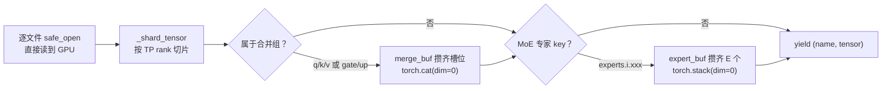

# 模型实现与权重加载

## 本章导读

前面几章讲的是引擎的"血管"——调度、KV Cache、Attention、CUDA Graph；本章讲的是"肌肉"：模型本身是怎么定义、怎么被装进引擎里的。

mini-sglang 没有用 PyTorch 的 `nn.Module`，而是自己造了一套约 100 行的轻量算子框架 `BaseOP`，在这套框架上组织出 Llama / Qwen2 / Qwen3 / Qwen3-MoE / Mistral 五个模型。你会看到一件有意思的事：五个模型文件每个只有 85 行左右，而且结构几乎一模一样——差异全部收敛到几个共享积木的开关参数上。

本章你将学到三件事：

1. **模型代码的组织方式**：`DecoderLayer → Model → ForCausalLM` 三层嵌套，以及为什么模型的 `forward()` 没有参数；
2. **权重加载流水线**：HuggingFace 的 safetensors checkpoint 如何被流式读出，经过「TP 切分 → 投影合并 → 专家堆叠」三级变换，严丝合缝地装进自定义层；
3. **MoE 的 fused 实现**：路由、排序对齐、分组 GEMM 如何用尽量少的 kernel 完成，以及 mini-sglang 对 SGLang 做了哪些简化（包括几处从上游移植后留下的预留/死代码，我们会如实指出）。

涉及的主要源码文件：

| 文件 | 内容 |
|---|---|
| `python/minisgl/models/llama.py` 等 5 个模型文件 | 三层模型结构 |
| `python/minisgl/models/utils.py` | 共享积木 `GatedMLP` / `MoEMLP` / `RopeAttn` |
| `python/minisgl/models/weight.py` | 权重加载流水线 |
| `python/minisgl/layers/base.py`、`linear.py`、`norm.py`、`embedding.py`、`moe.py` | 算子框架与基础层 |
| `python/minisgl/moe/fused.py`、`kernel/triton/fused_moe.py` | fused MoE 后端与 Triton kernel |

## 背景概念

正式进入源码前，先补齐几个初学者未必熟悉的概念。

**张量并行（Tensor Parallelism, TP）**。单卡放不下或跑不快时，把一个矩阵乘法切到多张卡上算。以线性层 `y = xW` 为例（W 形状 `[out, in]`）：沿 `out` 维切开叫**列并行**（每张卡算输出的一部分，互不通信）；沿 `in` 维切开叫**行并行**（每张卡算出一个部分和，最后做一次 all_reduce 相加）。理解本章只需要记住这个对称结构：q/k/v、gate/up 用列并行，o_proj、down_proj 用行并行。

**safetensors**。HuggingFace 模型的标准权重格式，本质是「key → tensor」的扁平字典文件，支持按需 mmap 读取单个 tensor，不用一次性加载整个文件。本章的加载器正是利用这一点做流式加载。

**MoE（Mixture of Experts，混合专家）**。把每个 Transformer 层的 MLP 换成 E 个「专家」MLP，每个 token 先经过一个小型「路由器」（gate）算出对 E 个专家的打分，只挑分数最高的 top-k 个专家来算，最后把 k 份输出按分数加权求和。Qwen3-MoE 就是这种结构。计算上的难点在于：不同 token 被派给不同专家，没法直接用一次普通 GEMM 完成，需要特殊的分组 GEMM（grouped GEMM）。

**meta 设备**。PyTorch 提供的一种「虚拟设备」，在上面创建 tensor 只记录形状和数据类型，不分配任何显存。mini-sglang 先在 meta 设备上把整棵模型树搭出来（免费、瞬间完成），再流式读入真实权重逐一替换。这样做还有两个好处：构造期间就能算出精确的参数量，且天然配合 CUDA Graph 的固定地址要求。

**CUDA Graph 与无参 forward**。CUDA Graph 会把一段 kernel 序列「录」下来反复重放，前提是每次重放时函数签名和内存地址完全不变。所以 mini-sglang 的模型 forward 不接收任何参数，输入数据通过全局单例 `Context` 注入——每步只需把新 batch 原地拷进固定 buffer。这一点贯穿本章，先记住，后面会反复遇到。

## 模型的三层组织：DecoderLayer / Model / ForCausalLM

mini-sglang 支持五种模型架构，注册表在 `models/register.py` 里（`python/minisgl/models/register.py:5`）：

```python
_MODEL_REGISTRY = {
    "LlamaForCausalLM": (".llama", "LlamaForCausalLM"),
    "Qwen2ForCausalLM": (".qwen2", "Qwen2ForCausalLM"),
    "Qwen3ForCausalLM": (".qwen3", "Qwen3ForCausalLM"),
    "Qwen3MoeForCausalLM": (".qwen3_moe", "Qwen3MoeForCausalLM"),
    "MistralForCausalLM": (".mistral", "MistralForCausalLM"),
    "Mistral3ForConditionalGeneration": (".mistral", "MistralForCausalLM"),
}
```

引擎启动时，`create_model` 取 HF config 里 `architectures[0]` 查表、懒加载对应模块并实例化（`python/minisgl/models/__init__.py:7`）。注意 `Mistral3ForConditionalGeneration` 直接复用了 `MistralForCausalLM`——多模态壳子里的文本模型和纯文本版是同一个。

五个模型文件的结构完全同构，我们以 `llama.py` 为例逐层看。

### 第一层：DecoderLayer

`LlamaDecoderLayer`（`python/minisgl/models/llama.py:18`）就是一个标准 pre-norm Transformer 块：两个 RMSNorm、一个注意力、一个 MLP。它的 forward 值得细看：

```python
def forward(
    self,
    x: torch.Tensor,
    residual: torch.Tensor | None = None,
) -> Tuple[torch.Tensor, torch.Tensor]:
    x, residual = self.input_layernorm.forward(x, residual)
    x = self.self_attn.forward(x)
    x, residual = self.post_attention_layernorm.forward(x, residual)
    x = self.mlp.forward(x)
    return x, residual
```

（`python/minisgl/models/llama.py:33`）

初看会觉得奇怪：为什么返回两个 tensor？MLP 的输出怎么不加回残差就返回了？这正是 mini-sglang 的「融合残差」写法，本章后面专门讲，这里先记住：**残差加法被推迟到了下一层的 norm 里**。

### 第二层：Model

`LlamaModel`（`python/minisgl/models/llama.py:46`）把词表 embedding、N 个 DecoderLayer、最终 norm 串起来：

```python
def forward(self, input_ids: torch.Tensor) -> torch.Tensor:
    x = self.embed_tokens.forward(input_ids)
    residual: torch.Tensor | None = None
    for layer in self.layers.op_list:
        x, residual = layer.forward(x, residual)
    return self.norm.forward(x, residual)[0]
```

（`python/minisgl/models/llama.py:60`）

第一层的 `residual` 是 `None`，最后一层的残差加由 `self.norm` 收尾，取返回值第 0 个元素就是每个 token 的最终隐状态。

### 第三层：ForCausalLM

`LlamaForCausalLM`（`python/minisgl/models/llama.py:68`）在最外层挂上 `lm_head`，把隐状态映射成词表上的 logits：

```python
def forward(self) -> torch.Tensor:
    output = self.model.forward(get_global_ctx().batch.input_ids)
    logits = self.lm_head.forward(output)
    return logits
```

（`python/minisgl/models/llama.py:79`）

注意它的签名——**没有任何参数**。输入 `input_ids` 从全局单例 `get_global_ctx().batch` 里取。这就是前面背景里说的 CUDA Graph 契约：`Engine.forward_batch`（`python/minisgl/engine/engine.py:191`）先用 `with self.ctx.forward_batch(batch)` 把 batch 注入全局上下文，然后直接调 `self.model.forward()` 或重放 CUDA Graph，函数签名从头到尾不变。

### 五个模型的差异只有几行

五个模型文件的差异，全部收敛到共享积木 `RopeAttn` / MLP 的构造开关上（积木本体在 `python/minisgl/models/utils.py`）：

| 模型 | 注意力差异 | MLP |
|---|---|---|
| Llama | 默认：无 bias、无 QK-norm | `GatedMLP` |
| Qwen2 | `has_attn_bias=True`（Qwen2 的 QKV 投影带 bias） | `GatedMLP` |
| Qwen3 | `has_qk_norm=True`（Q/K 各加一个小 RMSNorm） | `GatedMLP` |
| Qwen3-MoE | `has_qk_norm=True` | `MoEMLP` |
| Mistral | 默认 | `GatedMLP` |

比如 Qwen3-MoE 与 Qwen3 的 DecoderLayer 差别仅一行（`python/minisgl/models/qwen3_moe.py:20`）：MLP 从 `GatedMLP` 换成 `MoEMLP`。这是一种非常「教学友好」的组织：公共结构只写一遍，模型特有行为用开关表达。

## BaseOP：一个 100 行的算子框架

所有模型组件的基类是 `BaseOP`（`python/minisgl/layers/base.py:15`）。它不是 `nn.Module`，就是个普通 Python 对象，只做两件事：递归收集参数、按名字替换参数。

`state_dict` 的实现直白到可爱（`python/minisgl/layers/base.py:19`）：

```python
def state_dict(self, *, prefix: str = "", result: _STATE_DICT | None = None) -> _STATE_DICT:
    result = result if result is not None else {}
    for name, param in self.__dict__.items():
        if name.startswith("_"):
            continue
        if isinstance(param, torch.Tensor):
            result[_concat_prefix(prefix, name)] = param
        elif isinstance(param, BaseOP):
            param.state_dict(prefix=_concat_prefix(prefix, name), result=result)
    return result
```

规则就三条：遍历 `self.__dict__`；`_` 开头的属性跳过（所以 RotaryEmbedding 的 `_cos_sin_cache` 不会被当参数收集）；tensor 直接登记，`BaseOP` 子对象递归，key 用属性名按 `.` 拼接。于是 `model.layers.0.self_attn.qkv_proj.weight` 这样的名字是**由属性名自动生成的**——mini-sglang 刻意让属性命名与 HuggingFace checkpoint 的命名保持一致，这是后面权重加载能「对上号」的根基。

`load_state_dict` 是逆操作（`python/minisgl/layers/base.py:32`）：从 dict 里 `pop` 出同名 tensor，**断言 shape 和 dtype 一致后，直接 `setattr` 整体替换属性**（`base.py:43-46`）。因为模型是在 meta 设备上构造的，`torch.empty` 出来的「空壳」参数就在这里被真实权重换掉。顶层调用结束后 dict 必须为空，否则抛 `RuntimeError`（`base.py:52-53`）——多出来的 key 说明 checkpoint 和模型定义不匹配，宁可报错也不静默忽略。

框架里还有两个配角：

- `StateLessOP`（`base.py:56`）：无参数算子的基类，如 `AttentionLayer`、`RotaryEmbedding`，state_dict 恒为空；
- `OPList`（`base.py:77`）：包装 Python list 的容器。为什么需要它？因为 `state_dict` 只递归 `BaseOP` 属性，普通 list 里的层会被静默漏掉。`OPList` 把 list 包成 BaseOP，让 `layers.0.xxx`、`layers.1.xxx` 这样的 key 能递归生成。

这套设计的代价也明显：没有 hook、没有 PyTorch 生态。但作为教学项目，100 行能讲清楚的框架远好过 `nn.Module` 的注册魔法。

## 融合残差：RMSNormFused

现在回来解开 DecoderLayer 返回 `(x, residual)` 的悬念。关键在 `RMSNormFused`（`python/minisgl/layers/norm.py:23`）：

```python
def forward(
    self, x: torch.Tensor, residual: torch.Tensor | None = None
) -> Tuple[torch.Tensor, torch.Tensor]:
    if residual is None:
        return self.rmsnorm(x, self.weight, self.eps), x
    self.fused_add_rmsnorm(x, residual, self.weight, self.eps)
    return x, residual
```

flashinfer 的 `fused_add_rmsnorm` 一个 kernel 原地完成两步：`residual += x` 和 `x = rmsnorm(residual)`。于是整条链路变成接力赛：MLP 输出 `x` 不急着加回残差，而是把 `residual` 传到下一层，由下一层的 `input_layernorm` 顺手完成。每个 DecoderLayer 因此省掉了两次独立的 elementwise 加法 kernel，而且整条链路没有任何动态 shape 分支，对 CUDA Graph 天然友好。

第一层的 `residual` 是 `None`，走普通 `rmsnorm` 分支；最后由 `LlamaModel.norm` 完成最后一次融合并只取归一化结果。读者可以自己动手验证：把 `(x, residual)` 打出来逐层跟踪，会发现数学上等价于标准的 `x = x + attn(norm(x)); x = x + mlp(norm(x))`。

## 权重加载流水线：shard → merge → stack

这是本章最精彩的部分。目标：把 HF checkpoint 里「q/k/v 分开、专家按编号分散」的权重，变成运行时「qkv 合并、专家堆叠成三维张量」的形态，并且**边读边转，峰值内存只有一个 tensor 的量级**。

入口 `load_weight` 是个生成器（`python/minisgl/models/weight.py:75`），逐个 yield `(name, tensor)`，tensor 已经完成所有变换并且已经在 GPU 上：



### 第一级：TP 切分 `_shard_tensor`

`_shard_tensor`（`python/minisgl/models/weight.py:34`）按 key 的后缀决定怎么切：

- `.q_proj/.k_proj/.v_proj/.gate_proj/.up_proj`：沿 dim 0（输出维）`chunk(n)[r]`——对应列并行；
- `.o_proj/.down_proj`：沿 dim 1（输入维）切——对应行并行；
- `lm_head`/`embed_tokens`：按 `div_ceil` 把词表切成 `n` 份（`weight.py:45-50`），与 `VocabParallelEmbedding` 的分词表约定严格一致；
- 其余（norm 权重等）：原样返回，全 rank 复制。

有一个隐晦但重要的特例（`weight.py:37-41`）：当 **KV head 数小于 TP 数**时（小模型配大 TP），K/V 不切片而是**按头复制**：

```python
if is_kv_proj and num_kv_heads is not None and num_kv_heads < n:
    head_dim = value.shape[0] // num_kv_heads
    head_idx = r * num_kv_heads // n
    return value[head_idx * head_dim : (head_idx + 1) * head_dim].clone()
```

`head_idx = r * num_kv_heads // n` 让多个 rank 映射到同一个头。这与构造侧 `div_even(..., allow_replicate=True)`（`python/minisgl/layers/linear.py:83`）是配套的——**构造时声明的尺寸和加载时切出的尺寸必须严格一致**，这是全代码库最隐蔽的一处不变量，KV cache 容量估算（`python/minisgl/engine/engine.py:153`）用的也是同一套语义。

### 第二级：投影合并

checkpoint 里 q、k、v 是三个独立 tensor，运行时却是一个 `qkv_proj`。合并规则写在常量表里（`python/minisgl/models/weight.py:17`）：

```python
_MERGE_GROUPS = {
    ".q_proj": (".qkv_proj", ("q", "k", "v")),
    ".k_proj": (".qkv_proj", ("q", "k", "v")),
    ".v_proj": (".qkv_proj", ("q", "k", "v")),
    ".gate_proj": (".gate_up_proj", ("gate", "up")),
    ".up_proj": (".gate_up_proj", ("gate", "up")),
}
```

加载循环里，属于合并组的 tensor 先进 `merge_buf`，**攒齐一个组的所有槽位才 `torch.cat(parts, dim=0)` yield 出去**（`weight.py:100-109`）。这样运行时一次 GEMM 同时算出 q/k/v（比三次小 GEMM 高效），attention 里再按 `[qo_dim, kv_dim, kv_dim]` split 回去（`python/minisgl/layers/attention.py:49`）。

**槽位顺序就是 `cat` 的顺序**，它必须和 split 的切片顺序一致——`("q", "k", "v")` 这个约定写死在 `weight.py:18` 和 `attention.py:49` 两处，是正确性的关键。

### 第三级：专家堆叠

MoE 模型的 checkpoint 把每个专家存成独立的 key，如 `model.layers.0.mlp.experts.5.gate_up_proj.weight`。正则 `_EXPERT_PATTERN`（`weight.py:31`）识别这种 key，`_get_expert_stack_info` 把它映射成「打包 key + 专家编号」（`weight.py:63-72`）。加载侧把同一打包 key 的 E 个 tensor 攒齐后 `torch.stack(experts, dim=0)`（`weight.py:111-119`）。

注意顺序：MoE 的 gate/up **先经过第二级合并成 `gate_up_proj`，再在第三级按专家堆叠**。最终 `model.layers.N.mlp.experts.gate_up_proj` 的形状是 `[E, 2·(I/tp), H]`，正好对上 `MoELayer` 里声明的打包权重（`python/minisgl/layers/moe.py:34-43`）。

### 流水线的外围细节

几个值得知道的工程细节：

- `safetensors.safe_open(file, framework="pt", device=str(device))`（`weight.py:90`）直接把 tensor 读到 GPU，CPU 零拷贝；进度条只在 rank 0 显示。
- 多模态模型兼容：跳过 `vision_tower.`/`multi_modal_projector.` 前缀，剥掉 `language_model.` 前缀（`weight.py:93-96`）。
- 排除 `consolidated.safetensors`（`weight.py:83`）——Mistral 官方仓库里有一份重复的全量文件，不排掉会加载两遍。
- 结尾两个 assert（`weight.py:123-124`）保证 merge buffer 和 expert buffer 都清空，防止 checkpoint 缺 tensor 时静默产出形状不对的权重。

引擎侧的收尾在 `Engine._load_weight_state_dict`（`python/minisgl/engine/engine.py:139`）：把 yield 出的 tensor 统一 `.to(self.dtype)` 转成目标精度，组成 dict 交给 `model.load_state_dict`——前面说过，这里会做 key 精确匹配和 shape/dtype 断言，任何对不上都会在启动期立刻爆炸，而不是推理到一半出错。

启动顺序全景（`python/minisgl/engine/engine.py:48-52`）：

```python
set_rope_device(self.device)
with torch.device("meta"), torch_dtype(config.dtype):
    self.model = create_model(config.model_config)
self.model.load_state_dict(self._load_weight_state_dict(config))
```

`set_rope_device` 必须先调用：RoPE 的 cos/sin 缓存依赖真实位置数据，不能在 meta 设备上建，所以 `get_rope` 检测到 meta 设备时会落到预设的真实设备上创建（`python/minisgl/layers/rotary.py:134-142`）。另外 `get_rope` 带 `functools.cache`，所有层共享同一个 RotaryEmbedding 实例。

## 基础层速览

模型积木依赖 `layers/` 下的几个基础层，简要过一遍。

**Linear 家族**（`python/minisgl/layers/linear.py`）。核心是 `_LinearTPImpl`（`linear.py:13`），记录 `full_isize/full_osize/local_isize/local_osize` 四个尺寸，权重按 PyTorch 惯例存成 `[local_out, local_in]`。四个子类对应四种并行方式：

- `LinearReplicated`（`linear.py:35`）：全复制，用于 MoE 的路由器 gate；
- `LinearColParallelMerged`（`linear.py:56`）：列并行，`output_sizes` 是 list，一个对象表达「合并投影」，`gate_up_proj` 就是 `[inter, inter]`；
- `LinearQKVMerged`（`linear.py:71`）：local 输出尺寸 = `(local_num_qo + 2·local_num_kv)·head_dim`，KV 侧允许复制；
- `LinearRowParallel` / `LinearOProj`（`linear.py:91-127`）：行并行，forward 里 `F.linear` 之后若 `tp_size > 1` 则 `all_reduce`。

**Embedding 与 LMHead**（`python/minisgl/layers/embedding.py`）。`VocabParallelEmbedding`（`embedding.py:14`）把词表按 TP 均切，forward 用自研 CUDA kernel 查本 rank 的分片（不属于本 rank 的 token 查 0），再 all_reduce 拼出完整结果。`ParallelLMHead`（`embedding.py:45`）继承它做输出投影，有一个连续批处理下的重要优化：prefill 时先用 `get_last_indices` **只取每条序列最后一个 token** 算 logits（`embedding.py:92-95`）——prefill 阶段只有末位 token 的 logits 会被用来采样。此外它处理了 `tie_word_embeddings`：若词表与输出投影共享权重，`load_state_dict` 直接把 `lm_head.weight` 从 dict 里 pop 掉丢弃，forward 改用 embedding 的权重（`embedding.py:59-85`）。

**AttentionLayer**（`python/minisgl/layers/attention.py:18`）。`StateLessOP`，本身无参数。forward 做的事：split 出 q/k/v → 可选 QK-norm（原地）→ RoPE 原地旋转 → 调 `ctx.attn_backend.forward(q, k, v, layer_id, batch)`（`attention.py:56`）。KV cache 读写、page table 查表全部封装在 attention backend 里（第 5 章的内容），模型层完全无感知。

## MoE：从路由器到 fused 分组 GEMM

最后看 MoE 这条链路，它集中体现了 mini-sglang「用最少的 kernel 做完整件事」的风格。

### MoEMLP 与 MoELayer

`MoEMLP`（`python/minisgl/models/utils.py:53`）很简单：`gate`（一个 `LinearReplicated`，全复制的小矩阵）算出 `router_logits`，然后交给 `experts`：

```python
def forward(self, hidden_states: torch.Tensor) -> torch.Tensor:
    num_tokens, hidden_dim = hidden_states.shape
    hidden_states = hidden_states.view(-1, hidden_dim)
    router_logits = self.gate.forward(hidden_states)
    final_hidden_states = self.experts.forward(
        hidden_states=hidden_states, router_logits=router_logits
    )
    return final_hidden_states.view(num_tokens, hidden_dim)
```

`MoELayer`（`python/minisgl/layers/moe.py:9`）持有的不是 Linear 对象，而是两块**打包好的 raw tensor**：`gate_up_proj [E, 2·(I/tp), H]` 和 `down_proj [E, H, I/tp]`。forward 把活委托给 `ctx.moe_backend`（`moe.py:47`），TP>1 时对结果 all_reduce（`moe.py:57-58`）——注意这里暗示了 mini-sglang 的 MoE **只支持 TP 不支持 EP**（专家并行）：每个 rank 持有全部 E 个专家、只切 intermediate 维，本质是把 E 个专家当成 batched GEMM 的 batch 维，省去了 EP 所需的 all-to-all 通信。

后端通过注册表创建（`python/minisgl/moe/__init__.py:19`），目前只有 `"fused"` 一个实现，MoE 模型在 `moe_backend == "auto"` 时自动选它（`python/minisgl/engine/engine.py:231-233`）。

### FusedMoe 主流程

`FusedMoe.forward`（`python/minisgl/moe/fused.py:230`）就两步：`fused_topk` 做路由，`fused_experts_impl` 做计算。

**第一步：路由**（`fused.py:9`）。调 sgl_kernel 的 `topk_softmax`，从 `[M, E]` 的 router logits 里选出每个 token 的 top-k 专家，产出 `[M, topk]` 的权重（fp32）和专家 id（int32）。`renormalize` 为真时再除一次和做归一化。

> 如实指出两处预留/死代码：`fused_topk` 的 `num_token_non_padded` 参数（`fused.py:14, 25-27`，用于把 padding token 的 topk_ids 置 -1）**当前没有任何调用方**，是从 SGLang 移植时保留的接口；另外 `fused.py:22-24` 的 renormalize 在 sgl_kernel 内部其实已经做过一次，这里是冗余但无害的防御。

**第二步：排序对齐** `moe_align_block_size`（`fused.py:31`）。这是理解 fused MoE 的钥匙。问题是：每个 block（GEMM 的基本计算单元）最好只服务一个专家，但 token 是乱序分到各专家的。解决办法是构造一张排序表：

- 把 `[M, topk]` 个分配扁平化成 `M*topk` 个条目，每个条目的值编码为 `token_idx * top_k + slot_idx`；
- 按专家 id 排序，并把每个专家的条目数 padding 到 `BLOCK_SIZE_M` 的倍数（padding 条目标记为 `M*topk`，即「不存在的 token」）。

输出三件套：`sorted_token_ids`（排序后的扁平条目）、`expert_ids`（每个 M-block 属于哪个专家）、`num_tokens_post_padded`。`fused.py:56-69` 的 docstring 里有一个完整的数值例子，强烈建议对照着读一遍——读懂它，后面的 kernel 就水到渠成。

**第三步：两次 GEMM + 求和** `fused_experts_impl`（`fused.py:127`）：

```python
sorted_token_ids, expert_ids, num_tokens_post_padded = moe_align_block_size(
    curr_topk_ids, config["BLOCK_SIZE_M"], E
)
fused_moe_kernel_triton(curr_hidden_states, w1, intermediate_cache1, ...)  # GEMM1: x @ w1
FN_MAP[activation](intermediate_cache1.view(-1, N), intermediate_cache2)   # silu_and_mul
fused_moe_kernel_triton(intermediate_cache2, w2, intermediate_cache3, ...) # GEMM2: act @ w2
moe_sum_reduce_triton(intermediate_cache3, out_hidden_states)              # topk 份求和
```

（节选自 `python/minisgl/moe/fused.py:188-227`）

几个细节：

- 显存复用：一块大 `cache` 同时 view 出 GEMM1 的输出 `cache1 [M, topk, N]` 和 GEMM2 的输出 `cache3 [M, topk, H]`（`fused.py:157-172`）；最终求和**原地写回输入 `hidden_states`**（`fused.py:175`），输入 buffer 直接复用为输出。
- 路由权重的乘法融在第二次 GEMM 里（`MUL_ROUTED_WEIGHT = not apply_router_weight_on_input`，默认在 GEMM2 乘），不用单独的 elementwise kernel。
- 又是一处预留代码：`fused.py:175-186` 有一段 `begin_token_idx/end_token_idx` 的切片逻辑，当前恒为全量区间 `[0, M)`，是 SGLang 支持 DP/EP 分块处理的版本简化后留下的骨架，读者知道它目前不起作用即可。
- Triton 配置不做自动调优，`get_default_config`（`fused.py:92-113`）只有两档：`M <= E`（小 batch，decode 常见）用 `BLOCK_M=16/ BLOCK_N=32/ BLOCK_K=64`，否则 `64/64/32`。这是对 SGLang 调优数据库的有意简化。

### fused_moe_kernel：把 gather/scatter 融进 GEMM

核心 Triton kernel 在 `python/minisgl/kernel/triton/fused_moe.py:50`。它的精妙之处：整个路由过程**没有一次显式的 scatter/gather kernel**，全部融进了一次分组 GEMM：

```python
num_tokens_post_padded = tl.load(num_tokens_post_padded_ptr)
if pid_m * BLOCK_SIZE_M >= num_tokens_post_padded:
    return
offs_token_id = pid_m * BLOCK_SIZE_M + tl.arange(0, BLOCK_SIZE_M)
offs_token = tl.load(sorted_token_ids_ptr + offs_token_id)
token_mask = offs_token < num_valid_tokens
a_ptrs = a_ptr + (offs_token[:, None] // top_k * stride_am + offs_k[None, :] * stride_ak)
off_experts = tl.load(expert_ids_ptr + pid_m)
b_ptrs = b_ptr + off_experts * stride_be + (offs_k[:, None] * stride_bk + offs_bn[None, :] * stride_bn)
```

（`python/minisgl/kernel/triton/fused_moe.py:132-149`）

逐行翻译：

- 超出 padding 后有效区域的 block 直接 return，不做无用功；
- `offs_token // top_k` 从扁平条目还原 token 行号——**A 矩阵的行指针按排序结果重排，gather 融进了取数**；
- `expert_ids[pid_m]` 给出本 block 的专家编号，`off_experts * stride_be` 让 B 指针跳到对应专家的矩阵——**专家选择只是指针偏移**；
- K 维循环用 `tl.dot` 做 fp32 累加（`fused_moe.py:158-181`），`even_Ks` 分支在 K 整除时省掉 mask；
- 若 `MUL_ROUTED_WEIGHT`，用 `topk_weights[offs_token]`（扁平索引直接可用，不用再除）乘累加器（`fused_moe.py:183-185`）；
- 写回时 `c_ptr + stride_cm * offs_token`（`fused_moe.py:191`）——**scatter 也融进了 store**，输出直接落到 `[M, topk, N]` 的对应位置。

grid 是一维的，`pid → (pid_m, pid_n)` 的映射用 `GROUP_SIZE_M` 分组排序以提升 L2 命中（`fused_moe.py:116-124`），这是经典 Triton matmul 技巧。kernel 的 host 端 launcher 在 `python/minisgl/kernel/moe_impl.py:6`，负责组装 stride 和 grid。

最后的 `moe_sum_reduce_kernel`（`fused_moe.py:5`）很朴素：二维 grid，fp32 累加器沿 topk 维把 k 份专家输出相加写回。因为路由权重已在 GEMM2 里乘过，这里就是纯求和。

## 设计亮点

- **BaseOP 而非 nn.Module**：约 100 行实现参数收集/替换、meta 初始化、CUDA Graph 友好的「属性即 tensor」模型，没有任何注册魔法。代价是没有 hook 和 PyTorch 生态，且普通 list 属性会被静默漏掉（所以发明了 `OPList`）。
- **融合残差的 pre-norm**：残差加法消失在下一层的 norm kernel 里，每层省两次 elementwise kernel，且无动态分支、天然兼容 CUDA Graph。
- **三级变换一条流水线**：shard → merge → stack 在流式读取中一次完成，直接读 GPU、峰值内存只有一个 tensor 加一个小合并 buffer。key 变换用后缀匹配而非全名映射表，代码紧凑，但代价是依赖 HF 命名约定——换个命名风格的 checkpoint 就得改常量表。
- **MoE 以 TP 换简单**：不做 EP，把 E 个专家当 batched GEMM 的 batch 维，省掉 all-to-all dispatch/combine 这堆最复杂的分布式代码；代价是每 rank 要存全量专家（只切 I 维），专家多、TP 小时显存效率不如 EP。
- **单 kernel 分组 GEMM**：gather、专家选择、路由权重乘、scatter 全部融进一个 Triton matmul，避免了早期 SGLang 的多轮 scatter/GEMM/gather；配置只留两档固定值，是教学项目对调优数据库的合理取舍。

## 常见困惑

**Q1：为什么 `model.forward()` 没有参数？**
输入（`input_ids`、`positions`、batch 元数据）全在全局单例 `Context` 里。这不是偷懒，而是 CUDA Graph 的硬要求：图捕获后函数签名和内存地址必须固定，每步只需把新 batch 原地拷进固定 buffer 再 replay。注入点就是 `Engine.forward_batch` 里的 `with ctx.forward_batch(batch)`（`python/minisgl/engine/engine.py:193`）。

**Q2：DecoderLayer 返回 `(x, residual)` 两个 tensor，残差去哪了？**
「加」被推迟并融合了。`fused_add_rmsnorm(x, residual, ...)` 一个 kernel 同时完成 `residual += x` 和 `x = rmsnorm(residual)`，所以 MLP 输出不立刻加回残差，而是传到下一层的 `input_layernorm` 里顺带完成；最后一次由 `model.norm(x, residual)[0]` 收尾。数学上与标准 pre-norm 完全等价。

**Q3：checkpoint 里 q/k/v 是分开的，模型里为什么只有一个 `qkv_proj`？**
加载器做了合并打包：攒齐 q/k/v 三个分片后按 `("q","k","v")` 顺序 `torch.cat(dim=0)`。运行时一次 GEMM 同时算出三者（比三次小 GEMM 高效），attention 里再按 `[qo_dim, kv_dim, kv_dim]` split 回去。cat 顺序与 split 顺序的约定写死在 `weight.py:18` 和 `attention.py:49` 两处，必须一致。

**Q4：TP=4 但模型只有 2 个 KV head，怎么办？**
复制而不是切分。构造侧 `div_even(..., allow_replicate=True)` 允许每个 rank 持有一份完整 KV；加载侧 `head_idx = r * num_kv_heads // n` 让多个 rank 映射到同一个头（`weight.py:40`）。构造、加载、KV cache 容量估算三处共用同一套语义，改一处不改其余两处就是 bug。

**Q5：MoE 里 token 是怎么「找到」自己的专家的？**
不靠 Python 循环，靠一张排序表。`moe_align_block_size` 把 `M*topk` 个 (token, expert) 分配按专家排序并 padding 到 block 倍数；Triton kernel 里每个 block 用 `sorted_token_ids // top_k` gather 输入行、用 `expert_ids[pid_m]` 偏移 B 指针选专家矩阵、写回时按 sorted id scatter。整个路由没有一次显式的 scatter/gather kernel，最后由 sum-reduce kernel 把每个 token 的 topk 份输出求和（权重已在 GEMM2 里乘过）。

## 回顾与动手

本章要点：

- 模型按 `DecoderLayer → Model → ForCausalLM` 三层组织，五个模型共享同一套积木，差异只在开关参数；
- `BaseOP` 用 `__dict__` 递归生成与 HF 对齐的参数名，`load_state_dict` 在 meta 空壳上整体替换 tensor；
- 权重加载是一条「shard → merge → stack」的流式流水线，直接读 GPU、峰值内存极小；
- MoE 用「排序表 + 单 kernel 分组 GEMM」完成路由与计算，只支持 TP 不支持 EP；
- 代码里有两处从 SGLang 移植留下的预留路径（`num_token_non_padded` 参数、token 切片骨架），目前不起作用，阅读时不必困惑。

动手实验：

1. **跟踪权重改名**：在 `load_weight`（`python/minisgl/models/weight.py:121`）的 `yield` 前加一行 `print(name, tensor.shape)`，加载一个小模型（如 `Qwen/Qwen3-0.6B`），对照 HF 网页上的 checkpoint key 列表，亲眼确认 q/k/v 合并、命名对齐的全过程。MoE 模型（如 `Qwen/Qwen3-30B-A3B`）还能观察到专家堆叠后的 `[E, 2I, H]` 形状。
2. **验证残差融合的等价性**：在 `LlamaDecoderLayer.forward` 里把 `x, residual` 的逐层值存下来，与手算的 `x + attn(norm(x)) + mlp(norm(...))` 对比，确认 fused 写法数学等价（注意浮点误差）。
3. **可视化 MoE 排序表**：写个脚本单独调用 `moe_align_block_size`，用 `fused.py:56-69` docstring 里的例子（`topk_ids=[[2,3,4],[1,2,4],[1,3,4],[1,2,3]]`，`block_size=4`，`num_experts=4`），打印 `sorted_token_ids` 和 `expert_ids`，验证输出是否为 `[3,6,9,12,0,4,10,12,1,7,11,12,2,5,8,12]`。改一改 `block_size` 再看 padding 怎么变。
