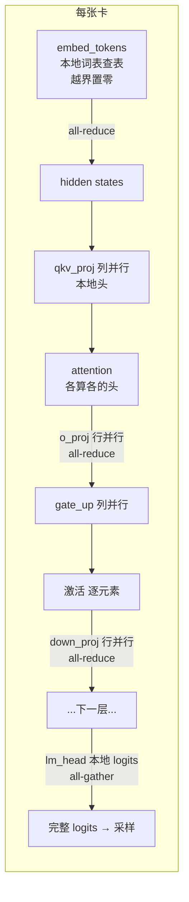

# 分布式与张量并行

## 本章导读

前面几章我们都在单张 GPU 的世界里打转：一个进程、一张卡、装下整个模型。但真实的模型动辄几百 GB 权重，一张卡根本装不下；即便装得下，单卡的算力和显存带宽也会成为吞吐瓶颈。**张量并行（Tensor Parallelism, TP）** 是推理引擎最常用的横向扩展手段：把同一个模型的权重矩阵切开，每张卡只持有一片，前向计算时在关键位置通过 NCCL 集合通信把各卡的部分结果拼回完整结果。

本章你将学到：

- mini-sglang 如何用 `multiprocessing` 启动 TP 进程组，每个进程如何拿到自己的"身份"（rank）；
- NCCL 通信是如何初始化和封装的——包括 mini-sglang 自己写的轻量 NCCL 封装（PyNCCL）；
- all-reduce / all-gather 这两个集合通信操作分别出现在前向的哪些位置、为什么恰好在那里；
- Megatron 式的权重切分：ColumnParallel（列并行）与 RowParallel（行并行）到底切的是什么维度。

对应的主要源码文件：

- `python/minisgl/server/launch.py` — TP 进程启动
- `python/minisgl/distributed/info.py`、`python/minisgl/distributed/impl.py` — TP 身份与通信抽象层
- `python/minisgl/kernel/pynccl.py` + `python/minisgl/kernel/csrc/src/pynccl.cu` — 自定义 NCCL 封装
- `python/minisgl/engine/engine.py` — Engine 中的通信初始化
- `python/minisgl/layers/linear.py`、`python/minisgl/layers/embedding.py` — TP 线性层与词表并行
- `python/minisgl/models/weight.py` — 权重加载时的切分
- `python/minisgl/scheduler/io.py` — 多 rank 下的请求广播

## 背景概念

### 为什么需要张量并行

一个 Llama-3-70B 级别的模型，仅 fp16 权重就要约 140 GB 显存，远超单张消费级甚至数据中心 GPU 的容量。解决办法有两类：

- **流水线并行（Pipeline Parallelism）**：按层切，前几层放卡 0，后几层放卡 1。实现简单，但推理时延敏感场景下气泡（bubble）明显，交互效率低。
- **张量并行（Tensor Parallelism）**：把每一层的权重矩阵横向/纵向切开，每张卡算整层的一部分，层与层之间不做拆分。所有卡同时算同一批 token，算完一层用通信把结果合起来。

打个比方：TP 就像让 N 个人合算一张巨大的乘法表——每人算其中一列，算完后大家凑在一起把结果对齐，再进入下一张表。mini-sglang 只实现了 TP，且只支持单机多卡（`distributed_addr` 硬编码为 `tcp://127.0.0.1:2333`，见 `python/minisgl/engine/config.py:54`）。

### 集合通信：all-reduce 与 all-gather

TP 的前向只用到两个**集合通信（collective communication）**原语：

- **all-reduce（求和归约）**：每张卡持有一个 tensor，all-reduce 后每张卡都拿到"所有卡的 tensor 之和"。用于把各卡算出的"部分和"合并成完整结果。
- **all-gather（收集拼接）**：每张卡持有一个 tensor 片段，all-gather 后每张卡都拿到所有片段沿某个维度拼接后的完整 tensor。用于 LM head 把各卡算出的词表分段 logits 拼成完整词表。

底层执行者是 **NCCL**（NVIDIA Collective Communications Library），它专门为 GPU 间的集合通信做了拓扑感知优化（NVLink、PCIe、RDMA）。可以把 NCCL 想象成"GPU 之间的微信群发"：一条调用，所有卡同步完成数据交换。

除了 NCCL 这条 GPU 数据面通道，mini-sglang 还用到 **gloo**（PyTorch 自带的 CPU 后端，跑低频控制任务）和 **ZMQ**（进程间消息队列，跑请求收发）。三条通道各司其职，本章后面会反复强调这一点。

### 列并行与行并行的直觉

线性层 `y = xW`（W 形状 `[in, out]`，PyTorch 中存为 `[out, in]`）有两种切法：

- **列并行（Column Parallel）**：按**输出维**切。每卡持有 W 的 `[out/tp, in]`，输入 x 各卡相同，各自算出输出的一部分分量。**不需要通信**，因为下游如果也是逐分量计算（比如按 attention 头、逐元素激活），可以继续用分片接着算。
- **行并行（Row Parallel）**：按**输入维**切。每卡持有 W 的 `[out, in/tp]`，输入也已被切成 `in/tp`。每卡算出的 y 只是"部分贡献之和"，**必须 all-reduce 求和**才是完整输出。

记忆口诀：**切输出不用通信，切输入要 all-reduce**。一个 Transformer decoder 层恰好是两者交替：QKV 投影和 MLP 的 gate/up 是列并行，o_proj 和 down_proj 是行并行——通信只发生在行并行的末尾，每层恰好两次 all-reduce。

## TP 进程的启动

mini-sglang 的 TP 是**多进程**架构：每张 GPU 对应一个独立进程，各跑一个完整的 Scheduler + Engine 副本。启动入口在 `launch_server`：

```python
# python/minisgl/server/launch.py:52
        mp.set_start_method("spawn", force=True)

        world_size = server_args.tp_info.size
        ack_queue: mp.Queue[str] = mp.Queue()

        for i in range(world_size):
            new_args = replace(
                server_args,
                tp_info=DistributedInfo(i, world_size),
            )
            mp.Process(
                target=_run_scheduler,
                args=(new_args, ack_queue),
                daemon=False,
                name=f"minisgl-TP{i}-scheduler",
            ).start()
```

三个要点：

1. **必须用 `spawn`**（launch.py:52）。CUDA 不允许 fork 出的子进程继承父进程的 CUDA 上下文，spawn 让每个子进程从零开始，干净地初始化自己的 GPU。
2. **每个进程拿到不同的 `DistributedInfo`**（launch.py:60-63）。`replace(server_args, tp_info=DistributedInfo(i, world_size))` 把 rank 编号 i 烙进配置里——这是进程间唯一的身份差异。
3. **ack 机制**（launch.py:110）：主进程用 `mp.Queue` 等待所有子进程汇报就绪，保证服务对外可用时整个进程组都已就位。

子进程入口 `_run_scheduler` 很短：构造 `Scheduler`（内部构造 `Engine`），所有 rank 在 barrier 上对齐，然后只有 rank 0 向主进程汇报就绪：

```python
# python/minisgl/server/launch.py:20
    with torch.inference_mode():
        scheduler = Scheduler(args)
        scheduler.sync_all_ranks()

        if args.tp_info.is_primary():
            ack_queue.put("Scheduler is ready")
```

## TP 身份：DistributedInfo 全局单例

`DistributedInfo` 是整个 TP 子系统里最简单的类，却是最重要的基础设施：

```python
# python/minisgl/distributed/info.py:6
@dataclass(frozen=True)
class DistributedInfo:  # should not export from here
    rank: int
    size: int

    def __post_init__(self):
        assert 0 <= self.rank < self.size

    def is_primary(self) -> bool:
        return self.rank == 0
```

配套的是三个模块级函数（info.py:21-35）：`set_tp_info` 设置全局单例（重复设置抛错）、`get_tp_info` 读取（未设置抛错）、`try_get_tp_info` 温和读取。Engine 构造的**第一步**就是设置它：

```python
# python/minisgl/engine/engine.py:30
    def __init__(self, config: EngineConfig):
        assert not torch.cuda.is_initialized()
        set_tp_info(rank=config.tp_info.rank, size=config.tp_info.size)
        _adjust_config(config)

        self.device = torch.device(f"cuda:{config.tp_info.rank}")
        torch.cuda.set_device(self.device)
```

为什么必须放在最前面？因为之后所有 TP 层（Linear、Embedding）在 `__init__` 里就要调用 `get_tp_info()` 来计算本地分片的形状——身份不确定，模型连构造都无从谈起。另外注意 engine.py:31 的断言 `assert not torch.cuda.is_initialized()`：保证 CUDA 的惰性初始化发生在进程 spawn 和身份确定**之后**，避免父子进程共享 CUDA 状态的隐患。

## 通信初始化：gloo 引导 + NCCL 数据面

Engine 的 `_init_communication` 是理解 mini-sglang 通信架构的关键，它有**两条路径**：

```python
# python/minisgl/engine/engine.py:112
    def _init_communication(self, config: EngineConfig) -> torch.distributed.ProcessGroup:
        if config.tp_info.size == 1 or config.use_pynccl:
            torch.distributed.init_process_group(
                backend="gloo",
                rank=config.tp_info.rank,
                world_size=config.tp_info.size,
                timeout=timedelta(seconds=config.distributed_timeout),
                init_method=config.distributed_addr,
            )
            tp_cpu_group = torch.distributed.group.WORLD
            max_bytes = (
                config.max_forward_len * config.model_config.hidden_size * self.dtype.itemsize
            )
            enable_pynccl_distributed(config.tp_info, tp_cpu_group, max_bytes)
        else:
            torch.distributed.init_process_group(backend="nccl", ...)
            tp_cpu_group = torch.distributed.new_group(backend="gloo")
        return tp_cpu_group
```

默认路径（`use_pynccl=True`，config.py:29）的含义值得咀嚼：**torch.distributed 只用来建一个 CPU 上的 gloo 组**，真正的 GPU 通信完全交给 mini-sglang 自己的 PyNCCL 封装。gloo 组承担四类低频控制任务：

1. 启动时广播 NCCL 的 unique ID（引导）；
2. barrier 对齐（`sync_all_ranks`）；
3. 跨 rank 显存对齐（下文 `_sync_get_memory`）；
4. 多 rank 调度时广播消息条数（见 Scheduler 一节）。

`max_bytes` 的计算（engine.py:123-125）也有讲究：`max_forward_len * hidden_size * dtype.itemsize` 恰好是"一个满 batch 的 hidden states"的字节数——这正是 PyNCCL 内部缓冲区需要容纳的最大通信负载。

### NCCL 的引导：unique ID 广播

NCCL 建组有一个"先有鸡还是先有蛋"的问题：各卡要组成通信组，得先共享一份 `ncclUniqueId`，但这份 ID 只有 rank 0 能生成。mini-sglang 用 gloo CPU 组完成这次引导：

```python
# python/minisgl/kernel/pynccl.py:59
    if tp_rank == 0:
        id_list = [module.create_nccl_uid()]
        torch.distributed.broadcast_object_list(
            id_list, src=0, group=tp_cpu_group,
        )
    else:
        id_list = [None]
        torch.distributed.broadcast_object_list(
            id_list, src=0, group=tp_cpu_group,
        )

    nccl_id = id_list[0]
    return cls(tp_rank, tp_size, max_size_bytes, nccl_id)
```

rank 0 调 C++ 侧导出函数 `create_nccl_uid()` 生成 ID，所有 rank 在 gloo 组上执行 `broadcast_object_list` 后都拿到同一份，最后一行用 rank、size、buffer 大小和 ID 构造 C++ 的 `NCCLWrapper` 对象（内部调 `ncclCommInitRank` 正式建组）。

C++ 侧（`python/minisgl/kernel/csrc/src/pynccl.cu`）还做了一件进阶的事：构造时 `ncclMemAlloc` 分配一块**对称内存**（symmetric memory，各 rank 地址布局一致、可被 NCCL 直接访问的缓冲区），并注册为对称窗口。`all_reduce` 时若消息小于 `max_bytes`，先把数据拷进这块缓冲区再通信。这个口子是为低延迟自定义 all-reduce 预留的（`get_buffer()` 目前无人调用），初学者只需知道"小消息走预分配 buffer"即可。

## 通信抽象层：插件栈设计

模型层不应该关心底层是 torch.distributed 还是 PyNCCL，mini-sglang 用一个优雅的"插件栈"隔离了这个差异：

```python
# python/minisgl/distributed/impl.py:63
class DistributedCommunicator:
    plugins: List[DistributedImpl] = [TorchDistributedImpl()]

    def all_reduce(self, x: torch.Tensor) -> torch.Tensor:
        return self.plugins[-1].all_reduce(x)

    def all_gather(self, x: torch.Tensor) -> torch.Tensor:
        return self.plugins[-1].all_gather(x)
```

`DistributedCommunicator` 总是委托给**栈顶**实现。默认栈里只有 `TorchDistributedImpl`（走 `dist.all_reduce` / `dist.all_gather_into_tensor`，见 impl.py:25-41）；当 `enable_pynccl_distributed` 被调用时，把 PyNCCL 实现**压栈**：

```python
# python/minisgl/distributed/impl.py:73
def enable_pynccl_distributed(
    tp_info: DistributedInfo, tp_cpu_group: torch.distributed.ProcessGroup, max_bytes: int
) -> None:
    if tp_info.size == 1:
        return
    from minisgl.kernel import init_pynccl

    comm = init_pynccl(
        tp_rank=tp_info.rank,
        tp_size=tp_info.size,
        tp_cpu_group=tp_cpu_group,
        max_size_bytes=max_bytes,
    )

    DistributedCommunicator.plugins.append(PyNCCLDistributedImpl(comm))
```

从此栈顶换成 PyNCCL，全局通信后端无缝切换，模型层代码一行不用改。这是教科书式的"策略模式 + 栈式覆盖"，非常适合模仿。

## 权重切分：ColumnParallel 与 RowParallel

### 公共基类：四元组描述切分

所有 TP 线性层共享一个基类，用四个尺寸字段刻画"切前多大、切后多大"：

```python
# python/minisgl/layers/linear.py:16
    def __init__(
        self,
        full_isize: int,
        full_osize: int,
        local_isize: int,
        local_osize: int,
        has_bias: bool,
    ):
        self.full_input_size = full_isize
        self.full_output_size = full_osize
        self.local_input_size = local_isize
        self.local_output_size = local_osize
        self.weight = torch.empty(local_osize, local_isize)
```

注意 linear.py:28：权重 tensor **只按 local 形状分配**——这就是 TP 省显存的根源，每卡只为自己的分片付显存。forward 则统一是 `F.linear(x, self.weight, self.bias)`。

### 列并行：切输出维，无需通信

`LinearColParallelMerged` 用于 MLP 的 `gate_up_proj`。"Merged"指把 gate 和 up 两个投影合并成一个权重，加载时拼起来（见 weight.py 的 `_MERGE_GROUPS`）：

```python
# python/minisgl/layers/linear.py:56
class LinearColParallelMerged(_LinearTPImpl):
    def __init__(
        self,
        input_size: int,
        output_sizes: List[int],
        has_bias: bool,
    ):
        # check that all output sizes are divisible by tp_size
        tp_info = get_tp_info()
        tp_output_sizes = [div_even(size, tp_info.size) for size in output_sizes]
        output_size = sum(output_sizes)
        tp_output_size = sum(tp_output_sizes)
        super().__init__(input_size, output_size, input_size, tp_output_size, has_bias)
```

每块输出分别整除 tp_size，本地输出是各分片之和。下游的 `silu_and_mul` 是逐元素激活，直接吃分片即可，所以列并行的 forward 里**没有任何通信调用**。

QKV 投影有专门的 `LinearQKVMerged`，它按**注意力头**为单位切分，并处理了 GQA 的边界情况：

```python
# python/minisgl/layers/linear.py:80
        tp_info = get_tp_info()

        local_num_qo = div_even(num_qo_heads, tp_info.size)
        local_num_kv = div_even(num_kv_heads, tp_info.size, allow_replicate=True)
        local_osize = (local_num_qo + 2 * local_num_kv) * head_dim
```

`allow_replicate=True`（linear.py:83）是关键：GQA 模型的 KV 头数可能比 TP 卡数还少（比如 8 个 KV 头开 TP=16 不行，但 4 个 KV 头开 TP=8 很常见时 TP>heads 会出现）。此时 `div_even`（`python/minisgl/utils/misc.py:20`）不再切分，每卡**复制持有一个完整的 KV 头**——代价是 KV cache 和 KV 权重不再省显存，换来的是小 KV 头模型也能开大 TP。

### 行并行：切输入维，all-reduce 收尾

`LinearRowParallel`（down_proj）和 `LinearOProj`（o_proj）是行并行：

```python
# python/minisgl/layers/linear.py:109
class LinearRowParallel(_LinearTPImpl):
    def __init__(self, input_size: int, output_size: int, has_bias: bool):
        tp_info = get_tp_info()
        local_input_size = div_even(input_size, tp_info.size)
        local_output_size = output_size
        self._comm = DistributedCommunicator()
        self._tp_size = tp_info.size
        super().__init__(input_size, output_size, local_input_size, local_output_size, has_bias)

    def forward(self, x: torch.Tensor) -> torch.Tensor:
        y = F.linear(x, self.weight, self.bias)
        if self._tp_size > 1:
            y = self._comm.all_reduce(y)
        return y
```

每卡只算了输入的一部分贡献，`F.linear` 的结果是部分和，`all_reduce` 之后才是完整输出（linear.py:123-126；`LinearOProj` 同构，见 linear.py:102-106）。注意通信器 `self._comm` 是在 `__init__` 里实例化的，但真正的通信实现走类属性的插件栈——所以即使实例化很早，运行时用的仍是当前栈顶实现。

### 接线全景与权重加载切分

模型装配时（`python/minisgl/models/utils.py`），attention 块 = `LinearQKVMerged` → `AttentionLayer` → `LinearOProj`（utils.py:89-116），MLP 块 = `LinearColParallelMerged` → 激活 → `LinearRowParallel`（utils.py:27-42）。MoE 模型里专家权重沿 intermediate 维切分、末尾 all-reduce（`python/minisgl/layers/moe.py:33`、`moe.py:57`），而 router 的 gate 用 `LinearReplicated` 全量复制（utils.py:62）。

权重加载侧与层的切分一一对应。`load_weight` 流式读 safetensors，每个 tensor 先过 `_shard_tensor`：

```python
# python/minisgl/models/weight.py:34
def _shard_tensor(key: str, value: torch.Tensor, r: int, n: int, num_kv_heads: int):
    """Extract rank r's shard from a single tensor. Returns a contiguous copy."""
    if any(key.count(sub) for sub in _SPLIT_DIM_0):
        is_kv_proj = any(key.count(sub) for sub in (".k_proj", ".v_proj"))
        if is_kv_proj and num_kv_heads is not None and num_kv_heads < n:
            head_dim = value.shape[0] // num_kv_heads
            head_idx = r * num_kv_heads // n
            return value[head_idx * head_dim : (head_idx + 1) * head_dim].clone()
        return value.chunk(n, dim=0)[r].clone()
    elif any(key.count(sub) for sub in _SPLIT_DIM_1):
        return value.chunk(n, dim=1)[r].clone()
```

规则清晰：列并行的投影（q/k/v/gate/up）沿 dim 0 切；行并行的投影（o/down）沿 dim 1 切；KV 头不足时按 `head_idx = r * num_kv_heads // n` 映射回本 rank 对应的那一个头做复制（weight.py:38-41）。每个 rank 独立执行同样的加载流程、只取自己的分片——**没有 rank 之间的权重传输**，各卡各读各的。

## 词表并行：Embedding 与 LM head

词表往往巨大（几万到几十万），embedding 表和 LM head 也要切。`VocabParallelEmbedding` 把词表按 `div_ceil(vocab, tp_size)` 切成连续区间：

```python
# python/minisgl/layers/embedding.py:25
        self.num_embeddings_tp = div_ceil(num_embeddings, self.tp_size)
        start_idx = self.num_embeddings_tp * tp_rank
        finish_idx = min(start_idx + self.num_embeddings_tp, num_embeddings)
        self.vocab_range = (start_idx, finish_idx - start_idx)
```

forward 用自定义 `indexing` kernel 查表，**不属于本 rank 词表区间的 token 直接输出零向量**，然后 all-reduce 求和：

```python
# python/minisgl/layers/embedding.py:36
        y = indexing(
            weights=self.weight,
            indices=x,
            vocab_range=self.vocab_range if self.tp_size > 1 else None,
        )

        return self._comm.all_reduce(y) if self.tp_size > 1 else y
```

为什么求和是对的？因为任意 token 恰好属于某一个 rank 的词表区间，其余 rank 都输出零——求和后零不影响结果，等价于完整查表。

`ParallelLMHead` 则相反：每卡算出的是词表**不同分段**的 logits，需要的是拼接而非求和，所以用 all-gather：

```python
# python/minisgl/layers/embedding.py:101
        input_shape = logits.shape
        output_tensor = self._comm.all_gather(logits)

        if bs == 1:
            return output_tensor.view(1, -1)[:, : self.num_embeddings]

        output_tensor = output_tensor.view((self.tp_size,) + input_shape)
        output_tensor = output_tensor.permute(1, 0, 2).contiguous()
        output_tensor = output_tensor.reshape(input_shape[:1] + (self.tp_size * input_shape[1],))
        return output_tensor[:, : self.num_embeddings]
```

这里藏着一个教科书不会讲的工程细节（embedding.py:107-109）：`all_gather_into_tensor` 的输出是 **rank-major** 布局 `[rank0 的全部 batch, rank1 的全部 batch, ...]`，而下游期望 batch-major 布局，所以 bs>1 时要做一次 `view → permute → reshape` 重排，最后再截断到真实词表大小（因为 `div_ceil` 可能有 padding）。

## 一次前向的通信全景

把以上碎片拼起来，TP>1 时一次 decode 前向的通信次数是确定的：



每个 decoder 层恰好 2 次 all-reduce，加上 embedding 的 1 次 all-reduce 和 LM head 的 1 次 all-gather。通信量都是 `[batch, hidden]` 或 `[batch, vocab/tp]` 级别的激活值，这也是 `max_bytes` 按满 batch hidden states 估算的原因。

## 复制式调度：所有 rank 跑同一个 Scheduler

mini-sglang 没有采用"rank0 调度 + 广播 batch 元数据"的集中式方案，而是让**每个 rank 都跑完整的调度逻辑**。成立的前提是：所有 rank 看到完全相同的消息流。实现分两半：

rank 0 收到请求后**原样转发**（不解码再重编码，零拷贝思想），并用 gloo broadcast 对齐消息条数：

```python
# python/minisgl/scheduler/io.py:100
        # broadcast the number of raw messages to all ranks
        src_tensor = torch.tensor(len(pending_raw_msgs))
        self.tp_cpu_group.broadcast(src_tensor, root=0).wait()

        for raw in pending_raw_msgs:
            self._send_into_ranks.put_raw(raw)
            pending_msgs.append(self._recv_from_tokenizer.decode(raw))
```

其他 rank 从 ZMQ SUB 收消息，先收条数再收等量消息（io.py:116-121）。于是每个 rank 独立做出**完全相同的调度决策**，省下每步广播 batch 元数据的延迟——代价是调度逻辑必须完全确定（同样输入必然产生同样输出）。结果回送也只有 rank 0 负责（io.py:124-133），其他 rank 的回复函数是空操作。

## 设计亮点

- **三层通道各司其职**：gloo（CPU）= 控制面（UID 分发、barrier、显存对齐、消息条数广播）；NCCL（GPU）= 数据面（每层激活值的 all-reduce/all-gather）；ZMQ = 请求消息面。看代码时先问"这条通信走哪条通道"，就不会迷路。
- **插件栈式通信后端**（impl.py:63-90）：`plugins[-1]` 栈顶生效，`use_pynccl` 一开即无缝切换，模型层零改动。是通信抽象层该长什么样的绝佳示范。
- **轻量 PyNCCL**：只保留两个集合操作、只支持 fp16/bf16、预分配对称 buffer，且所有 NCCL 调用挂在调用者的 CUDA stream 上——因此可以被 CUDA Graph 捕获（与第 7 章的图优化兼容）。
- **复制式调度**：用"所有 rank 收相同消息流 + 确定性调度"取代每步的 batch 元数据广播，简洁且高效。
- **流式权重切分加载**（weight.py:75-121）：边读边切边合并，每个 rank 峰值 CPU 内存只有"一个完整 tensor + 小 merge buffer"，无 rank 间权重传输。

## 常见困惑

**Q1：为什么每个 TP rank 都跑一个完整 Scheduler？这不是浪费吗？**
不是浪费，是复制式调度。所有 rank 收到相同的消息序列，独立跑相同的调度逻辑，自然产出相同的 batch。这样只需在模型 forward 里同步激活值，省掉了每一步从 rank0 广播 batch 元数据的延迟和复杂度。代价是调度必须完全确定。

**Q2：列并行不用通信、行并行要 all-reduce，为什么？**
列并行切的是输出维，每卡算出的本来就是不同的输出分量，下游按头/逐元素继续算分片即可，天然不需要合并。行并行切的是输入维，每卡的 `F.linear` 结果只是部分输入的贡献之和，必须 all-reduce 求和才是完整输出。所以一个 decoder 层里通信只在 o_proj 和 down_proj 末尾各发生一次。

**Q3：gloo、NCCL、ZMQ 三条通道不会混吗？**
不会。gloo 是 CPU 控制面：启动引导、barrier、消息条数对齐、显存对齐，全是低频小数据。NCCL 是 GPU 数据面：每层 hidden states 的 all-reduce，高频大数据。ZMQ 是进程间请求/响应：tokenizer 与 scheduler、rank0 与其他 rank 之间的消息。

**Q4：embedding 的 all-reduce 为什么能对？LM head 为什么又用 all-gather？**
embedding 的自定义 `indexing` kernel 对不在本 rank 词表区间的 token 输出零向量，各 rank 相加恰好等价于完整查表（一个 token 只属于一个区间）。LM head 则相反，每卡算出词表不同分段的 logits，是互补的片段，需要拼接（all-gather）而不是求和——并且拼接后还要做一次 rank-major 到 batch-major 的重排。

**Q5：GQA 模型 KV 头比 TP 卡数还少怎么办？**
`div_even(..., allow_replicate=True)`（misc.py:20-26）：当 `tp_size > num_kv_heads` 且能整除时不再切分，每卡复制持有一个 KV 头。这让 4 KV 头的模型也能开 TP=8，代价是 KV cache 和 qkv 权重的 KV 部分不再省显存。

## 回顾与动手

本章要点：

- TP 用 N 个 spawn 进程、每进程一个 Engine，靠 `DistributedInfo` 全局单例确定身份，必须在模型构造前设置。
- 通信架构是"gloo 引导 + PyNCCL 数据面 + ZMQ 消息面"三层分离；通信后端用插件栈抽象，可在 torch.distributed 与 PyNCCL 间无缝切换。
- 权重切分遵循"列并行切输出、行并行切输入"，通信只发生在行并行末尾；词表并行中 embedding 用 all-reduce（越界置零求和）、LM head 用 all-gather（分段拼接重排）。
- 调度是复制式的：所有 rank 收相同消息流、独立做出相同决策。

动手实验：

1. **数通信次数**：在 `python/minisgl/distributed/impl.py` 的 `DistributedCommunicator.all_reduce`（impl.py:66）里加一行计数日志，分别用 `--tp 1` 和 `--tp 2` 跑一条短请求，对比日志确认：TP=2 时每个 decoder 层恰好触发 2 次 all-reduce，外加 embedding 的 1 次。
2. **观察进程组**：用 `--tp 2` 启动服务后执行 `ps aux | grep minisgl-TP`，应看到 `minisgl-TP0-scheduler` 和 `minisgl-TP1-scheduler` 两个进程；再用 `nvidia-smi` 确认两张卡各占用了约一半的权重显存。
3. **验证显存对齐保护**：读 `_sync_get_memory`（engine.py:170-189），把 2 GiB 的阈值临时调小（比如 1 MiB），启动服务观察它如何报"Memory across TP ranks are imbalanced"——理解为什么各 rank 的 KV cache 页数必须严格一致（否则会 hang）。
