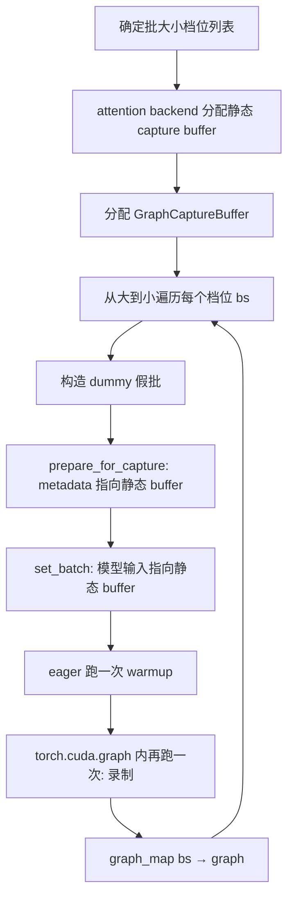
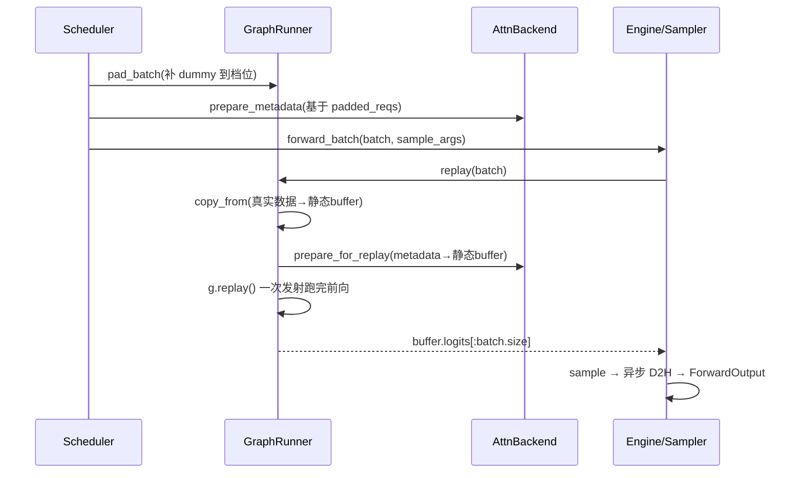

# CUDA Graph 与采样

## 本章导读

一个 LLM 推理引擎的时间主要花在两种截然不同的阶段上：**prefill**（处理用户输入的一整段 prompt）和 **decode**（逐个吐出生成的 token）。prefill 是「算力密集型」——一次前向要处理成百上千个 token，GPU 忙得不亦乐乎；而 decode 每一步每个请求只算 **1 个 token**，矩阵又小又瘦，GPU 的实际计算可能只要一两毫秒，甚至更快。

这就带来一个尴尬的问题：如果 GPU 算得飞快，瓶颈就转移到了 **CPU 发射 kernel 的开销**上。本章要讲的 CUDA Graph 正是解决这个问题的技术——把 decode 的一次完整前向「录制」下来，之后每次 decode 只需一次「回放」，CPU 几乎零开销。

本章的另一半是**采样（sampling）**：模型前向的输出是词表大小的 logits（每个候选 token 的打分），如何从中挑出下一个 token——是直接取最大（greedy），还是按概率随机抽（temperature / top-k / top-p）——决定了生成文本的质量与多样性。

对应的核心源码文件：

- `python/minisgl/engine/graph.py`：CUDA Graph 的捕获、回放、批大小 padding；
- `python/minisgl/engine/sample.py`：采样参数的组装与 flashinfer 采样 kernel 的调用；
- `python/minisgl/engine/engine.py`：把两者串起来的 `forward_batch`，以及为 padding 准备的 dummy request；
- `python/minisgl/kernel/index.py`：一个会被录进图里的自研 embedding gather kernel。

读完本章，你应该能回答：为什么 CUDA Graph 只对 decode 生效？「捕获」到底录下了什么？为什么要把批大小 padding 到固定档位？temperature=0 为什么不能直接传 0？

---

## 背景概念

### Kernel launch 开销

GPU 执行任何计算前，CPU 都要先「发射（launch）」一个 kernel——把任务描述打包发给 GPU。这个动作本身要花几微秒到十几微秒的 CPU 时间。一次 decode 前向包含几百个 kernel（embedding、几十层的 attention、RMSNorm、MLP、all-reduce、LM head……），逐个发射的 CPU 开销叠加起来，可能超过 GPU 的总执行时间。结果就是 **GPU 在等 CPU**：每个 kernel 之间出现空泡（bubble），GPU 利用率低下。

可以类比成点外卖：菜（计算）很小一份，但每次都要重新打电话下单（launch）。订单电话占的时间比做菜还长。

### CUDA Graph 是什么

CUDA Graph 的思路是：**既然 decode 每一步的计算形状完全一样，那就把这一串 kernel 录制成一张「图」，以后一步 decode 只需发射一次图，图内所有 kernel 由 GPU 按录制好的依赖关系自动执行。** 类比成把外卖菜单固定下来后办了一张「一键下单」卡。

录制有一个硬性约束：图里所有 kernel 的**内存地址是固化的**。图只记录「对地址 A 做操作 X，再对地址 B 做操作 Y」，不记录数值。所以回放前必须把这一步的真实数据**拷贝到录制时使用的那些固定地址**——这就是后文反复出现的「静态 buffer」的由来。

### 采样的三个旋钮

- **temperature（温度）**：把 logits 除以温度再做 softmax。温度低 → 分布更尖锐，越接近「只选最大者」；温度高 → 分布更平坦，生成更随机。
- **top-k**：只在打分最高的 k 个 token 中抽样，其余直接排除。
- **top-p（nucleus）**：按概率从高到低累加，只保留累积概率达到 p 的最小集合，在其中抽样。

这三个参数可以组合使用；而 `temperature <= 0` 或 `top_k == 1` 时退化成一个确定性的选择——**greedy（贪心）**，即永远选打分最高的 token，等价于 argmax。

---

## 为什么只有 decode 用 CUDA Graph

先建立整体印象。判定逻辑非常直白（`python/minisgl/engine/graph.py:149`）：

```python
def can_use_cuda_graph(self, batch: Batch) -> bool:
    return batch.is_decode and batch.size <= self.max_graph_bs
```

两个条件缺一不可：

1. **必须是 decode 阶段**。CUDA Graph 要求每次回放的计算形状完全一致。decode 批里每个请求恰好算 1 个 token，批的形状只由请求数决定，天然规整；而 prefill 每次的 prompt 长度不同，形状千变万化，根本无法图化。mini-sglang 的 `HybridBackend`（`python/minisgl/attention/base.py`）也印证了这一点——它把所有 graph 相关的调用全部委托给 decode 用的 attention 后端。
2. **批大小不能超过已捕获的最大档位**。图的形状在录制时固化，只能回放「录过」的批大小。

不能走图的时候（prefill、超大 decode 批），就退回普通的 eager 模式逐 kernel 执行。这个二选一发生在引擎的前向入口（`python/minisgl/engine/engine.py:193-197`）：

```python
with self.ctx.forward_batch(batch):
    if self.graph_runner.can_use_cuda_graph(batch):
        logits = self.graph_runner.replay(batch)
    else:
        logits = self.model.forward()
```

接下来我们按时间顺序拆解：引擎启动时如何**捕获**图，运行时如何 **padding 批大小**，每个 decode step 如何**回放**。

---

## 静态 buffer 与 dummy request：图的地基

### GraphCaptureBuffer：固定的输入输出地址

图的地址固化约束意味着：模型读的 `input_ids`、写的 `logits` 等张量必须永远在同一块显存上。mini-sglang 用 `GraphCaptureBuffer`（`python/minisgl/engine/graph.py:20-46`）集中管理这些固定地址：

```python
@dataclass
class GraphCaptureBuffer:
    input_ids: torch.Tensor
    out_loc: torch.Tensor
    positions: torch.Tensor
    logits: torch.Tensor
```

`init` 按**最大图批大小**一次性把四个张量分配好（`python/minisgl/engine/graph.py:27-34`），此后不再变动。buffer 上有两个方向相反的操作，是全章最关键的一对：

```python
def set_batch(self, batch: Batch) -> None:
    _slice = slice(batch.padded_size)
    batch.input_ids = self.input_ids[_slice]
    batch.out_loc = self.out_loc[_slice]
    batch.positions = self.positions[_slice]

def copy_from(self, batch: Batch) -> None:
    _slice = slice(batch.padded_size)
    self.input_ids[_slice] = batch.input_ids
    self.out_loc[_slice] = batch.out_loc
    self.positions[_slice] = batch.positions
```

- `set_batch`（**捕获时用**）：把 batch 里的张量**指针**换成静态 buffer 的切片。这样录制时模型读写的地址就是 buffer 的固定地址。
- `copy_from`（**回放时用**）：batch 里装的是调度器刚算好的真实数据，把它们**拷贝**进静态 buffer 的同一段地址。图回放时读到的自然就是新数据。

一句话总结：**捕获换指针，回放拷数据。** 理解了这个，就理解了所有 CUDA Graph 系统的核心套路。

### dummy request：一个「合法但无意义」的请求

padding 需要把批「补」到某个固定档位，那补进来的位置填什么？mini-sglang 的答案是：填一个精心构造的假请求——dummy request（`python/minisgl/engine/engine.py:89-98`）：

```python
self.dummy_req = Req(
    input_ids=torch.tensor([0], dtype=torch.int32, device="cpu"),
    table_idx=config.max_running_req,
    cached_len=0,
    output_len=1,
    uid=-1,
    sampling_params=None,  # type: ignore
    cache_handle=None,  # type: ignore
)
self.page_table[self.dummy_req.table_idx].fill_(num_tokens)  # point to dummy page
```

这个假请求有三处巧思：

- `cached_len=0`、`input_ids` 长度为 1，使 `device_len=1`，于是 `extend_len = device_len - cached_len = 1`（`python/minisgl/core.py:49-50`）——恰好是「正要 decode 一步」的样子，走与真实请求**完全相同**的代码路径，无需任何特判分支。
- `table_idx = max_running_req`：page table 在分配时特意多开了一行（`python/minisgl/engine/engine.py:69-70` 的 `+ 1`），就是给它预留的。
- 它的 page table 整行指向**第 `num_pages` 号 dummy page**——KV cache 分配时的 `+1`（`python/minisgl/engine/engine.py:59`）同样是预留。dummy 请求读写的所有 KV 都落在这个「垃圾桶页」里，不会污染任何真实缓存。

dummy request 还身兼二职：**捕获时**，整个假批就是 `[dummy_req] * bs`（`python/minisgl/engine/graph.py:134`）；**回放时**，它又是 padding 的填充物。捕获用「合法但无意义」的数据完全没问题——图只记操作和地址，不记数值。

---

## 捕获：引擎启动时的一次性录制

捕获发生在引擎启动阶段，由 `GraphRunner._capture_graphs` 完成（`python/minisgl/engine/graph.py:105-147`）。整体流程如下：



### 第一步：捕获哪些批大小

不能为每个整数批大小都录一张图（太耗时间和显存），只能选一组**档位**（`python/minisgl/engine/graph.py:49-67`）：

```python
def _determine_cuda_graph_bs(
    cuda_graph_bs: List[int] | None,
    cuda_graph_max_bs: int | None,
    free_memory: int,
) -> List[int]:
    if cuda_graph_bs is not None:
        return cuda_graph_bs
    free_memory_gb = free_memory / (1 << 30)
    if cuda_graph_max_bs is None:
        if free_memory_gb > 80:  # H200
            cuda_graph_max_bs = 256
        else:
            cuda_graph_max_bs = 160
    if cuda_graph_max_bs < 1:
        return []
    return [1, 2, 4] + list(range(8, cuda_graph_max_bs + 1, 8))
```

档位设计是小密大疏：`[1, 2, 4, 8, 16, ..., 256]`。小批（1、2、4）密集是因为在线服务里小批最常见，值得精细覆盖；大批每 8 一档，在捕获开销和命中率之间折中。`cuda_graph_max_bs < 1` 时返回空列表，即整体禁用 CUDA Graph。

### 第二步：主循环

核心循环如下（`python/minisgl/engine/graph.py:128-144`）：

```python
pool = None
for bs in pbar:  # 从大到小
    graph = torch.cuda.CUDAGraph()
    batch = Batch(reqs=[self.dummy_req] * bs, phase="decode")
    batch.padded_reqs = batch.reqs
    self.attn_backend.prepare_for_capture(batch)
    self.buffer.set_batch(batch)
    with get_global_ctx().forward_batch(batch):
        self.buffer.logits[:bs] = model.forward()  # warmup
        with torch.cuda.graph(graph, pool=pool, stream=self.stream):
            self.buffer.logits[:bs] = model.forward()  # 录制
    if pool is None:
        pool = graph.pool()  # reuse cuda graph handle to reduce memory
    self.graph_map[bs] = graph
```

几个值得细看的点：

- **为什么每个 bs 跑两遍 `model.forward()`？** 第一遍是 eager warmup：触发各层的一次性初始化（如 cuDNN benchmark、JIT 编译），这些行为只能发生一次，绝不能被录进图里。第二遍才在 `torch.cuda.graph` 上下文里正式录制。
- **`self.buffer.logits[:bs] = model.forward()` 这个赋值是故意的。** 它把「将输出拷入静态 buffer」这一步也录进图里，保证每次回放后新 logits 一定落在 `buffer.logits` 里，回放方可以直接从固定地址读结果。
- **从大到小遍历 + `pool=graph.pool()`**：第一张（最大的）图建立自己的显存池，后续所有小图通过 `pool=` 参数**共享同一块池**来放中间激活，显著节省显存。这是 PyTorch CUDA Graph 的标准技巧。
- 录制前调用了 `synchronize + empty_cache + reset_peak_memory_stats`（`python/minisgl/engine/graph.py:112-114`），拿到干净的显存基线，方便观察捕获前后的显存变化（代码里有日志输出）。

attention backend 也要参与捕获：它有自己的一组静态 buffer（`BaseCaptureData`，`python/minisgl/attention/utils.py:7-23`，包括 `seq_lens`、`cu_seqlens_k/q`、`page_table`），`prepare_for_capture` 让 metadata 里的张量指向这些静态 buffer 的切片（以 fa 后端为例，`python/minisgl/attention/fa.py:115-126`）。

---

## 批大小 padding：向上对齐到最近档位

运行时，真实批大小几乎不可能正好等于某个档位，需要**向上 padding**（`python/minisgl/engine/graph.py:160-166`）：

```python
def pad_batch(self, batch: Batch) -> None:
    padded_size = (  # choose the first available batch size
        next(bs for bs in self.graph_bs_list if bs >= batch.size)
        if self.can_use_cuda_graph(batch)
        else batch.size
    )
    batch.padded_reqs = batch.reqs + [self.dummy_req] * (padded_size - batch.size)
```

例如真实批有 37 个请求，`graph_bs_list` 中第一个 ≥ 37 的档位是 40，就补 3 个 dummy request，使 `padded_size = 40`，然后回放 bs=40 的图。`Batch` 同时保存 `reqs`（真实请求，`size`）和 `padded_reqs`（pad 后，`padded_size`），见 `python/minisgl/core.py:91-97`。不能用图时 `padded_size = size`，等于不 pad。

这个调用发生在调度器准备批的最开始（`python/minisgl/scheduler/scheduler.py:204-205`），之后 `positions`、KV 分配、attention metadata 全部基于 `padded_reqs` 计算——也就是说 **padding 后的批对下游完全透明**，走的是正常路径。

---

## 回放：每个 decode step 的三板斧

回放逻辑短得惊人（`python/minisgl/engine/graph.py:152-158`）：

```python
def replay(self, batch: Batch) -> torch.Tensor:
    assert self.can_use_cuda_graph(batch)
    self.buffer.copy_from(batch)
    g = self.graph_map[batch.padded_size]
    self.attn_backend.prepare_for_replay(batch)
    g.replay()
    return self.buffer.logits[: batch.size]
```

三步：

1. **`copy_from`**：把调度器算好的真实 `input_ids / out_loc / positions` 拷进静态 buffer 的前 `padded_size` 个槽位；
2. **`prepare_for_replay`**：attention backend 把这一步真实的 metadata 拷进它自己的静态 capture buffer。以 fa 后端为例（`python/minisgl/attention/fa.py:128-136`），就是几个 `copy_`：`cu_seqlens_k`、`seq_lens`、`page_table` 各就各位；
3. **`g.replay()`**：整个模型前向——embedding gather、几十层 attention/MLP、TP all-reduce、LM head——以**一次图发射**执行完毕。

返回值 `buffer.logits[:batch.size]` 把 padding 行切掉，只保留真实请求的 logits。

回放之后，引擎完成收尾（`python/minisgl/engine/engine.py:199-206`）：真实请求各自 `complete_one()`（长度前移一位），采样得到 next token，然后**异步**拷贝回 CPU：

```python
for req in batch.reqs:
    req.complete_one()

next_tokens_gpu = self.sampler.sample(logits[: batch.size], args).to(torch.int32)
next_tokens_cpu = next_tokens_gpu.to("cpu", non_blocking=True)
copy_done_event = torch.cuda.Event()
copy_done_event.record(self.stream)
return ForwardOutput(next_tokens_gpu, next_tokens_cpu, copy_done_event)
```

注意 `complete_one` 遍历的是 `batch.reqs` 而不是 `padded_reqs`——dummy 请求的长度永远不会被推进。异步 D2H + event 则是 overlap 调度的关键：GPU 马不停蹄地跑下一批，CPU 等 `copy_done.synchronize()` 之后再消费结果（`python/minisgl/scheduler/scheduler.py:143`）。

整个 decode step 的协作关系可以用一张图概括：



---

## 采样：从 logits 到下一个 token

前向结束后，每个请求得到一个长度为 `vocab_size` 的 logits 向量。采样分两步：CPU 侧**准备参数**，GPU 侧**执行采样**。

### 参数准备：Sampler.prepare

调度器在 `_prepare_batch` 里调用 `sampler.prepare(batch)`（`python/minisgl/scheduler/scheduler.py:214`），把每个请求的 `SamplingParams` 规整成 GPU 张量（`python/minisgl/engine/sample.py:53-68`）：

```python
def prepare(self, batch: Batch) -> BatchSamplingArgs:
    params = [r.sampling_params for r in batch.reqs]
    if all(p.is_greedy for p in params):
        return BatchSamplingArgs(temperatures=None)

    MIN_P = MIN_T = 1e-6
    ts = [max(0.0 if p.is_greedy else p.temperature, MIN_T) for p in params]
    top_ks = [p.top_k if p.top_k >= 1 else self.vocab_size for p in params]
    top_ps = [min(max(p.top_p, MIN_P), 1.0) for p in params]
    temperatures = make_device_tensor(ts, torch.float32, self.device)
    top_k, top_p = None, None
    if any(k != self.vocab_size for k in top_ks):
        top_k = make_device_tensor(top_ks, torch.int32, self.device)
    if any(p < 1.0 for p in top_ps):
        top_p = make_device_tensor(top_ps, torch.float32, self.device)
    return BatchSamplingArgs(temperatures, top_k=top_k, top_p=top_p)
```

这段代码有三层逻辑：

- **全批 greedy 快路径**：如果所有请求都是 greedy（`is_greedy` 定义在 `python/minisgl/core.py:23-25`：`temperature<=0 或 top_k==1，且 top_p==1.0`），直接返回 `temperatures=None`，后面走 `torch.argmax`，连 flashinfer 都不用调。
- **clamp 规整**：混合批里 greedy 请求的 temperature 记为 0.0 再 clamp 到 `1e-6`（避免除零，近似等价 argmax）；`top_k < 1` 表示「关闭」，替换为 `vocab_size`（等价于不截断）；`top_p` clamp 到 `[1e-6, 1.0]`。
- **惰性裁剪**：全批 `top_k` 都等于 `vocab_size`（即没人用 top-k）就把整个 `top_k` 张量置 None；`top_p` 同理。这让底层 kernel 能选更省的路径。

`make_device_tensor`（`python/minisgl/engine/sample.py:20-21`）也值得一看：

```python
def make_device_tensor(data: List, dtype: torch.dtype, device: torch.device) -> torch.Tensor:
    return torch.tensor(data, dtype=dtype, pin_memory=True).to(device, non_blocking=True)
```

`pin_memory=True` 分配锁页内存（不会被操作系统换页，DMA 可以直接搬运），配合 `non_blocking=True` 发起异步 H2D 拷贝——CPU 把参数发出去后立刻返回，不阻塞后续调度。这是 overlap 调度模式里的常规手法。

### 执行采样：Sampler.sample 与 sample_impl

GPU 侧的分派非常薄（`python/minisgl/engine/sample.py:70-75`）：greedy 走 `torch.argmax(logits, dim=-1)`；否则把 logits 显式升为 fp32（数值稳定），交给 `sample_impl`。

`sample_impl`（`python/minisgl/engine/sample.py:24-45`）是 flashinfer 采样 kernel 的封装：

```python
def sample_impl(
    logits: torch.Tensor,
    temperatures: torch.Tensor,
    top_k: torch.Tensor | int | None,
    top_p: torch.Tensor | float | None,
) -> torch.Tensor:
    import flashinfer.sampling as sampling

    probs = sampling.softmax(logits, temperatures, enable_pdl=is_sm90_supported())
    if top_k is None and top_p is None:
        return sampling.sampling_from_probs(probs)
    if top_p is None:
        return sampling.top_k_sampling_from_probs(probs, top_k)
    if top_k is None:
        return sampling.top_p_sampling_from_probs(probs, top_p)
    return sampling.top_k_top_p_sampling_from_probs(probs, top_k, top_p)
```

先做带温度的 softmax（`enable_pdl` 是 Hopper 架构的 Programmatic Dependent Launch 特性，允许前后 kernel 重叠发射），再按 top-k / top-p 的有无组合分派到四个 kernel 之一。前面「惰性裁剪」置 None 的意义就在这里：参数越少，走的 kernel 越简单。

**一个容易忽略的事实：采样不在 CUDA Graph 里。** 图只覆盖 `model.forward()`，`Sampler.sample` 在图外 eager 执行（`python/minisgl/engine/engine.py:202`）。因为采样参数每步由 CPU 动态生成、且 greedy 与非 greedy 走完全不同的 kernel，控制流不固定，图化收益小。mini-sglang 选择用 pinned-memory 异步 H2D 尽量掩盖这部分开销，这是相对 SGLang（把采样也图化）的一个教学性简化。

### 顺带一提：图内的自研 gather kernel

模型 forward 的第一步是 embedding：按 token id 从词表权重中取行。mini-sglang 为此写了一个 JIT 编译的 CUDA gather kernel（`python/minisgl/kernel/index.py:31-50`）：

```python
def indexing(
    weights: torch.Tensor,
    indices: torch.Tensor,
    *,
    output: torch.Tensor | None = None,
    vocab_range: Tuple[int, int] | None = None,  # (start, length)
) -> torch.Tensor:
    if output is None:
        output = weights.new_empty(indices.shape[0], weights.shape[1])
    element_size = weights.shape[1] * weights.element_size()
    if element_size % 2048 == 0:
        num_splits = 4
    elif element_size % 1024 == 0:
        num_splits = 2
    else:
        num_splits = 1
    module = _jit_index_module(element_size, num_splits=num_splits)
    module.launch(weights, indices, output, vocab_range)
    return output
```

它根据每行字节数的整除性选择一行由几个 warp 协作拷贝（`num_splits`），并通过 `functools.cache` 按 `(element_size, num_splits, config)` 缓存 JIT 编译结果（`python/minisgl/kernel/index.py:15-28`）。`vocab_range` 参数服务于张量并行的 vocab 切分：本 rank 不拥有的 token 输出清零，靠后续 all-reduce 汇总。由于它是模型 forward 的一部分，它同样会被录进 decode 图——模板参数都是编译期常量，图内执行零动态开销。

---

## 设计亮点

- **「换指针」实现零侵入图化。** 模型代码从不感知 CUDA Graph 的存在：它通过全局 `Context.batch` 读 `input_ids` 等张量（`python/minisgl/core.py:110-122`），捕获时这些字段指向静态 buffer，回放时指向调度器算好的新张量，数据流的切换全靠 `set_batch` / `copy_from` 这一对操作，模型层一行代码都不用改。
- **Dummy request 是「假请求」而非「假数据」。** 它拥有真实的 page table 行和合法的 `extend_len=1`，因此 padding 位置走与真实请求完全相同的代码路径。防泄漏靠三层隔离：KV 写进 dummy page（`python/minisgl/engine/engine.py:98`）、logits 被 `[:batch.size]` 切掉（`python/minisgl/engine/graph.py:158`）、`complete_one` 只遍历真实请求（`python/minisgl/engine/engine.py:199`）。
- **显存池共享 + 从大到小捕获。** 所有图共享一块中间激活池（`python/minisgl/engine/graph.py:143`），多录几十张图也花不了多少显存。
- **采样参数的惰性降维。** 全批 greedy 用 `torch.argmax` 绕过 flashinfer；全批无 top-k/top-p 时传 None 让 kernel 最简化；混合批用 `1e-6` 温度把 greedy 统一进连续 kernel——每一层都在「能省则省」。
- **为 overlap 调度铺路。** 采样参数在 CPU 侧提前 `prepare`（pin_memory + non_blocking H2D），next token 的 D2H 用 event 异步化，`ForwardOutput` 让 CPU 延迟一批再消费结果。这些细节单个看都不大，合起来让 CPU 和 GPU 几乎不互相等待。

---

## 常见困惑

**Q1：捕获时模型跑的是 dummy 假数据，为什么回放结果是对的？**

CUDA Graph 录制的是**操作序列 + 固定内存地址**，不是数值。捕获时 dummy 数据只为提供合法的形状和地址；回放前 `copy_from` 把真实数据写进同一批地址，图 replay 时读到的就是新数据。「地址固定、内容可变」是理解一切静态 buffer 设计的钥匙。

**Q2：为什么要 pad？直接按真实批大小捕获不行吗？**

图的形状在录制时固化，bs=37 的批必须有 bs=37 的图才能回放，但为每个整数都捕获不现实——捕获本身要跑两遍前向、占用显存。于是预捕获一组档位，运行时向上 pad 到最近档位。pad 的代价是多算几个 dummy token，而 decode 是显存带宽瓶颈，这点算力几乎免费。

**Q3：dummy 请求算出的垃圾 token 去哪了？**

三层隔离保证它不外泄：KV 写进专属的 dummy page；logits 在 `replay` 返回时被 `[:batch.size]` 切掉；`complete_one` 和调度器的 token 写回（`python/minisgl/scheduler/scheduler.py:231`）都只处理 `batch.reqs`，不碰 padding 位。

**Q4：temperature=0 和 top_k=1 都算 greedy，为什么混合批里还要传 1e-6？**

混合批无法对每一行单独选 kernel，只能统一走 `softmax(logits / temperature)` 再采样。temperature 直接取 0 会除零，clamp 到 `1e-6` 后分布近似 one-hot，采样结果等价于 argmax。这是「用连续近似模拟离散分支」的常见工程手法。

**Q5：采样为什么不录进 CUDA Graph？**

采样参数（temperatures/top_k/top_p）每步由 CPU 动态生成，greedy 与非 greedy 还走不同 kernel，形状和控制流都不固定，图化收益小、复杂度高。mini-sglang 把它留在 eager 路径，靠 pinned memory 异步 H2D 掩盖开销。这是教学版相对 SGLang 的刻意简化。

---

## 回顾与动手

**本章要点：**

- decode 阶段 kernel 小、数量多，CPU 的 kernel launch 开销成为瓶颈；CUDA Graph 把一次 decode 前向录制成图，回放时一次发射跑完，消除逐 kernel 发射开销。
- 图只记录操作和**固定地址**，因此需要静态 buffer（`GraphCaptureBuffer` + attention 的 `BaseCaptureData`）：捕获时 `set_batch` 换指针，回放时 `copy_from` 拷数据。
- 运行时批大小向上 pad 到最近的捕获档位，padding 用 dummy request 填充；其副作用被 dummy page、logits 切片、只遍历真实请求三层机制隔离。
- 采样由 `Sampler.prepare`（CPU 侧组装参数，pinned memory 异步上传）和 `Sampler.sample`（greedy 走 argmax，否则交 flashinfer）两段组成，刻意留在图外。

**动手实验：**

1. **观察捕获过程**：用一个小模型启动引擎（可配合 `--use-dummy-weight`），观察启动日志里 `Capturing graphs: bs = ...` 进度条以及捕获前后的 `Free GPU memory` 变化。试试传 `--cuda-graph-max-bs 0` 禁用图，对比 decode 吞吐（benchmark 目录下有现成脚本）。
2. **给回放加日志**：在 `GraphRunner.replay`（`python/minisgl/engine/graph.py:152`）开头加一行 `logger.info(f"replay: size={batch.size} padded={batch.padded_size}")`，跑几个并发请求，观察真实批大小和 padding 档位的对应关系，体会档位设计的取舍。
3. **验证 1e-6 近似的正确性**：写一个独立小脚本，构造固定 logits，分别用 `torch.argmax` 和「temperature=1e-6 的 softmax + 采样」各跑多次，确认二者选中的 token 一致；再把 temperature 改成 0.5 对比分布差异，直观感受温度旋钮的作用。
