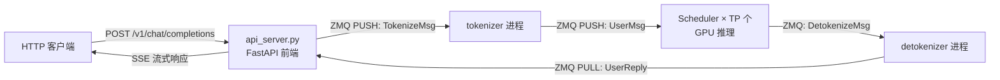
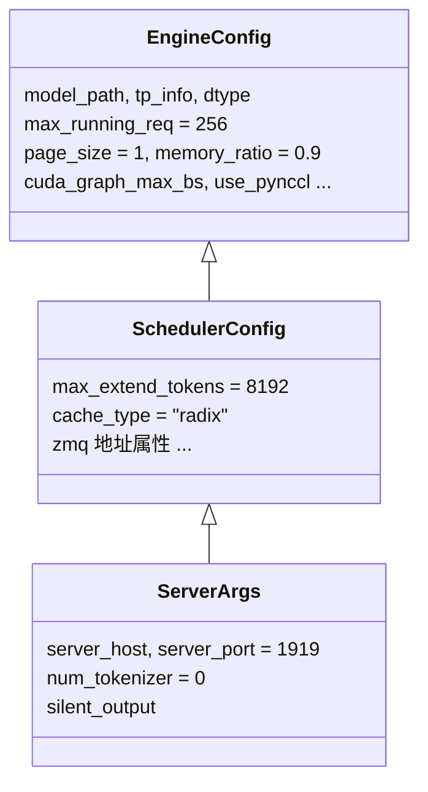

# 服务化接口与性能评测

## 本章导读

第 1 章我们跟踪了一条请求在引擎内部的完整旅程，但那个旅程的"起点"和"终点"——用户怎么把请求发进来、结果怎么流回去、性能怎么量——还没有细看。本章补上这一环，讲三个问题：

1. **服务化**：`python/minisgl/server/` 如何把推理引擎包装成一个 OpenAI 兼容的 HTTP 服务，多进程怎么编排；
2. **流式输出**：SSE（Server-Sent Events）流式协议在代码里如何逐 token 吐字；
3. **性能评测**：`python/minisgl/benchmark/` 的客户端如何测量 TTFT、TPOT 和吞吐量，以及为什么测量方法本身值得讲究。

本章涉及的源码文件：

```
python/minisgl/server/
├── api_server.py   # FastAPI 前端：OpenAI 兼容路由 + SSE 流式输出
├── launch.py       # 进程编排：拉起 scheduler / tokenizer / detokenizer
└── args.py         # ServerArgs：CLI 参数与配置继承链的最外层
python/minisgl/env.py              # MINISGL_* 环境变量体系
python/minisgl/benchmark/
├── client.py       # 在线压测客户端：打点、统计、trace 回放
└── perf.py         # CUDA kernel 微基准
benchmark/          # 仓库根目录下的调用脚本（offline/online 场景）
```

为什么先学"外壳"再学"内脏"？因为服务化接口定义了引擎对外的**契约**，而 benchmark 定义了引擎好坏的**度量衡**。读懂这两层，后面深入调度器、KV Cache 时，你才知道每一行优化到底在优化什么。

## 背景概念

**OpenAI 兼容 API**。OpenAI 的 `/v1/chat/completions` 接口已成为行业事实标准：客户端 POST 一个包含 `messages`、`max_tokens`、`temperature` 等字段的 JSON，服务端返回生成结果。所谓"兼容"，就是字段名、请求/响应结构与 OpenAI 官方一致，这样现成的 OpenAI SDK 换个 `base_url` 就能直接用。本章会看到 mini-sglang 只实现了这个协议的一个**子集**。

**SSE（Server-Sent Events）**。一种基于 HTTP 的服务端推送协议：响应头 `Content-Type: text/event-stream`，响应体是一系列 `data: <内容>\n\n` 形式的"事件"，连接保持不断开，服务端可以随时再推一条。LLM 用它实现"打字机效果"——每生成一个 token 就推一个事件，而不必等整段话生成完。

**TTFT / TPOT / 吞吐量**。推理服务的三个核心指标：

- **TTFT**（Time To First Token）：从请求发出到收到第一个 token 的时间，反映 prefill 阶段的速度和排队情况，决定用户"等多久才开始看到字"；
- **TPOT**（Time Per Output Token）：相邻两个输出 token 之间的平均间隔，反映 decode 阶段的速度，决定"打字"流不流畅；
- **吞吐量**（Throughput）：单位时间产出的 token 总数（token/s），反映系统的整体产能。

可以类比一家餐厅：TTFT 是"下单到上第一道菜"的时间，TPOT 是"之后每道菜之间的间隔"，吞吐量是"整家店一小时能出多少道菜"。

**进程分离与 GIL**。Python 的全局解释器锁（GIL）意味着一个进程同一时刻只能跑一个 Python 线程。GPU 调度循环、tokenize/detokenize、HTTP 收发都是吃 CPU 的活，挤在一个进程里会互相阻塞。因此 mini-sglang 把系统拆成多个进程：前端（HTTP）→ tokenizer → scheduler（GPU 推理）→ detokenizer → 前端，进程间用 ZMQ（一个高性能消息队列库）通过 IPC 套接字通信。

## 全局视角：进程拓扑

启动命令 `python -m minisgl --model-path Qwen/Qwen3-0.6B` 之后，系统里实际跑着这些进程：



注意前端进程里**没有任何推理代码**——它只做"翻译和转发"：HTTP JSON → msgpack 消息 → ZMQ，再把 ZMQ 回来的增量文本包装成 SSE。这种隔离保证了：tokenizer 的 CPU 开销不会阻塞 GPU 调度循环，GPU 进程崩溃也不会拖垮 HTTP 服务。

进程间的通信地址是带 pid 后缀的 IPC 套接字，避免多实例冲突。地址分散定义在配置类的属性里：

- `ipc:///tmp/minisgl_0.pid=N`：tokenizer → scheduler（`python/minisgl/scheduler/config.py:24-25`）
- `minisgl_1`：scheduler → detokenizer（`scheduler/config.py:28-29`）
- `minisgl_3`：detokenizer → 前端（`server/args.py:26-27`）
- `minisgl_4`：前端 → tokenizer（`server/args.py:30-35`）

默认情况下 `num_tokenizer=0`，此时进入**共享 tokenizer 模式**：tokenizer 和 detokenizer 是同一个进程，`zmq_tokenizer_addr` 直接返回 detokenizer 的地址（`args.py:30-32`），少一个进程、少一跳 IPC。这个"用地址别名折叠拓扑"的小技巧值得记住。

## 服务启动：进程编排与就绪同步

入口是 `launch_server()`（`python/minisgl/server/launch.py:40`）。它的核心是一个 `start_subprocess` 闭包，负责把所有后端进程拉起来。

第一步是设置多进程启动方式（`launch.py:52`）：

```python
mp.set_start_method("spawn", force=True)
```

必须用 `spawn` 而不能用默认的 `fork`：fork 出来的子进程会继承父进程的内存状态，而 CUDA 上下文一旦被继承就废了——CUDA 要求在子进程里从头初始化。

接着按 TP（张量并行）大小拉起 scheduler 进程（`launch.py:59-69`）：

```python
for i in range(world_size):
    new_args = replace(
        server_args,
        tp_info=DistributedInfo(i, world_size),
    )
    mp.Process(
        target=_run_scheduler,
        args=(new_args, ack_queue),
        daemon=False,
        name=f"minisgl-TP{i}-scheduler",
    ).start()
```

`ServerArgs` 是不可变的 frozen dataclass，所以每个 rank 的差异（`tp_info` 里的 rank 编号）用 `dataclasses.replace` 造一个副本出来——改不了就复制一份改过的，这是函数式风格的典型做法。之后用同样的方式拉起 1 个 detokenizer 和 `num_tokenizer` 个 tokenizer 进程（`launch.py:71-103`）。

最后是**就绪同步**（`launch.py:105-111`）：

```python
# Wait for acknowledgments from all worker processes:
# - world_size schedulers (but only primary rank sends ack)
# - num_tokenizers tokenizers
# - 1 detokenizer
# Total acks expected: 1 + num_tokenizers + 1 = num_tokenizers + 2
for _ in range(num_tokenizers + 2):
    logger.info(ack_queue.get())
```

主进程在一个 `mp.Queue` 上阻塞，直到收齐 `num_tokenizers + 2` 条 ack（1 个 primary scheduler + N 个 tokenizer + 1 个 detokenizer）。这样 "API server is ready to serve" 打印出来时，后端保证已全部就绪——不会出现"服务起来了但第一个请求报错"的竞态。每个 scheduler 子进程的入口 `_run_scheduler`（`launch.py:16-37`）在构造完 `Scheduler`、做完 `sync_all_ranks()` 之后，由 primary rank 往队列里放这条 ack。

## OpenAI 兼容 API 的实现

### 请求模型：协议的"形状"

路由层用 pydantic 模型声明 OpenAI 协议的请求格式（`python/minisgl/server/api_server.py:64-83`）：

```python
class OpenAICompletionRequest(BaseModel):
    """Unified request model for OpenAI-style completions and chat-completions."""

    model: str
    prompt: str | None = None
    messages: List[Message] | None = None

    max_tokens: int = 16
    temperature: float = 1.0
    top_k: int = -1
    top_p: float = 1.0
    n: int = 1
    stream: bool = False
    stop: List[str] = []
    presence_penalty: float = 0.0
    frequency_penalty: float = 0.0
    ignore_eos: bool = False
```

字段和 OpenAI 官方对齐，任何用 OpenAI SDK 写的客户端都能直接发过来。但要注意一个**已知简化**：`n`、`stop`、`presence_penalty`、`frequency_penalty` 这几个字段只是被"接住"了，从未透传给后端——路由函数里有一行诚实的注释 `# TODO: support more sampling parameters`（`api_server.py:264`）。真正生效的只有 `max_tokens`、`temperature`、`top_k`、`top_p` 和私有扩展字段 `ignore_eos`。

> **`stream=False` 的行为**：`/v1/chat/completions` 已支持非流式——`req.stream` 为真时走 SSE 流式响应，否则在服务端把增量文本攒齐、一次性返回完整的 OpenAI 兼容 JSON（`api_server.py:280-310`）。但仍有两处简化：`/generate` 端点（`api_server.py:244-247`）**无条件**返回 SSE；非流式响应里的 `usage` 统计是三个 0 的占位符（`api_server.py:305-309`），token 计数没有真正实现。

### FrontendManager：单 listener + 事件扇出

前端的核心状态机是 `FrontendManager`（`api_server.py:99-113`）：

```python
@dataclass
class FrontendManager:
    config: ServerArgs
    send_tokenizer: ZmqAsyncPushQueue[BaseTokenizerMsg]
    recv_tokenizer: ZmqAsyncPullQueue[BaseFrontendMsg]
    uid_counter: int = 0
    initialized: bool = False
    ack_map: Dict[int, List[UserReply]] = field(default_factory=dict)
    event_map: Dict[int, asyncio.Event] = field(default_factory=dict)
```

它解决一个经典的并发问题：ZMQ PULL socket 只有**一个**，但同时有 N 个请求的 SSE 生成器在等各自的回复。如果每个请求自己去 `recv`，就会互相抢消息。mini-sglang 的做法是"**一个全局 listener 协程 + 每个请求一个 asyncio.Event**"：

```python
async def listen(self):
    while True:
        msg = await self.recv_tokenizer.get()
        for msg in _unwrap_msg(msg):
            if msg.uid not in self.ack_map:
                continue
            self.ack_map[msg.uid].append(msg)
            self.event_map[msg.uid].set()
```

（`api_server.py:116-123`）listener 统一收消息，按 `uid` 分发到 `ack_map`，然后 `event.set()` 叫醒对应的等待者。`uid` 不在表里的消息直接丢弃——这处理的是"客户端已断开、回复才姗姗来迟"的情况。

消费侧是一个异步生成器（`api_server.py:134-150`）：

```python
async def wait_for_ack(self, uid: int):
    event = self.event_map[uid]
    while True:
        await event.wait()
        event.clear()
        pending = self.ack_map[uid]
        self.ack_map[uid] = []
        ack = None
        for ack in pending:
            yield ack
        if ack and ack.finished:
            break
    del self.ack_map[uid]
    del self.event_map[uid]
```

`event.wait()` 挂起 → 被叫醒后 `clear` → 一次性取走积压的所有回复（一条 ZMQ 消息可能是打包了多个 chunk 的 `BatchFrontendMsg`，所以用列表缓冲）→ 逐个 yield → 看到 `finished` 就退出并清理两张表。这是教科书式的异步生产者-消费者解耦，全程无锁。

### SSE 流的拼装

路由函数本身非常薄（`api_server.py:255-283`）：解析请求 → `new_user()` 分配 uid → 发 `TokenizeMsg` 给 tokenizer 进程 → 返回一个 `StreamingResponse`。真正的协议拼装在 `stream_chat_completions`（`api_server.py:160-187`）：

```python
async def stream_chat_completions(self, uid: int):
    first_chunk = True
    async for ack in self.wait_for_ack(uid):
        delta = {}
        if first_chunk:
            delta["role"] = "assistant"
            first_chunk = False
        if ack.incremental_output:
            delta["content"] = ack.incremental_output
        chunk = {
            "id": f"cmpl-{uid}",
            "object": "text_completion.chunk",
            "choices": [{"delta": delta, "index": 0, "finish_reason": None}],
        }
        yield f"data: {json.dumps(chunk)}\n\n".encode()
        if ack.finished:
            break
```

按 OpenAI 流式协议，第一个 chunk 只带 `delta.role="assistant"`（可能不含内容），之后每个 chunk 带 `delta.content` 增量文本，最后补一个 `finish_reason="stop"` 的空 delta chunk，再发 `data: [DONE]\n\n` 收尾（`api_server.py:181-187`）。`delta`（增量）而不是 `message`（全量）正是流式协议的关键字段——客户端把一个个 delta 拼起来就是完整回复。

`incremental_output` 从哪来？detokenizer 进程做的是**增量解码**：新 token 的字节未必是完整的 UTF-8 字符（比如一个汉字被切成两个 token），所以要用 read/surround 等多个偏移量配合 `find_printable_text`（`python/minisgl/tokenizer/detokenize.py:35-51`）只把"能完整打印"的部分发出来。这是流式输出的经典难点，mini-sglang 用约 40 行复现了 SGLang 的做法。

### 客户端断连：取消链路

流式请求里客户端随时可能掐断连接。每个 chunk 发出前，前端都会检查一次（`api_server.py:190-200`）：

```python
async def stream_with_cancellation(self, generator, request: Request, uid: int):
    try:
        async for chunk in generator:
            # detect if the client has disconnected
            if await request.is_disconnected():
                logger.info("Client disconnected for user %s", uid)
                raise asyncio.CancelledError
            yield chunk
    except asyncio.CancelledError:
        asyncio.create_task(self.abort_user(uid))
        raise
```

`abort_user`（`api_server.py:202-209`）先 `sleep(0.1)` 让在途消息落地，删掉本地状态，再发 `AbortMsg` 通知后端释放 KV Cache。这是 serving 系统里"请求取消"的最小完整实现——少了它，断开的请求会在后端继续烧 GPU 直到生成完。

## Benchmark：怎么测 TTFT / TPOT / 吞吐量

### 打点：每个 chunk 记一个时间戳

在线压测的核心是 `benchmark_one`（`python/minisgl/benchmark/client.py:202-248`）。它用 OpenAI 异步 SDK 发一条流式请求：

```python
kwargs = {
    "ignore_eos": True,
    "top_k": 1,
}
response = await client.chat.completions.create(
    model=model,
    stream=True,
    messages=[{"role": "user", "content": prompt}],
    max_tokens=output_length,
    temperature=0.0,
    extra_body=kwargs,
)
tics = [time.perf_counter()]
async for _ in response:
    tics.append(time.perf_counter())
```

（`client.py:215-238`）设计上有两个讲究：

- `tics[0]` 是**请求发出时刻**，之后每收到一个 SSE chunk 追加一个 `perf_counter` 时间戳。这一个数组就蕴含了 TTFT、TPOT、E2E 三种信息。
- `ignore_eos=True` + `top_k=1`（经 `extra_body` 透传，这是 OpenAI SDK 留的私有参数通道）+ `temperature=0.0` 三管齐下，把生成变成**确定性的定长流水线**：忽略 EOS 提前结束、强制贪心采样，输出恰好是 `max_tokens` 个 token。不固定输出长度，吞吐就成了采样随机性的函数，两次测量不可比——这是所有推理 benchmark 的第一条军规。

并发压测由 `benchmark_one_batch`（`client.py:251-284`）完成，本质就是 `asyncio.gather` 一批 `benchmark_one`。

### 统计：从时间戳数组到指标

`process_benchmark_results`（`client.py:320-404`）做统一统计。TTFT 和 TPOT 的提取（`client.py:327-333`）：

```python
for tics in results:
    deltas: List[float] = []
    for i in range(len(tics) - 1):
        diff = tics[i + 1] - tics[i]
        deltas.append(diff)
    first_times.append(deltas[0])
    accum_times.extend(deltas[1:])
```

- **TTFT** = `tics[1] - tics[0]`，即每个请求的第一个间隔，乘以 1000 转毫秒（`client.py:358`）；
- **TPOT** = 除第一个间隔外的所有相邻间隔，**全部展平**进一个大列表再统计。注意这是把所有请求的所有 decode 间隔混在一起的全局分布，而不是"先求每请求均值再聚合"——样本量更大，长尾看得更清楚；
- **E2E** = `tics[-1] - tics[0]`，单位秒（`client.py:335`）。

分位数统计直接排序后取下标 `int(len*p)` 得到 p50/p90/p99（`client.py:344-347`）。吞吐量的口径（`client.py:362-384`）：

```python
min_time = min(min(r) for r in results)
max_time = max(max(r) for r in results)
dur = max_time - min_time
```

即"从第一个请求发出到最后一个 chunk 落地"的**全局挂钟时间**，`num_tokens / dur` 就是系统吞吐（token/s），同时报告 req/s。一个精度上的小注脚：`num_tokens`（`client.py:367`）统计的是打点次数，比真实输出 token 数每个请求多约 2 个（发送时刻点 + 结束的 finish_reason chunk），大规模压测下可以忽略，但单请求测量时要心里有数。

### 精确的输入：`generate_prompt`

输出侧用 `ignore_eos` 定长，输入侧怎么保证长度精确？`generate_prompt`（`client.py:183-199`）：

```python
vocab_size = tokenizer.vocab_size // 2
token_ids = [random.randint(0, vocab_size) for _ in range(n)]
for _ in range(64):
    prompt = tokenizer.decode(token_ids)
    token_ids = tokenizer.encode(prompt, add_special_tokens=False)
    if len(token_ids) == n:
        return prompt
    ...
```

随机 token id → decode 成文本 → re-encode 检查长度，不一致就补/截，最多迭代 64 次。之所以要"迭代校准"，是因为 decode/encode 不是完美互逆的（BPE 合并可能改变边界）。只用词表前一半，是为了避开特殊 token。最终产出一个**恰好 n 个 token** 的 prompt。

### 回放真实流量：trace replay

除了合成负载，client.py 还支持按真实生产 trace（Qwen 百炼、Mooncake 格式）回放（`client.py:407-476`）。回放机制（`client.py:297-305`）很直白：

```python
start = time.perf_counter()
offset = min(msg.timestamp for msg in msgs) - 1

async def benchmark_timed(msg: BenchmarkTrace):
    target = start + msg.timestamp - offset
    await asyncio.sleep(max(0, target - time.perf_counter()))
    return await benchmark_one(...)
```

每条 trace 记录有到达时间戳，协程睡到目标时刻再发请求，模拟真实的到达模式（突发、空闲、早晚高峰）。`scale_traces`（`client.py:479-495`）把时间轴乘以系数：`scale>1` 放慢到达速率（负载变轻），`<1` 加速。`benchmark/online/bench_qwen.py` 就用六种速率扫出**负载-延迟曲线**——这是容量规划的核心数据：负载到什么程度 TTFT 开始恶化？

### 离线吞吐与 kernel 微基准

`benchmark/offline/bench.py:25-38` 是更简单的口径：256 条随机 token 序列，`ignore_eos=True` 定长输出，通过 `LLM` 类（不走 HTTP，进程内直接调引擎）一次 `generate` 全跑完，吞吐 = `Σmax_tokens / 挂钟时间`。它测的是**满载吞吐**——没有到达-排队动力学，纯粹考验引擎的批处理能力。

`python/minisgl/benchmark/perf.py:10-51` 的 `perf_cuda` 是 kernel 级计时工具：用 CUDA Event 计时，并默认把被测函数连续调用 10 次**捕获进一个 CUDA Graph 再 replay**。为什么用 Graph？因为单次 kernel 调用的测量里混着 CPU 发起调度的开销（launch overhead），用 Graph 把这 10 次调用"冻"成一条 GPU 指令序列反复回放，就能逼近 kernel 的真实 GPU 时间。后面 Attention、MoE 章节会反复用到它。

## 配置体系：ServerArgs 与 env.py

### 三层继承的 frozen dataclass

mini-sglang 的配置是一条继承链，每层加自己关心的字段：



（分别见 `python/minisgl/engine/config.py:15-31`、`python/minisgl/scheduler/config.py:14-33`、`python/minisgl/server/args.py:14-19`）三层全部 `@dataclass(frozen=True)`——不可变，想改就 `dataclasses.replace` 造副本，前面 launch.py 里每个 TP rank 的配置就是这么来的。

这条链有几个细节值得学：

1. **CLI 默认值直接引用类属性**（`args.py:98`）：`default=ServerArgs.max_running_req`。默认值只存在一处，不会出现"文档/代码/CLI 三处漂移"。
2. **choices 来自注册表**（`args.py:209`）：`--cache-type` 的候选值是 `SUPPORTED_CACHE_MANAGER.supported_names()` 动态喂出来的，新增一种 cache 实现无需改 CLI 代码。
3. **`dtype="auto"` 的解析**（`args.py:251-261`）：读 HF 模型 config 里的 dtype 字段再映射到 torch 类型，用户不用关心模型是什么精度。
4. **ZMQ 地址的 pid 后缀**：`SchedulerConfig._unique_suffix` 用 `field(default_factory=_get_pid_suffix)`（`scheduler/config.py:8-11, 21`），在每个进程首次构造配置时绑定**自己的** pid。因为 spawn 出的子进程会重新 import 模块、重新构造配置，suffix 自然就是子进程的——同一台机器跑多个实例也不会抢 IPC 地址。

`parse_args` 里还有个 shell 模式的后处理（`args.py:230-234`）：交互式终端强制 `cuda_graph_max_bs=1, max_running_req=1`——单轮对话没有并发，开 CUDA Graph 捕获纯属浪费。

### env.py：环境变量的类型化封装

CLI 参数之外的"全局开关"走环境变量。`env.py` 把它们包装成带类型的对象（`python/minisgl/env.py:16-28`）：

```python
class EnvVar(BaseEnv, Generic[T]):
    def __init__(self, default_value: T, fn: Callable[[str], T]):
        self.value = default_value
        self.fn = fn

    def _init(self, name: str) -> None:
        env_value = os.getenv(name)
        if env_value is not None:
            try:
                self.value = self.fn(env_value)
            except Exception:
                pass
```

每个变量有默认值和解析函数 `fn`，解析失败**静默保留默认值**。配合 `functools.partial` 预置的类型别名（`EnvInt/EnvBool/EnvMem` 等，`env.py:51-55`）——`EnvMem` 甚至支持 `K/M/G` 后缀，比如 `PYNCCL_MAX_BUFFER_SIZE=512M`。

`EnvClassSingleton`（`env.py:58-84`）在 `__init__` 里遍历所有非 `_` 开头的类属性，统一加 `MINISGL_` 前缀去环境变量里找值。当前注册了三组：shell 默认采样参数（`SHELL_MAX_TOKENS=2048` 等）、`FLASHINFER_USE_TENSOR_CORES`（三态：不设则自动判断）、`DISABLE_OVERLAP_SCHEDULING` 和 `PYNCCL_MAX_BUFFER_SIZE`。新增一个环境变量只需在类里加一行声明，读取逻辑零改动。

对比两套体系的分工：**ServerArgs 管"每次启动可能不同"的参数（模型、端口、batch 上限），env.py 管"环境级"的开关（调试、后端行为微调）**。

## 设计亮点

- **前端完全无锁异步化**。整个 FastAPI 路由层没有一把锁：一个全局 ZMQ listener 协程 + per-uid `asyncio.Event` 扇出，就支撑起高并发 SSE。加上 `is_disconnected` + `AbortMsg` 的取消链路，构成了"请求生命周期管理"的最小闭环。
- **拓扑可组合的地址设计**。`share_tokenizer` 模式用"地址别名"把 tokenizer/detokenizer 折叠进一个进程；`create` 标志显式声明谁 bind 谁 connect。切换进程拓扑不用改任何通信代码，只改配置属性的返回值。
- **配置即类型**。三层 frozen dataclass 继承，CLI 默认值引用类属性、choices 引用注册表，把"配置漂移"的空间压缩到最小。
- **benchmark 的方法论自觉**。`ignore_eos + top_k=1` 固定输出长度、`generate_prompt` 迭代校准输入长度、trace replay 用 `perf_counter` 对齐相对时间、kernel 测试用 CUDA Graph 消除 launch 噪声——每一步都在主动消除测量噪声，而不只是把数字跑出来。
- **教学版的诚实注释**。`# TODO: support more sampling parameters`（`api_server.py:264`）这类注释明确告诉你哪里是简化，读教学代码时能分清"这就是正确做法"和"这里被砍掉了"。

## 常见困惑

**Q1：为什么 API server 里看不到任何推理代码？**
故意的。`api_server.py` 是纯"翻译+转发"层：HTTP → msgpack → ZMQ。真正的 prefill/decode 在 Scheduler 子进程里。进程隔离让 tokenizer/HTTP 的 CPU 开销无法阻塞 GPU 调度循环（Python GIL 的限制），GPU 进程崩溃也不拖垮 HTTP 服务。理解了 `minisgl_0~4` 这几类 IPC 地址，就理解了整个架构的骨架。

**Q2：流式输出为什么要 `ack_map` + `event_map` 两张表？**
因为 ZMQ PULL socket 只有一个，而并发请求有 N 个 SSE 生成器在等。各自 `recv` 会互相抢消息，所以用一个 `listen()` 协程统一收、按 uid 分发。`ack_map` 缓冲回复（一条 ZMQ 消息可能携带同一 uid 的多个 chunk，即 `BatchFrontendMsg`），`event_map` 负责叫醒等待者。一张表存数据、一张表做通知，各司其职。

**Q3：TTFT 真的是"第一个 token 的时间"吗？**
严格说不是。它是"第一个 SSE chunk 到达客户端的时间"，包含网络、序列化、进程间 IPC 的开销；而且首个 chunk 常常只带 `delta.role="assistant"` 不含内容（`api_server.py:164-168`）。但这是**用户可感知的** TTFT，也是业界标准的客户端视角测法。如果想测纯 prefill 计算时间，得在引擎内部打点。

**Q4：benchmark 里 `ignore_eos=True` 为什么至关重要？**
不固定输出长度，吞吐就是采样随机性的函数，两次测量不可比。`ignore_eos=True` + `top_k=1` + `temperature=0.0` 把生成变成确定性定长流水线，吞吐数字才有意义。反例可以看 `benchmark/offline/bench_wildchat.py`：它用真实对话数据且允许提前结束，所以特意区分"output budget"（预算长度）和 "actual output"（实际生成长度）。

**Q5：`stream=False` 拿到了完整 JSON，但 `usage` 为什么全是 0？**
`/v1/chat/completions` 的非流式分支（`api_server.py:286-310`）只是把增量文本拼起来返回，`usage` 是硬编码的 0 占位——token 计数需要在 detokenizer 链路上顺手统计，教学版没做。另外注意 `/generate` 端点不支持非流式，无论什么都返回 SSE。同样被"接住但没生效"的还有 `n`、`stop`、两个 penalty 字段。

## 回顾与动手

本章要点：

- mini-sglang 的服务化是"FastAPI 前端 + ZMQ 多进程后端"的分离架构，前端只做协议翻译，靠单 listener 协程 + asyncio.Event 扇出支撑并发 SSE；
- OpenAI 兼容是**部分**兼容：核心采样参数透传，`stream=False` 在 chat 端点已支持（但 `usage` 是占位 0），`n/stop/penalty` 仍未实现，`/generate` 只支持流式；
- benchmark 的三个指标从同一个 `tics` 时间戳数组提取：TTFT 是第一个间隔、TPOT 是其余间隔的全局分布、吞吐是打点总数除以全局挂钟时间；`ignore_eos + top_k=1` 定长输出是测量可比性的前提；
- 配置是三层 frozen dataclass 继承（EngineConfig → SchedulerConfig → ServerArgs）+ `MINISGL_*` 环境变量单例，前者管启动参数，后者管环境级开关。

动手实验：

1. **对比 `stream` 两种行为**。按导读里的 Quickstart 启动服务，分别用 `"stream": true` 和 `"stream": false` 各 `curl` 一次 `/v1/chat/completions`，观察 SSE 逐 chunk 输出与一次性 JSON 的差异；再对 `/generate` 发 `"stream": false`，确认它仍然返回 SSE（`api_server.py:244`）。最后看看非流式响应里的 `usage` 字段——三个 0 就是留给你的练手 TODO。
2. **亲手测一次 TTFT/TPOT**。服务启动后运行 `python benchmark/online/bench_simple.py`，观察输出的 TTFT/TPOT/吞吐。然后在 `benchmark/client.py:238` 的循环里加一行 `print(time.perf_counter() - tics[0])`，直观感受每个 chunk 的到达节奏。改 `--max-running-requests` 重启服务再测，看并发上限对 p99 TTFT 的影响。
3. **加一个环境变量**。在 `env.py:58-84` 的 `EnvClassSingleton` 里加一行 `MY_DEBUG = EnvBool(False)`，然后在 `api_server.py` 的路由里读 `ENV.MY_DEBUG.value` 打印请求日志。用 `MINISGL_MY_DEBUG=1 python -m minisgl ...` 启动，验证这套"加一行声明即生效"的机制。
